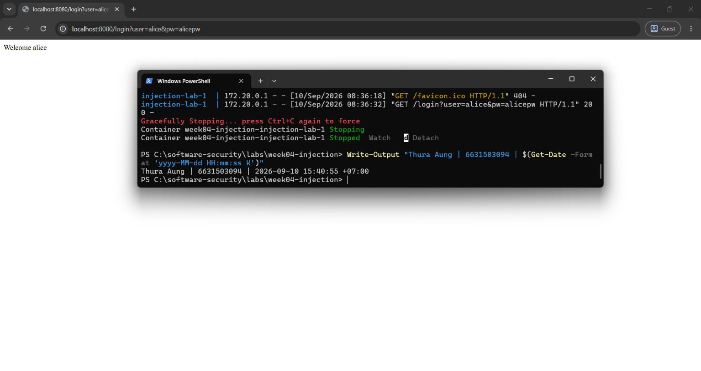
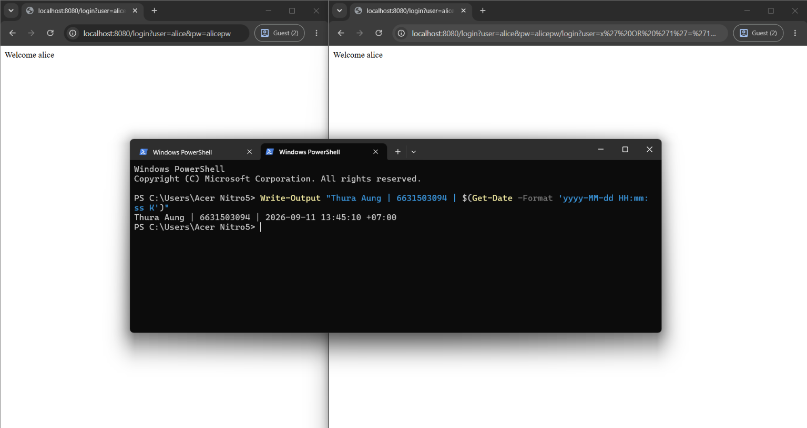
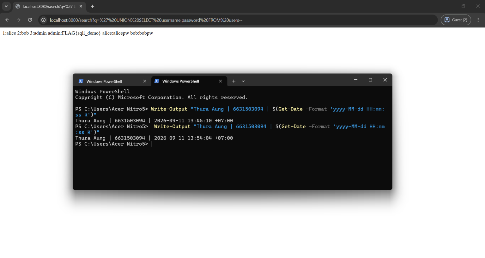
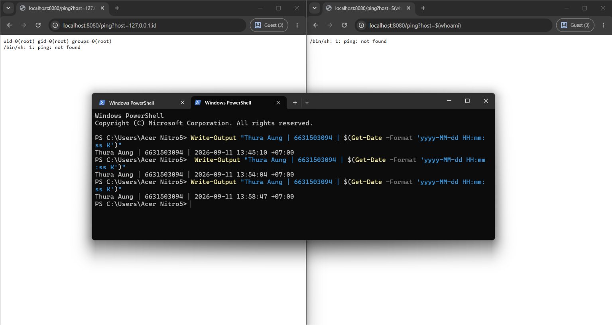
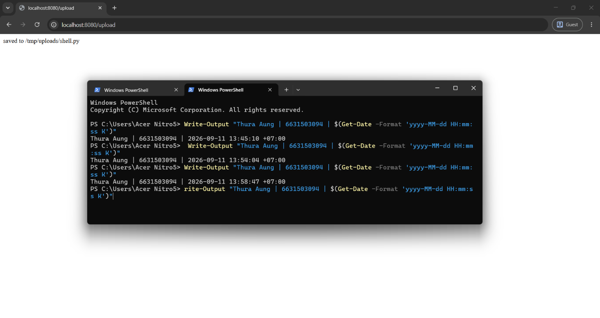
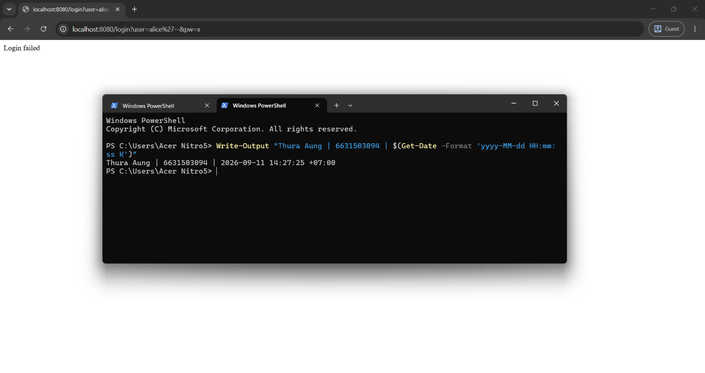
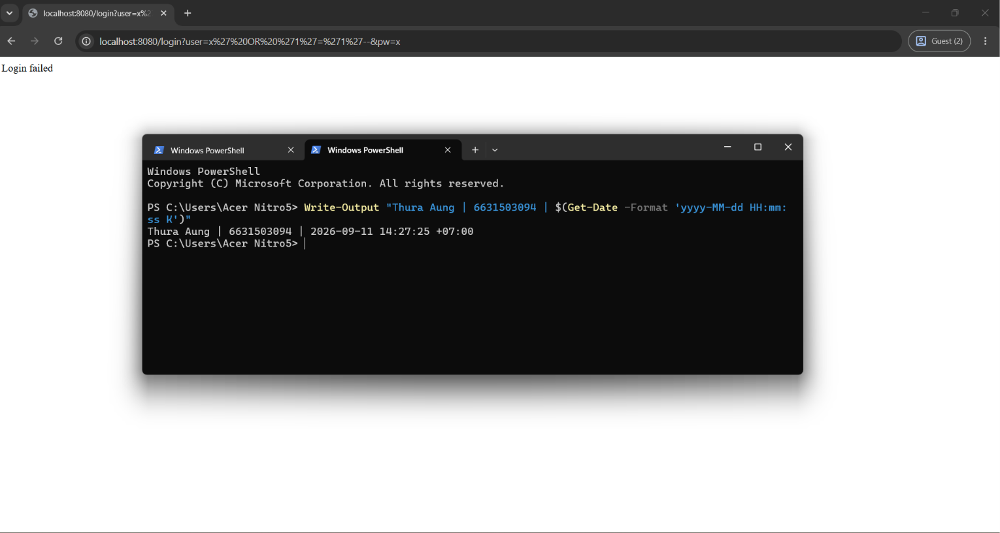
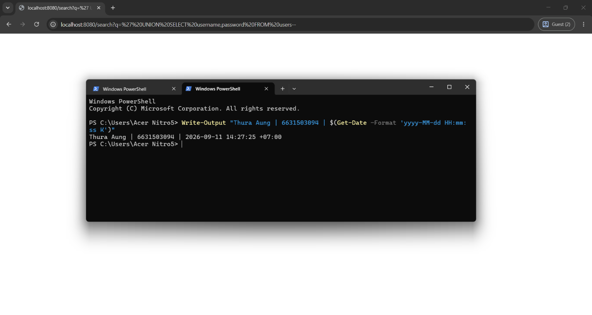
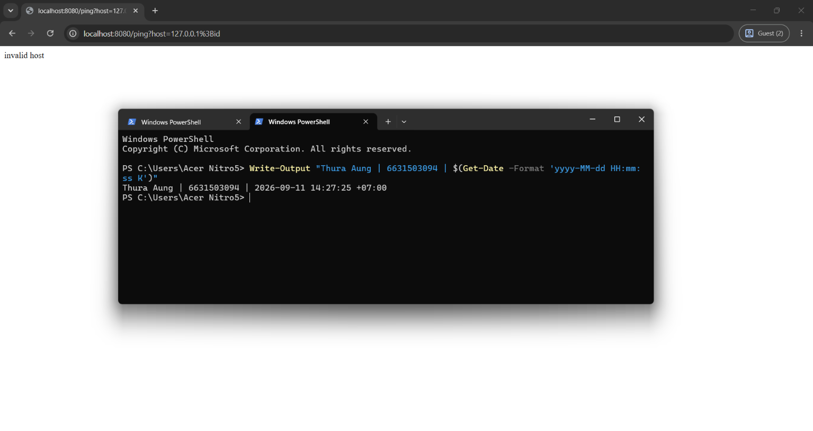
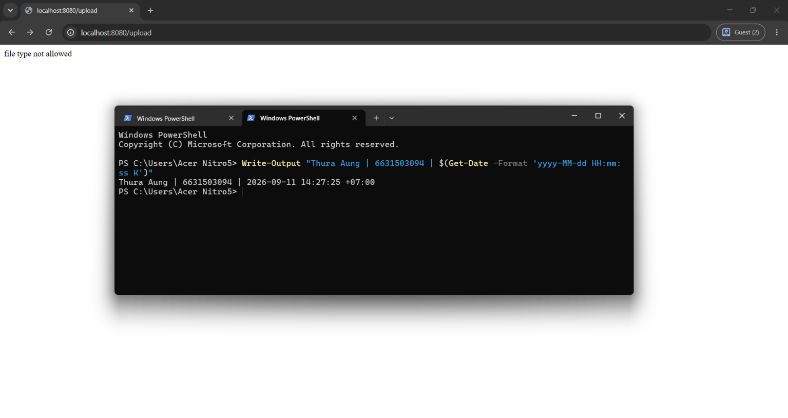

# Worksheet 4 — Injection & Input Handling (3 hrs)

> **Course:** Software Security (KOSEN69) · **Week 4**
> **Aligned:** OWASP 2025 **A05 Injection** · **CWE-89** (SQLi), **CWE-78** (OS command injection), **CWE-434** (unrestricted upload)
> **Signature game:** 🐉 **SQLi Boss Fight** — each successful injection lands a "hit" on the boss; the boss falls when you dump every credential and land an RCE.

> ⚠️ **Ethics note:** All payloads here are for the provided sandbox (`vulnerable_app.py`) and your own DVWA/Juice Shop containers **only**. Never test systems you do not own or have written permission to test. Unauthorized injection is a crime under most computer-misuse laws.

## Part 1 — Student Information

| Name | Student ID | Date | Group | AI Tool |

|------|-----------|------|-------|

| Thura Aung | 6631503094 | 9.September.2026 | - | ChatGPT |

## Part 2 — Lecture Questions

Answer in 2–4 sentences each.

1. Why does a **parameterized query** (`execute(sql, (params,))`) defeat SQL injection, while string formatting (`"... '%s'" % user`) does not? Reference how the database treats data vs. code.

- A parameterized query sends the SQL structure and the user input separately, so the database treats the input only as data, not executable SQL code. With string formatting, the input is inserted directly into the SQL statement, so characters like ', OR, or -- can change the query itself and cause SQL injection.

2. In the `/ping` endpoint, `subprocess.run("ping -c 1 " + host, shell=True)` is vulnerable. Explain how `shell=True` turns user input into **CWE-78**, and how an argument array (`["ping","-c","1",host]`) removes the shell.

- With shell=True, the full string is interpreted by a command shell. If host contains shell operators such as ;, &&, or |, the attacker may execute extra commands, which is CWE-78: OS Command Injection. Using ["ping", "-c", "1", host] passes each value directly as an argument to the program without a shell interpreting special characters.

3. Distinguish **input validation** (allow-list) from **output handling**. Why is validation alone insufficient defense for SQLi?

- Input validation checks whether input matches allowed rules, such as permitting only letters or numbers. Output handling means safely using or encoding data for its destination, such as parameterizing SQL or escaping HTML; validation alone is not enough for SQLi because permitted input can still become dangerous if it is concatenated into SQL, so parameterized queries are still required.

4. The `/upload` route saves any filename to disk (**CWE-434**). What two properties must a directory and a filename have for an upload to become remote code execution, and which does `solution_app.py` remove?

- For an uploaded file to become remote code execution, the file must be stored in a location where the server can execute it, and the attacker must be able to upload a filename/type that the server recognizes as executable code. solution_app.py removes this attack path by restricting/sanitizing uploaded filenames and file types so arbitrary executable files cannot be placed where they could be executed.

5. What is a **UNION-based** SQLi, and why must the injected `SELECT` return the same number of columns as the original query? Relate to `/search?q=' UNION SELECT username,password FROM users--`.

- UNION-based SQL injection uses SQL's UNION operator to combine results from an attacker-controlled SELECT with the application's original query. Both SELECT statements must return the same number of columns with compatible types, so in /search?q=' UNION SELECT username,password FROM users--, the injected query returns two columns to match the two columns expected by the original search query.


## Part 3 — Hands-on Lab (150 min)

**Learning goals:** extract data via SQLi, achieve OS command injection, exploit an unrestricted upload, then prove each fix in `solution_app.py` blocks the payload.

**Prerequisites:** Docker + Docker Compose, `curl`, a browser. Working dir: `labs/week04-injection/`.

### Environment setup

```bash
cd labs/week04-injection
docker compose up            # builds python:3.12-slim, installs flask, runs vulnerable_app.py
# vulnerable app -> http://localhost:8080   (service name: injection-lab, port 8080)
```
Optional secondary targets:
```bash
docker run --rm -it -p 80:80 vulnerables/web-dvwa        # DVWA  -> http://localhost
docker run --rm -p 3000:3000 bkimminich/juice-shop       # Juice Shop -> http://localhost:3000
```

**What to submit per task:** the exact **payload/command**, a **screenshot** of the response proving success, and a **2–3 sentence mitigation** in your own words.

---

**Task 0 — Onboarding (5 min).** Browse to `http://localhost:8080/login?user=alice&pw=alicepw` and confirm `Welcome alice`. Note the seeded users (`alice`, `bob`). Screenshot the working app. *Deliverable: screenshot.*

**Before you start — see why concatenation is the flaw** 🔬 Type any input and watch which characters the database will parse as *SQL* rather than as a name. The point is not the payload; it is that with concatenation the input becomes syntax, and with a parameterised query it structurally cannot. You will be asked to state that difference in your own words in Task 5.

```sim
sqli-parse
```


**Task 1 — Auth bypass via SQLi (25 min) 🐉 Hit #1.**
- *Goal:* log in as `alice` with **no valid password**.
- *Steps:* hit `/login?user=alice'--&pw=x`, then `/login?user=x' OR '1'='1'--&pw=x` (the trailing `--` is required: without it, SQL binds `AND` tighter than `OR`, so `... OR '1'='1' AND password='x'` matches no row). Observe the comment in the query at lines 61–63 of `vulnerable_app.py`.
- *Deliverable:* both URLs + screenshot of `Welcome alice` + explain why `--` and `OR '1'='1` work.

Task 1 



Both URLs

First Payload - http://localhost:8080/login?user=alice&pw=alicepw

Second Payload - http://localhost:8080/login?user=alice&pw=alicepw/login?user=x%27%20OR%20%271%27=%271%27--&pw=x
```
Why they work: The single quote closes the original username string in the SQL query, allowing the injected text to become SQL syntax. The `--` starts a SQL comment, so the rest of the query, including the password check, is ignored; it must be followed by a space or line break for the database to recognize it as a comment. In `OR '1'='1'`, both quoted values are equal, so that condition is always true and the query can return a user even when the supplied password is invalid. Because the database returns the first matching row, the application may display `Welcome alice`.
```
**Task 2 — Credential dump via UNION SQLi (30 min) 🐉 Hit #2.**
- *Goal:* exfiltrate every username **and password** from the `users` table.
- *Steps:* request `/search?q=' UNION SELECT username,password FROM users--`. Confirm `alice:alicepw` and `bob:bobpw` appear.
- *Deliverable:* payload + screenshot of dumped credentials + note on why column count must match.

Task 2



Payload - /search?q=' UNION SELECT username,password FROM users--
```
Why the column count must match: `UNION` combines the rows from two `SELECT` statements into one result, so both statements must return the same number of columns in the same positions, with compatible data types. The original `/search` query returns two columns, so the injected `SELECT username,password FROM users` also returns two columns; `username` and `password` then appear in the two displayed result fields. If the numbers or types do not match, the database rejects the query instead of returning the dumped rows.
```
**Task 3 — OS command injection (30 min) 🐉 Hit #3.**
- *Goal:* run an arbitrary command through `/ping`.
- *Steps:* request `/ping?host=127.0.0.1;id` then `/ping?host=$(whoami)` (URL-encode if needed). Capture the injected command's output.
- *Deliverable:* both payloads + screenshot of `id`/`whoami` output + explanation of the `shell=True` flaw (CWE-78).

Task 3

Both Payloads 

> /ping?host=127.0.0.1;id

> /ping?host=$(whoami)


```
Why `shell=True` is dangerous: the application concatenates the untrusted `host` value into one command string and gives that string to the system shell. The shell interprets characters such as `;` as command separators and `$()` as command substitution, so input intended to be a hostname can cause additional commands to run; this is CWE-78, OS command injection. Passing an argument list such as `subprocess.run(["ping", "-c", "1", host], shell=False)` sends `host` as one literal argument to `ping`, so shell operators are not interpreted as commands.
```

**Task 4 — Unrestricted upload (25 min) 🐉 Hit #4.**
- *Goal:* show the upload accepts a dangerous file type with no checks (CWE-434).
- *Steps:* `GET /upload` (form), then upload a file named `shell.py`. Confirm `saved to /tmp/uploads/shell.py`. Discuss: if `UPLOAD_DIR` were web-served or executed, this is the RCE chain (here the dir is **not** served, so document the missing control rather than claiming auto-RCE).
- *Deliverable:* upload command/screenshot + 2–3 sentences on why extension allow-listing matters.

Task 4 



upload command - /upload
```
Why extension allow-listing matters: allowing only approved, non-executable extensions prevents an attacker from uploading files such as `.py`, `.sh`, or server-side script files that could be executed if the upload directory is served or processed by the application. The check must be performed on the server and combined with a generated filename and storage outside the web root, because an extension check alone does not guarantee that the file is safe.
```

**Task 5 — Defend / fix it (35 min) 🛡️ Boss defeated.**
- *Goal:* prove `solution_app.py` blocks Tasks 1–4.
- *Steps:* stop the vulnerable container (`Ctrl-C`), then run the fixed app on the same compose env:
  ```bash
  docker compose run --rm --service-ports injection-lab bash -c "pip install --no-cache-dir flask && python solution_app.py"
  ```
  Re-fire each payload from Tasks 1–4. Expected: `Login failed`, no credential dump, `invalid host` (400) on `127.0.0.1;id`, and `file type not allowed` for `shell.py`.
- *Deliverable:* screenshots of all four failures + name the fix line for each (parameterized query L52–55 login / L62–66 search, `shell=False`+regex L74–77, `secure_filename`+allow-list L86–93).

Login fix: [solution_app.py](solution_app.py#L43-L51) - parameterized query





Search fix: [solution_app.py](solution_app.py#L53-L60) - parameterized query



Ping fix: [solution_app.py](solution_app.py#L62-L71) - `shell=False` + regex validation



Upload fix: [solution_app.py](solution_app.py#L73-L86) - `secure_filename` + extension allow-list




## Part 4 — Reflection

1. **CWE/OWASP mapping:** map each of your four exploits to its CWE (89/78/434) and to OWASP 2025 **A05 Injection**.
2. **Real breach:** the **2017 Equifax breach** exposed ~147M people after attackers exploited a known input-handling flaw (Apache Struts CVE-2017-5638). In 3–4 sentences, connect that failure to the lessons in this lab (untrusted input reaching a powerful interpreter; the cost of an unpatched/unvalidated input path).
3. **Best mitigation:** of parameterized queries, allow-list validation, least privilege, and avoiding `shell=True`, which single control would have prevented the most damage in this lab, and why?

- 1.**CWE/OWASP mapping:** The login bypass and UNION credential dump are SQL injection, mapped to CWE-89 and OWASP 2025 A05 Injection. The `/ping` exploit is OS command injection, mapped to CWE-78 and A05 Injection. The unrestricted `shell.py` upload is mapped to CWE-434; it becomes related to A05 when the uploaded file is later interpreted as executable code, although its primary weakness is unrestricted file upload.

- 2.**Real breach:** The Equifax incident shows how an untrusted request can reach a powerful application component and lead to a very large data breach. This is similar to the lab because SQL, shell, and file-handling operations become dangerous when user-controlled input is accepted without the correct validation and separation controls. The incident also shows that failing to patch a known vulnerable component leaves an input path open for attackers. Secure coding, dependency patching, least privilege, and verification of the fix all reduce the chance and impact of that failure.

- 3.**Best mitigation:** Least privilege would have limited the damage most broadly in this lab because the application and database account would have had fewer permissions even if one input-handling flaw were missed. It would not replace parameterized queries, shell-free subprocesses, or upload allow-lists, which are the controls that directly stop each exploit, but it could reduce credential exposure and prevent the application from performing high-impact actions.

## Grading rubric (100)

| Criterion | Points |
|-----------|-------:|
| Part 2 — Lecture questions (conceptual accuracy) | 20 |
| Part 3 — Exploitation + evidence (payloads + screenshots, Tasks 1–4) | 40 |
| Part 3 — Defense (Task 5: fixes proven, lines cited) | 25 |
| Part 4 — Reflection (CWE/OWASP mapping, breach, mitigation) | 15 |
| **Total** | **100** |

---

## Evidence & Integrity (required)

- **Identity proof:** every screenshot/diagram must show a terminal running `printf '%s | %s | ' "$(whoami)" '<YOUR-STUDENT-ID>'; date '+%F %T %Z'` **in the
  same image as the evidence**. When the evidence is a browser page, a DevTools panel or a
  rendered response, put that terminal **beside the browser and capture the whole screen** — a
  cropped window carries nothing that identifies you, and the lab's own output is
  byte-identical for the whole cohort *by design*, so the stamp is the only thing that makes
  the shot yours. Generic or borrowed evidence is not accepted.
- **Personalized flag (if this lab issues one):** "FLAG{sqli_demo}"

  *Flags are unique per student — submitting another student's flag is a violation. How to submit: **learn.zcr.ai/submit** (full guide: `SUBMISSION.md` in the repo root).*
- **Explain in your own words** *(graded on your reasoning, not copied text):*
  1. What did you do, and **why did the vulnerability work**?

  -  I sent crafted input to the login, search, ping, and upload endpoints. The attacks worked because the application joined untrusted input directly into SQL or a shell command, or saved an attacker-chosen filename without checking its type. That allowed the database to read injected SQL, the shell to interpret `;` and `$()` as commands, and the upload handler to accept a potentially executable file.

  2. **Why does your fix actually stop it** — and what could still break it?

  - The fix separates user input from SQL with parameterized queries, rejects invalid hosts before calling `ping`, runs the process with an argument list and `shell=False`, and allows only approved upload extensions after sanitizing the filename. These controls stop the tested payloads, but another endpoint that concatenates input, a client-only validation check, an overly permissive upload directory, or excessive database and operating-system permissions could still leave the application vulnerable.


---

## 🤖 Audit the AI (required)

AI is a power tool you must **distrust** — you are graded on your *critique*, not the AI's answer.

1. Ask an AI assistant to exploit **or** fix this week's vulnerability. Paste its full answer.
2. **Find what's wrong or risky** in it — insecure code, a subtly incomplete fix, a hallucinated API/function/CVE, a missed edge case, or wrong reasoning. Quote the exact line(s).
3. Produce the **correct, verified** version yourself and explain in 2–3 sentences why the AI's output was insufficient.

> Disclose your AI use in the Part 1 table. This task counts toward your **Defense + Reflection** score.

### AI answer I received

For the login SQL injection, escape single quotes before building the query:

```python
user = request.args.get("user", "").replace("'", "''")
pw = request.args.get("pw", "").replace("'", "''")
sql = "SELECT id, username FROM users WHERE username = '%s' AND password = '%s'" % (user, pw)
row = db().execute(sql).fetchone()
```

### My critique and verified correction

The risky line is `sql = "SELECT id, username FROM users WHERE username = '%s' AND password = '%s'" % (user, pw)`. Escaping quotes manually is easy to get wrong and does not reliably handle every database context, encoding, or future change; it also leaves the application dependent on string-built SQL. The verified correction is:

```python
row = db().execute(
  "SELECT id, username FROM users WHERE username = ? AND password = ?", (user, pw)
).fetchone()
```

This uses SQLite parameter binding, so input such as `x' OR '1'='1'--` is treated as a value instead of changing the query structure. Repeating the login payload against `solution_app.py` returned `Login failed`, which verified that the fix blocked the tested bypass.

---

## 🧠 Comprehension & Prompt (required)

**A. Explain in Plain English (EiPE).** In 2–3 sentences, in your own words, describe what this week's vulnerable code/endpoint actually *does* and *why it is exploitable* — explain the mechanism, don't dump jargon.

The vulnerable app takes values from HTTP requests and inserts them directly into database queries and shell commands, while also accepting uploaded filenames without an extension check. The attacks worked because the database and shell interpreted parts of the input as instructions instead of ordinary data, and the upload handler trusted an attacker-controlled file type.

**B. Prompt Problem.** Write a **single prompt** that makes an AI produce a *correct, secure* fix for one finding. Run it: does the exploit now fail? If not, refine the prompt and try again. Submit the **final prompt + the verified result**.
*Graded on the prompt's precision and your verification — this trains problem decomposition and AI literacy (Denny et al. 2024).*

**Final prompt:** “In this Python Flask application, fix the `/login` SQL injection without changing the endpoint behavior. Use SQLite parameter binding with `?` placeholders and a parameter tuple; do not concatenate, format, or manually escape user input. Show the replacement code and explain why the payload `user=x' OR '1'='1'--` is treated as data. Then state one concrete test and its expected result.”

**Verified result:** The AI-generated fix used a parameterized query. I ran the payload against the fixed app, and the response was `Login failed` instead of `Welcome alice`, so the exploit failed as expected.
