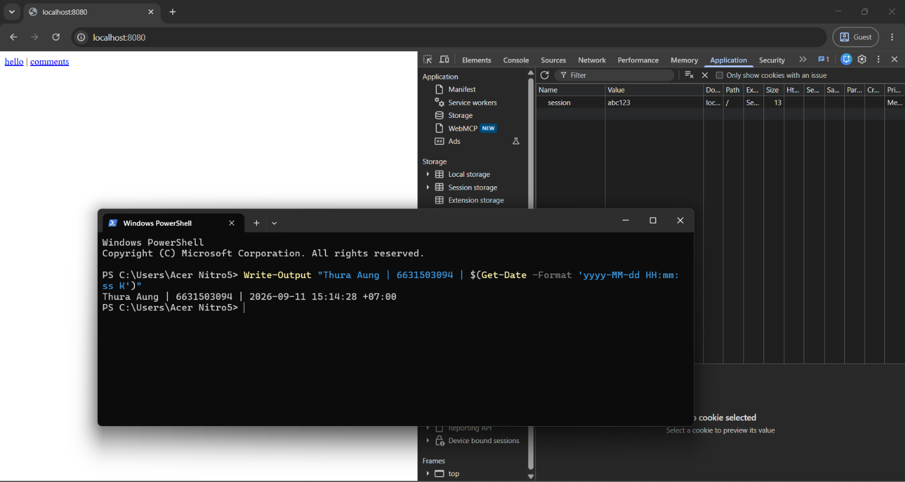
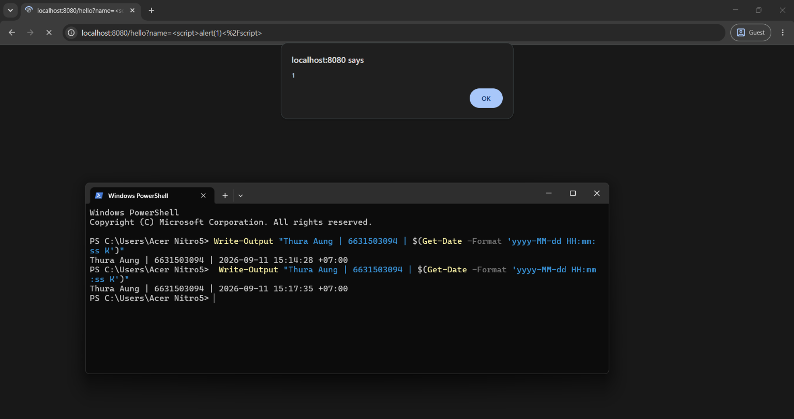
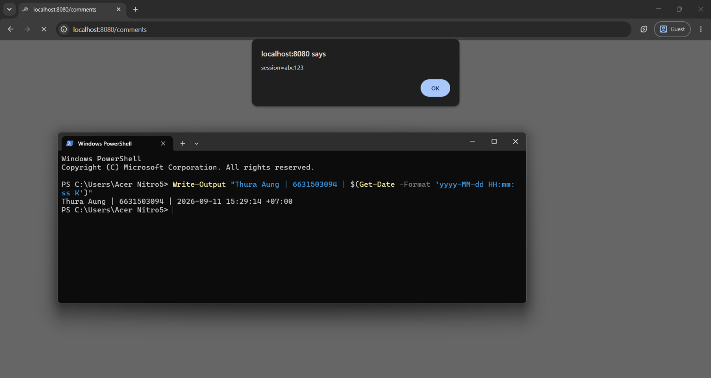
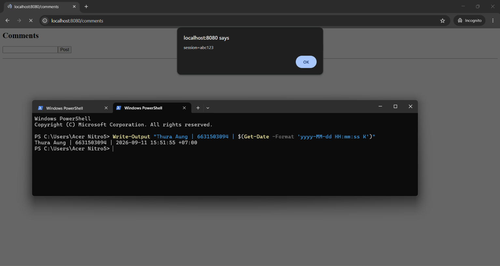
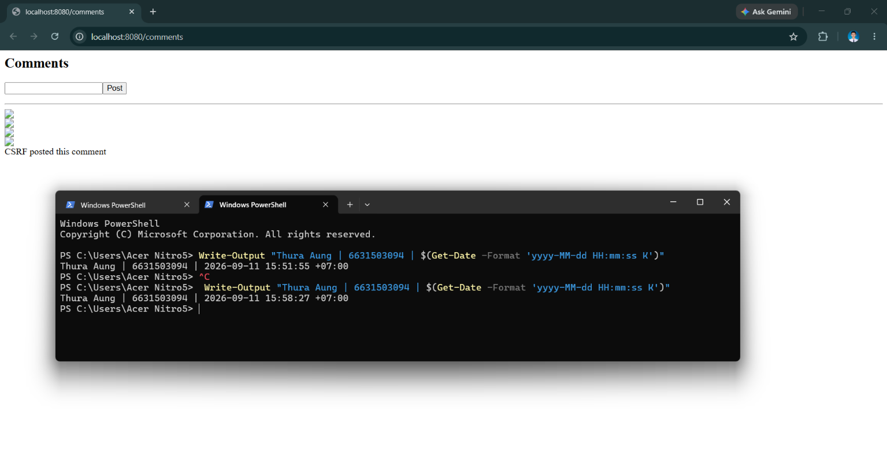
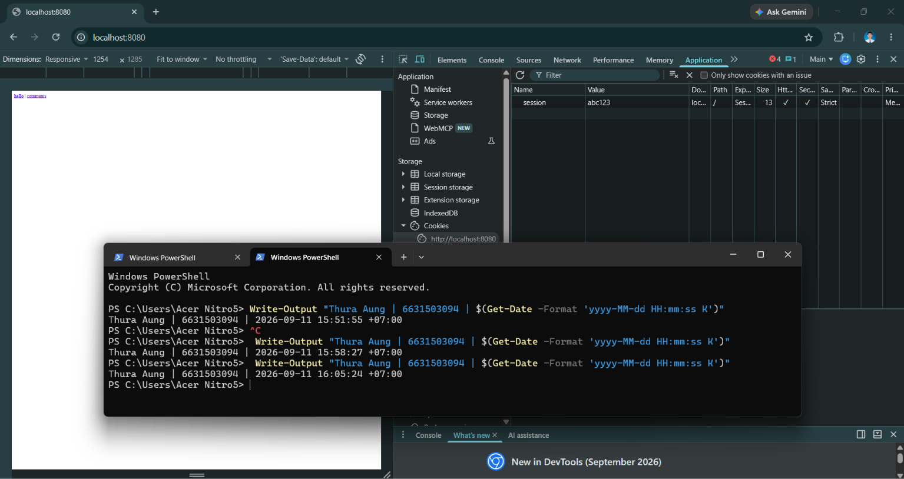
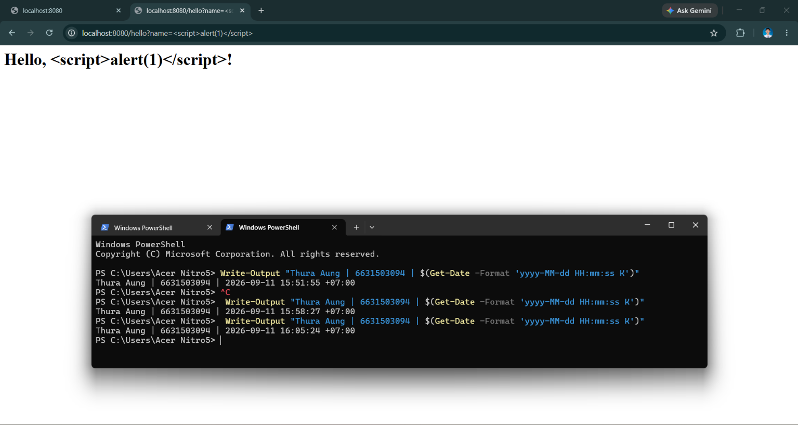
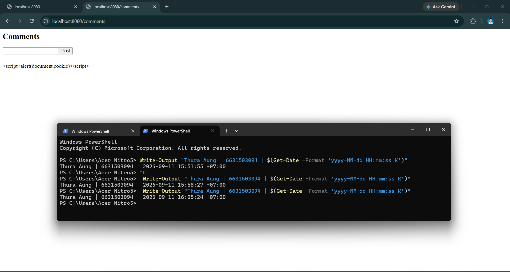
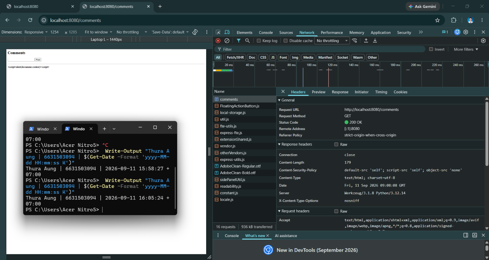
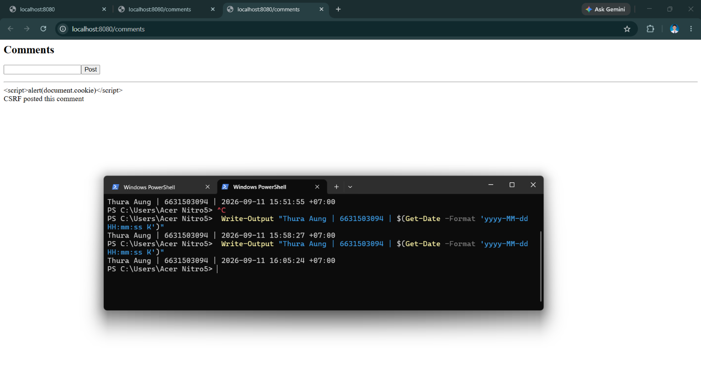

# Worksheet 5 — Cross-Site Scripting & Client-Side Risks (3 hrs)

> **Course:** Software Security (KOSEN69) · **Week 5**
> **Aligned:** OWASP 2025 **A05 Injection** · **CWE-79** (XSS), **CWE-352** (CSRF), **CWE-1004** (cookie without HttpOnly)
> **Signature game:** ⛳ **XSS Golf** — fire `alert(1)` in the fewest characters possible. Lower payload length = lower score = better. Par for reflected is the `` vector; can you go under par?

> ⚠️ **Ethics note:** Use only the provided `vulnerable_app.py` sandbox and your own Juice Shop container. Stealing real users' cookies or sessions is illegal. All "session theft" steps here target the sandbox cookie `session=abc123` only.

## Part 1 — Student Information
| Name | Student ID | Date | Group | AI Tool |
|---|---|---|---|---|
| Thura Aung | 6631503094 | 11.September.2026 | - | ChatGPT |

## Part 2 — Lecture Questions

Answer in 2–4 sentences each.

1. Distinguish **reflected**, **stored**, and **DOM-based** XSS by *where* the untrusted data is injected and *when* it executes. Which two does our `vulnerable_app.py` implement, and at which routes?
- Reflected XSS uses input from the current request and immediately places it into the response, so it runs when the victim opens the crafted URL. Stored XSS saves the input on the server and executes it later for every visitor who views the affected page, while DOM-based XSS is created entirely by client-side JavaScript modifying the page. This app implements reflected XSS at `/hello` and stored XSS at `/comments`; it does not implement DOM-based XSS.

2. How does **contextual output encoding** (`markupsafe.escape`) stop `<script>` from executing? Why is HTML-context encoding different from JavaScript- or URL-context encoding?
- `markupsafe.escape` converts characters such as `<`, `>`, `&`, and quotes into HTML entities, so `<script>` is displayed as text rather than parsed as an HTML element. HTML encoding is designed for insertion into HTML text or attributes, but JavaScript and URL contexts have different escaping rules and dangerous syntax. Therefore, HTML escaping should not be reused blindly inside a JavaScript string or a URL.

3. Explain how a strict **Content-Security-Policy** (`script-src 'self'`) defeats an *injected* inline script even when encoding is missing.
- A policy of `script-src 'self'` allows scripts loaded from the same origin but does not allow inline `<script>` blocks or inline event handlers such as `onerror` by default. The browser therefore refuses to execute an injected inline script even if the application failed to encode it. CSP is defense-in-depth, not a replacement for correct output encoding, and a weakened policy such as `unsafe-inline` would remove this protection.

4. What do the cookie flags **HttpOnly**, **SameSite**, and **Secure** each protect against? Map each to a concrete attack (cookie theft via XSS, CSRF, network sniffing).
- `HttpOnly` prevents JavaScript from reading the cookie, reducing cookie theft through XSS such as `document.cookie`. `SameSite=Strict` prevents the browser from sending the cookie on cross-site requests, which blunts CSRF, while `Secure` sends the cookie only over HTTPS and helps prevent theft through network sniffing. These flags reduce impact but do not remove the need for XSS prevention, CSRF tokens, and HTTPS.

5. Why does **CSRF** (CWE-352) work even without any script injection, and how does `SameSite=Strict` plus the same-origin policy blunt it?
- CSRF works because a victim's browser can submit a cross-site form to a state-changing endpoint and automatically attach the victim's cookies, even when no script runs on the target site. The same-origin policy prevents the attacker from reading the response, but it does not necessarily prevent the forged request itself. `SameSite=Strict` stops the session cookie from being sent cross-site, which blocks endpoints that require that cookie; a server-side CSRF token is still needed when the endpoint can process requests without verifying the session.

## Part 3 — Hands-on Lab (150 min)


**Learning goals:** land reflected + stored XSS, abuse a JS-readable cookie, build a CSRF PoC against the comment board, then prove `fixed_app.py` blocks all of it.

**Prerequisites:** Docker + Docker Compose, a browser with DevTools, a text editor. Working dir: `labs/week05-xss-client-side/`.

### Environment setup

```bash
cd labs/week05-xss-client-side
docker compose up            # python:3.12-slim + flask, runs vulnerable_app.py
# vulnerable app -> http://localhost:8080   (service name: xss-lab, port 8080)
```
Optional secondary target (for DOM XSS, which our app does not expose):
```bash
docker run --rm -p 3000:3000 bkimminich/juice-shop       # -> http://localhost:3000
```

**What to submit per task:** the exact **payload**, a **screenshot** of the alert/effect, and a **2–3 sentence mitigation**.

---

**Task 0 — Onboarding (5 min).** Browse `http://localhost:8080/`. Open DevTools → Application → Cookies and confirm `session=abc123` is set with **no HttpOnly / SameSite**. Screenshot it. *Deliverable: screenshot.*



**Task 1 — Reflected XSS + XSS Golf (30 min) ⛳.**
- *Goal:* execute JS via `/hello`, then minimize the payload.
- *Steps:* visit `/hello?name=<script>alert(1)</script>`, then the alternate `/hello?name=` (useful when `<script>` tags specifically are filtered — note it's actually 3 characters longer, not shorter). Record each payload's character count for your golf score.
- *Deliverable:* both payloads + char counts + screenshot of `alert(1)` + your lowest score.

Task 1 
>`http://localhost:8080/hello?name=<script>alert(1)</script>`



>`http://localhost:8080/hello?name=Payload 1: `<script>alert(1)</script>` — 25 characters

>Payload 2: `` - 28 characters

> Lowest score: 25 characters using the `<script>` vector.

**Task 2 — Stored XSS (30 min) ⛳.**
- *Goal:* persist a script that runs for every visitor of `/comments`.
- *Steps:* POST a comment with body `<script>alert(document.cookie)</script>` (use the form or `curl -d 'body=...'`). Reload `/comments` and watch the cookie pop.
- *Deliverable:* payload + screenshot of the alert showing `session=abc123` + why stored XSS is more dangerous than reflected.

Task 2 



- Stored XSS is more dangerous because the malicious script is saved on the server and runs automatically for every user who opens the affected page. Reflected XSS usually requires each victim to click or visit a specially crafted URL, while stored XSS can affect many visitors without repeated attacker action and may steal cookies or perform actions in their sessions.

**Task 3 — Cookie theft via XSS (25 min).**
- *Goal:* show the cookie is readable by injected JS because **HttpOnly is missing** (CWE-1004).
- *Steps:* store `<script>new Image().src='http://localhost:8080/hello?name='+document.cookie</script>` (a beacon), or simply ``. Observe the cookie value being exfiltrated/displayed.
- *Deliverable:* payload + screenshot + 2–3 sentences on how HttpOnly would have stopped this.

Task 3



- `HttpOnly` would prevent JavaScript from reading the `session` cookie through `document.cookie`, so the injected XSS could still run but could not directly display or steal that cookie. It limits cookie theft; it does not fix the underlying XSS vulnerability, so the application must still safely encode user input.

**Task 4 — CSRF PoC (30 min).**
- *Goal:* make a third-party page force a state-changing POST to `/comments`.
- *Steps:* create a local `csrf.html` with an auto-submitting form targeting the board (no token exists, cookie has no SameSite, so the browser attaches `session` cross-site):
  ```html
  <body onload="document.forms[0].submit()">
    <form action="http://localhost:8080/comments" method="POST">
      <input name="body" value="CSRF posted this comment">
    </form>
  </body>
  ```
  Open the file and confirm the comment appears on `/comments`.
- *Deliverable:* the HTML + screenshot of the forged comment + why `SameSite=Strict` blocks it.

```sim
xss-context
```
Task 4



- `SameSite=Strict` tells the browser to send the session cookie only with same-site requests. Because the CSRF form is opened from another origin, the browser sends the POST but omits the `session` cookie, so the server cannot treat it as an authenticated request.

It is defense-in-depth, not a replacement for a server-side CSRF token.


**Task 5 — Defend / fix it (30 min) 🛡️.**
- *Goal:* prove `fixed_app.py` blocks Tasks 1–3, then show that Task 4's CSRF PoC still gets through and explain why.
- *Steps:* stop the vulnerable container (`Ctrl-C`), then:
  ```bash
  docker compose run --rm --service-ports xss-lab bash -c "pip install --no-cache-dir --index-url https://pypi.org/simple flask && python fixed_app.py"
  ```
  Re-fire each payload. Expected: `/hello` renders the script **as text** (escape, L21), stored comments render literally (Jinja autoescape, L30–33), a strict CSP header is now present as defense-in-depth (`Content-Security-Policy: script-src 'self'`, L12 — check DevTools → Network → Response Headers; escaping already neutralizes these payloads, so no CSP *violation* fires in the console), and the cookie now has `HttpOnly; SameSite=Strict; Secure` (L42). Then re-run Task 4's `csrf.html` PoC against `fixed_app.py`: it **still posts the forged comment** — `/comments` (L25–28) never checks the `session` cookie or a CSRF token before accepting a POST, so hardening the cookie only stops the browser from *attaching* it cross-site; it doesn't stop the request itself from being processed.
- *Deliverable:* screenshots of escaped output + the CSP response header + the hardened cookie flags + the still-successful Task 4 forgery against `fixed_app.py`, with 2–3 sentences on why cookie hardening alone doesn't close CSRF here (no server-side check tied to the cookie, and no CSRF token).

Task 5 











- The fixed app stops XSS by escaping reflected input and using Jinja autoescaping for stored comments. The CSP and cookie flags add defense-in-depth: CSP blocks inline scripts, while HttpOnly prevents JavaScript from reading the cookie and SameSite limits cross-site cookie sending. However, the CSRF request can still be processed because the server does not check a CSRF token or require an authenticated session. A complete fix would add a server-generated CSRF token and validate it on every state-changing request.

## Part 4 — Reflection

1. **CWE/OWASP mapping:** map your reflected/stored XSS to **CWE-79** and your CSRF PoC to **CWE-352**, both under OWASP 2025 **A05 Injection** (CSRF historically A01/A05).

- The reflected and stored XSS vulnerabilities are CWE-79: Improper Neutralization of Input During Web Page Generation. They fit under OWASP 2025 A05: Injection because untrusted input is inserted into HTML and interpreted as browser code. The CSRF vulnerability is CWE-352: Cross-Site Request Forgery, because an external page can cause the victim’s browser to submit an unwanted state-changing request.

2. **Real breach:** the **2018 British Airways breach** (~380k payment records) used malicious JavaScript (Magecart) injected into the site to skim card data — a client-side script-injection failure. In 3–4 sentences relate it to this lab's XSS and CSP lessons.

- The 2018 British Airways breach involved malicious JavaScript being injected into the payment process, allowing attackers to collect customers’ payment information. This is similar to the lab because XSS or another client-side injection flaw causes code to run in a trusted website’s origin. A strict CSP could reduce the impact by blocking unauthorized inline scripts or scripts from untrusted sources. However, CSP is defense-in-depth; correct output encoding and secure application design are still necessary.

3. **Best mitigation:** between output encoding, a strict CSP, and HttpOnly+SameSite cookies, which gives the broadest defense-in-depth, and why is "encoding alone" still risky?

- The strongest defense is to combine contextual output encoding, a strict CSP, and secure cookie flags such as HttpOnly and SameSite=Strict. Output encoding prevents user input from becoming HTML or JavaScript, CSP limits script execution if an injection mistake remains, and cookie flags reduce session theft and cross-site request abuse. Encoding alone is still risky because developers may use the wrong encoding for a JavaScript or URL context, miss an injection point, or introduce another vulnerability such as CSRF.

## Grading rubric (100)

| Criterion | Points |
|-----------|-------:|
| Part 2 — Lecture questions (conceptual accuracy) | 20 |
| Part 3 — Exploitation + evidence (payloads + screenshots, Tasks 1–4) | 40 |
| Part 3 — Defense (Task 5: fixes proven, lines cited) | 25 |
| Part 4 — Reflection (CWE/OWASP mapping, breach, mitigation) | 15 |
| **Total** | **100** |

---

## Evidence & Integrity (required)

- **Identity proof:** every screenshot/diagram must show a terminal running `printf '%s | %s | ' "$(whoami)" '<YOUR-STUDENT-ID>'; date '+%F %T %Z'` **in the
  same image as the evidence**. When the evidence is a browser page, a DevTools panel or a
  rendered response, put that terminal **beside the browser and capture the whole screen** — a
  cropped window carries nothing that identifies you, and the lab's own output is
  byte-identical for the whole cohort *by design*, so the stamp is the only thing that makes
  the shot yours. Generic or borrowed evidence is not accepted.
- **Personalized flag (if this lab issues one):** ____________________
  *Flags are unique per student — submitting another student's flag is a violation. How to submit: **learn.zcr.ai/submit** (full guide: `SUBMISSION.md` in the repo root).*
- **Explain in your own words** *(graded on your reasoning, not copied text):*
  1. What did you do, and **why did the vulnerability work**?

  - I tested the /hello and /comments endpoints with HTML and JavaScript payloads. The vulnerability worked because the application inserted user-controlled input directly into the HTML without escaping it, so the browser interpreted the input as markup and executed the event handler or script. The missing HttpOnly flag also allowed the injected JavaScript to read document.cookie.

  2. **Why does your fix actually stop it** — and what could still break it?
  - The fixed app escapes reflected input and uses Jinja autoescaping for stored comments, so the browser displays the payload as text instead of executing it. CSP provides additional protection, while HttpOnly prevents JavaScript from reading the session cookie and SameSite=Strict limits cross-site cookie sending. This could still fail if another output context is left unescaped, CSP is weakened with unsafe-inline, or the application accepts state-changing requests without a server-side CSRF token, as the remaining CSRF test demonstrated.

---

## 🤖 Audit the AI (required)

AI is a power tool you must **distrust** — you are graded on your *critique*, not the AI's answer.

1. Ask an AI assistant to exploit **or** fix this week's vulnerability. Paste its full answer.
2. **Find what's wrong or risky** in it — insecure code, a subtly incomplete fix, a hallucinated API/function/CVE, a missed edge case, or wrong reasoning. Quote the exact line(s).
3. Produce the **correct, verified** version yourself and explain in 2–3 sentences why the AI's output was insufficient.

> Disclose your AI use in the Part 1 table. This task counts toward your **Defense + Reflection** score.

### Submitted AI answer

> Use `markupsafe.escape()` for the `/hello` parameter and enable Jinja autoescaping for stored comments. Add `Content-Security-Policy: script-src 'self'` and set the session cookie with `HttpOnly`, `SameSite=Strict`, and `Secure`. These changes prevent XSS and cookie theft, and they also prevent CSRF because cross-site requests will not include the session cookie.

### Critique

The risky statement is: **"These changes prevent XSS and cookie theft, and they also prevent CSRF because cross-site requests will not include the session cookie."** `SameSite=Strict` can prevent the cookie from being attached to a cross-site request, but it does not stop the request from reaching `/comments`. In this lab, `fixed_app.py` accepts `POST /comments` without checking the session cookie or a CSRF token, so the forged comment is still added. The answer also describes the defenses generally but does not verify every output context or test the actual endpoints.

### Correct, verified version

The fixed app escapes the `/hello` value with `markupsafe.escape()` and renders stored comments through Jinja autoescaping, so the XSS payloads are displayed as text. It adds a CSP response header and sets `HttpOnly`, `SameSite=Strict`, and `Secure` on the session cookie; I verified the escaped output, the header, and the cookie attributes in the browser. The original CSRF proof of concept still posts a comment because the server does not validate a CSRF token or require an authenticated session, so a complete fix must generate a server-side token, include it in the form, and reject missing or invalid tokens.

---

## 🧠 Comprehension & Prompt (required)

**A. Explain in Plain English (EiPE).** In 2–3 sentences, in your own words, describe what this week's vulnerable code/endpoint actually *does* and *why it is exploitable* — explain the mechanism, don't dump jargon.

**B. Prompt Problem.** Write a **single prompt** that makes an AI produce a *correct, secure* fix for one finding. Run it: does the exploit now fail? If not, refine the prompt and try again. Submit the **final prompt + the verified result**.
*Graded on the prompt's precision and your verification — this trains problem decomposition and AI literacy (Denny et al. 2024).*

### Final prompt

> Inspect this Flask Week 5 XSS lab. Secure `/hello` against reflected XSS using contextual HTML output encoding, secure `/comments` against stored XSS using Jinja autoescaping, add a strict CSP without `unsafe-inline`, and set the session cookie with `HttpOnly`, `SameSite=Strict`, and `Secure`. Analyze the existing CSRF proof of concept separately: do not claim that cookie flags alone prevent CSRF. Add a server-generated CSRF token to the session, include it in the comment form, validate it on every POST to `/comments`, reject missing or invalid tokens, preserve the existing behavior otherwise, and explain how each change can be verified with the lab payloads.

### Verified result

The reflected and stored XSS payloads were rendered as text instead of executing, the CSP header was present, and JavaScript could not read the hardened session cookie. The original `fixed_app.py` still accepted the CSRF form because it has no server-side CSRF-token check; therefore, cookie hardening alone was insufficient. The final prompt correctly requires token generation and validation to close that remaining gap.
