# Worksheet 12 — Software Supply-Chain Security (3 hrs)

> **Course:** Software Security (KOSEN69) · Week 12
> **Aligned:** OWASP 2025 — A03 Software Supply Chain Failures · A08 Software or Data Integrity Failures · **CWE:** CWE-1104, CWE-829, CWE-1357, CWE-1395
> **Signature game:** 📦 Dependency Confusion Heist
>
> **Ethics note:** This lab has **no live private/public registry to attack** — the dependency-confusion exercise is a controlled walkthrough (`dependency-confusion.md`) plus the interactive resolver simulation in Task 2, not a real package pull. **Never** plant or publish look-alike packages on the real PyPI or npm — that is an attack on every downstream user, and nothing in this lab requires it.

## Part 1 — Student Information

| Name | Student ID | Date | Group | AI Tool |
|------|-----------|------|-------|---------|
| Thura Aung | 6631503094 | 23.October.2026 | - | ChatGPT |

## Part 2 — Lecture Questions

1. Explain **dependency confusion** (substitution). Why does a public `acme-internal-utils==99.0.0` win over a private `==1.4.0` when a resolver shops both indexes?

Dependency confusion happens when a build can reach both a private index and a public one, and an attacker publishes a package on the public index with the **same name** as an internal package. With `pip install --extra-index-url <private> acme-internal-utils`, pip does **not** treat the indexes as "primary" and "backup". It puts every candidate from **all** indexes into one list, drops the ones that don't match the version specifier, and installs the **highest PEP 440 version**. pip's own docs say the indexes have no priority order, and once a candidate is in the list pip doesn't care which index it came from. So the attacker's public `99.0.0` beats the real private `1.4.0` because 99 > 1, and its install-time code runs on the CI runner or developer machine, with access to whatever secrets are there (CWE-1357 / CWE-829). The attacker only needs the internal name, and those leak all the time through `requirements.txt` or `package.json` in public repos, error messages, or JS bundles. In 2021, Alex Birsan used this to get code running inside Apple, Microsoft, PayPal and 30+ other companies. Pinning `==1.4.0` alone is **not** a fix: the attacker can publish their own `1.4.0` publicly, and you can't choose which of the two files pip takes. The fixes are hash pinning (`--require-hashes`), a single `--index-url` or a curated proxy, and reserving the internal name on the public registry.

2. How does **typosquatting** (`reqeusts`, `urlib3`) achieve code execution *at install time* before any of your code runs?

A typosquat is a malicious package whose name is one typo away from a popular one. It waits for someone to mistype the name, or for an AI assistant to suggest a package name that doesn't exist (now called "slopsquatting"). Installing a Python **source distribution** is not just copying files. pip has to *build* it, so it runs the package's `setup.py` (or its PEP 517 build backend) as ordinary Python, with your user's permissions. Any code at the top of `setup.py`, or in a custom `install` command, runs **during `pip install`**, before anything imports `reqeusts` and before your app starts. npm's `preinstall`/`postinstall` scripts work the same way. A typical payload collects environment variables, `~/.aws`, `~/.ssh` and CI tokens, sends them to the attacker, and then installs the real `requests` as a dependency so nothing looks broken. `pip install` inside a `Dockerfile` or CI job often runs as **root** with deploy credentials loaded, so one typo can compromise the whole pipeline. This has already happened: in 2017 SK-CSIRT found `urlib3`, `urllib` and other typosquats on PyPI. Wheels don't run code at install time, but a wheel can still ship a `.pth` file, and Python runs it on **every** interpreter startup. Defenses: hash-pinned lockfiles, `--only-binary :all:` (no sdist builds), an allow-list or proxy registry, and SCA that flags packages that are new to the project.

3. What is an **SBOM** (CycloneDX/SPDX) and why is it a prerequisite for both incident response and SLSA provenance?

An SBOM (Software Bill of Materials) is a machine-readable list of every component inside an artifact, both direct and transitive. For each one it records the name, version, supplier, package URL (`pkg:pypi/flask@…`), hashes and licence, plus which components depend on which. **CycloneDX** (OWASP) is focused on security and can also carry vulnerability/VEX data. **SPDX** (Linux Foundation, ISO/IEC 5962:2021) grew out of licence compliance. `sign.sh` uses Trivy to write a CycloneDX SBOM (`sbom.cdx.json`).
- **Incident response:** when Log4Shell (CVE-2021-44228) came out, everyone had to answer "where do we run `log4j-core` 2.x?". Many teams needed weeks, because it was usually a transitive or shaded jar that nobody had listed. If you keep an SBOM for every release, that is one query (`trivy sbom`, Dependency-Track), and you can re-check old releases against new CVEs without rebuilding them. You can't patch what you don't know you ship.
- **SLSA provenance:** provenance is a signed record of *how* an artifact was built (builder, source commit, build steps). The SBOM is the record of *what* went into it. Without the SBOM you can prove the build ran in trusted CI, but you can't check what it shipped, so a deploy gate can't enforce rules like "no unapproved packages, no critical CVEs". In practice the SBOM is attached as a signed attestation (`cosign attest --type cyclonedx`) so it is tied to the image digest and can't be swapped later.

One limit: an SBOM shows what is present, not whether it is malicious. The SBOM for XZ 5.6.0 would have been accurate. Its value was showing, minutes after CVE-2024-3094 was published, exactly who was running it.

4. Sigstore **keyless** signing uses Fulcio (CA) + Rekor (transparency log) tied to an OIDC identity. Why is that safer than a long-lived private key (CWE-321)?

A traditional signing key (`cosign generate-key-pair`) lasts for years and has to be stored somewhere: in a CI secret, on a laptop, or, in the worst case, committed to the repo (CWE-321, hard-coded cryptographic key). Anyone who copies it can sign malware that verifies as yours, possibly for a long time before anyone notices. Revoking it means getting every verifier to update their trust settings. Keyless signing removes that long-lived secret:
1. cosign creates a **throwaway key pair in memory**, and the signer logs in through OIDC (a person via Google/GitHub, or a CI job via its workload identity token).
2. **Fulcio** checks the OIDC token and issues a **~10-minute** X.509 certificate that binds the public key to that identity (an email, or a workflow URI such as `https://github.com/acme/app/.github/workflows/release.yml@refs/heads/main`) and to the issuer.
3. The artifact is signed, the signature and certificate are recorded in **Rekor** (an append-only, publicly auditable log that also proves *when* the signing happened), and the private key is thrown away.

So there is no long-lived key to steal or rotate. A stolen certificate expires within minutes, and every signature is public, so you can watch Rekor for signatures in your name that you didn't make. Verifiers check *who* signed ("our release workflow") instead of matching a key fingerprint. The trade-off is that trust moves to the OIDC account, so MFA and protected CI workflows become what you have to defend. Verification is also only as strict as the identity you require. `sign.sh` verifies with `--certificate-identity-regexp '.*'` and `--certificate-oidc-issuer-regexp '.*'`, which accepts a valid Sigstore signature from **anyone**, including an attacker who signs their own image with their own Gmail. A real gate pins `--certificate-identity` and `--certificate-oidc-issuer` to exact values.

5. Summarize the **SLSA** levels. Which level does "signed artifact + SBOM + provenance gate before deploy" put you at, and what is still missing?

SLSA (Supply-chain Levels for Software Artifacts) rates how far you can trust that an artifact really came from the source and build process it claims. The current spec's (v1.x) **Build track** has four levels:

| Level | Requirement | What it protects against |
|-------|-------------|--------------------------|
| **L0** | Nothing | — |
| **L1** | **Provenance exists**: the build automatically records how the artifact was made (builder, source, inputs). It may be unsigned. | Mistakes and undocumented builds. Easy to forge. |
| **L2** | A **hosted** build platform generates and **signs** the provenance, and consumers verify it | Tampering *after* the build. Forging it means compromising the build platform. |
| **L3** | **Hardened** builder: builds are isolated from each other, and signing keys are out of reach of user-defined build steps, so the provenance **can't be faked** | Tampering *during* the build, even by a malicious build script or maintainer |

(The older v0.1 had an L4 that required two-person review and hermetic, reproducible builds. v1.x moved source requirements to a separate track.)

"Signed artifact + SBOM + provenance gate" gets you to about **SLSA Build L2**, **if** the signing and provenance come from hosted CI (e.g., GitHub Actions with OIDC). If `sign.sh` runs on a developer's laptop, that laptop *is* the build platform and nothing stops its owner from forging the record, so you are at L1 at most. Also, a signed image is not provenance: the gate has to verify a SLSA provenance **attestation** (`cosign verify-attestation --type slsaprovenance`), not just the image signature. **Still missing:**
- **For L3:** an isolated, short-lived, hardened builder whose signing identity the build steps can't reach (e.g., `slsa-github-generator` reusable workflows), so nothing inside the build can fake the provenance.
- **Outside the Build track:** source integrity (branch protection, two-person review), hermetic/reproducible builds, and trust in how your *dependencies* were built.
- **A strict policy:** the gate must pin the expected builder identity and source repo instead of accepting `.*`.

SLSA proves *where and how* something was built, not that the code is *safe*. A malicious commit from a trusted maintainer still gets perfectly valid provenance.


## Part 3 — Hands-on Lab (150 min)

**Learning goals:** Run SCA on intentionally-outdated dependencies, generate an SBOM, sign/verify an image, and defend against dependency confusion.

**Prerequisites:** Docker; the lab folder (`requirements.txt`, `Dockerfile`, `app.py`, `sca_scan.sh`, `sign.sh`). For signing: browser for the OIDC flow + registry push access.

**Environment setup**
```bash
cd labs/week12-supply-chain
bash sca_scan.sh                 # trivy fs + pip-audit on requirements.txt (+ optional image scan)
docker build -t week12-supplychain:lab .
bash sign.sh week12-supplychain:lab   # CycloneDX SBOM -> sbom.cdx.json, then cosign sign + verify
```

**What to submit per task:** the exact command(s) + output, a screenshot, and a 2–3 sentence remediation note mapping the finding to A03/A08 or the CWE.

### Task 0 — Onboarding (15 min)
Read `requirements.txt` and list the pinned packages with their versions. Note why they are intentionally outdated (each is deliberately an old release so SCA tools flag its known CVEs).
**Deliverable:** the package/version table + which OWASP/CWE this maps to.

**Command (PowerShell):**
```powershell
cd C:\software-security\labs\week12-supply-chain
Get-Content requirements.txt -Encoding UTF8
Write-Output "Thura Aung | 6631503094 | $(Get-Date -Format 'yyyy-MM-dd HH:mm:ss K')"
```

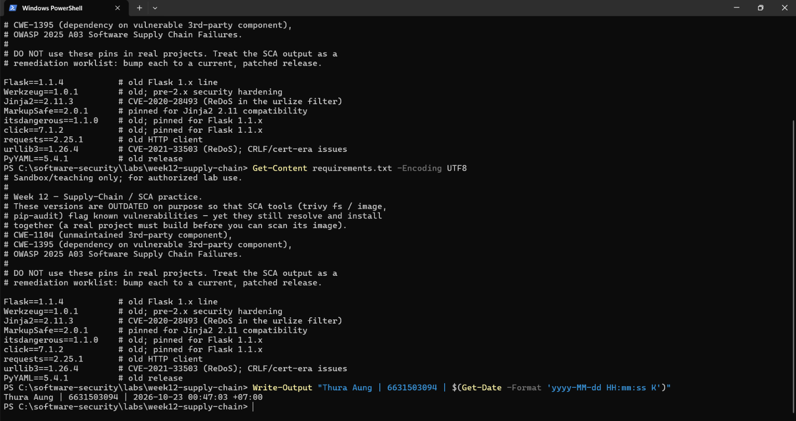

| Package | Pinned version | What it does | Why this old version | Example known CVE |
|---------|---------------|--------------|----------------------|-------------------|
| Flask | 1.1.4 | Web framework | Old 1.x line | CVE-2023-30861 |
| Werkzeug | 1.0.1 | HTTP/WSGI layer under Flask | Flask 1.1.4 requires `<2.0` | CVE-2023-25577, CVE-2024-34069 |
| Jinja2 | 2.11.3 | Templates | Flask 1.1.4 requires `<3.0` | CVE-2024-22195 |
| MarkupSafe | 2.0.1 | HTML escaping for Jinja2 | 2.1 removed `soft_unicode`, which Jinja2 2.11 imports | none |
| itsdangerous | 1.1.0 | Signs session cookies | Flask 1.1.4 requires `<2.0` | none |
| click | 7.1.2 | CLI (`flask run`) | Flask 1.1.4 requires `<8.0` | none |
| requests | 2.25.1 | HTTP client | Old release | CVE-2023-32681 |
| urllib3 | 1.26.4 | Network layer under requests | Old 1.26.x | CVE-2021-33503 |
| PyYAML | 5.4.1 | YAML parser | Old release | none |

**Mapping:** OWASP 2025 **A03 Software Supply Chain Failures**. In 2025 this category absorbed the old A06, "Vulnerable and Outdated Components".
- **CWE-1395** (depends on a vulnerable third-party component): Flask, Werkzeug, Jinja2, requests, urllib3.
- **CWE-1104** (outdated, unmaintained components): MarkupSafe, itsdangerous, click, PyYAML. These are old but have no known CVE.

**Note:** These versions are deliberately old so that SCA tools have known CVEs to flag. They still have to install together, so the Flask 1.1.x helpers (Werkzeug, Jinja2, itsdangerous, click, MarkupSafe) are pinned old too. The fix is to upgrade them as one group to Flask 3.x, not one package at a time. The comment in `requirements.txt` says Jinja2 2.11.3 has CVE-2020-28493, but 2.11.3 is the release that fixed it. OSV doesn't list that CVE for this version, so I used CVE-2024-22195.

### Task 1 — SCA scan: build the remediation worklist (35 min)
**Goal:** Flag the known-vulnerable dependencies — A03.
**Steps:**
1. `bash sca_scan.sh` — read the `trivy fs` table (CVE, installed vs. fixed version) and the `pip-audit` advisory IDs (GHSA-/PYSEC-).
2. Pick three findings; record CVE/advisory id, severity, and the fixed version.
**Deliverable:** the SCA output + a 3-row remediation table (package → current → fixed).

**Commands (PowerShell).** These are the two scans that `sca_scan.sh` runs (its `trivy fs` and `pip-audit` steps), run directly in PowerShell instead of through `bash`:
```powershell
cd C:\software-security\labs\week12-supply-chain
docker run --rm -v "${PWD}:/src" aquasec/trivy:latest fs --scanners vuln --severity HIGH,CRITICAL /src
docker run --rm -v "${PWD}:/src" -w /src python:3.9-slim sh -c "pip install --quiet pip-audit && pip-audit -r requirements.txt"
Write-Output "Thura Aung | 6631503094 | $(Get-Date -Format 'yyyy-MM-dd HH:mm:ss K')"
```

 `Total: 11 (HIGH: 11, CRITICAL: 0)` across Flask, Werkzeug and urllib3.

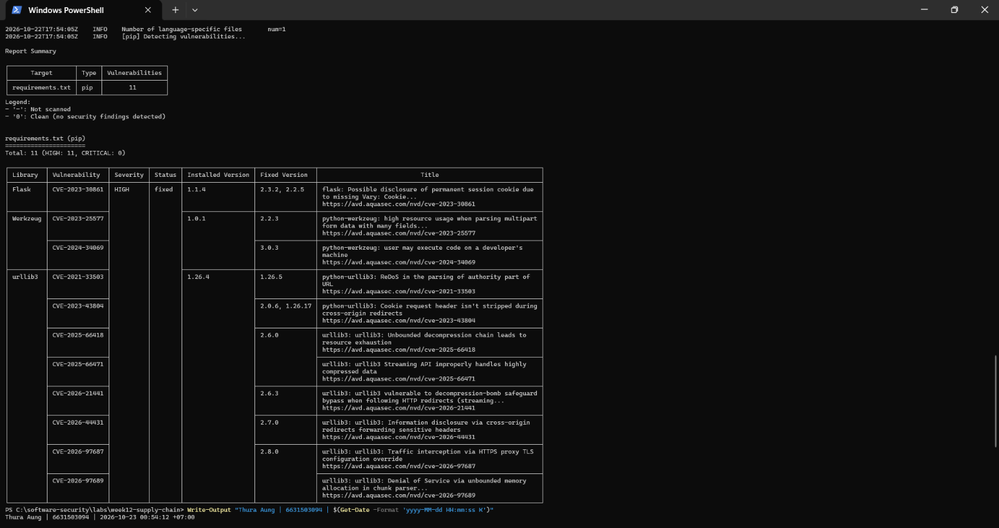

 `Found 33 known vulnerabilities in 6 packages` (flask, werkzeug, jinja2, requests, urllib3, idna).

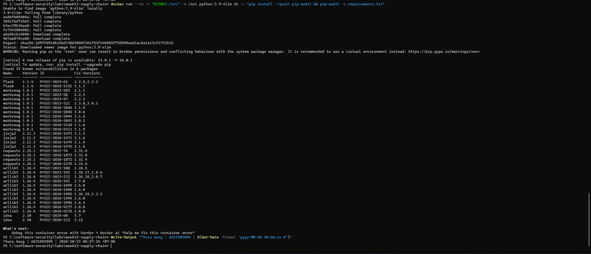

**Why the two tools disagree (11 vs 33):**
- Trivy ran with `--severity HIGH,CRITICAL`, so it hid the Medium-severity findings. That's why Jinja2 and requests don't appear in its table at all. pip-audit reports every severity.
- pip-audit **installs** the requirements to resolve them, so it also found **idna 2.10**, which isn't in `requirements.txt`. It's a *transitive* dependency pulled in by `requests==2.25.1`, and it has CVE-2024-3651 (PYSEC-2024-60, fixed in 3.7). You inherit a vulnerability in a package you never listed.

**Remediation table** (three findings that both tools reported; the PYSEC↔CVE mapping was checked against OSV):

| Package | Current | Fixed | CVE / advisory | Severity (Trivy) | What it is |
|---------|---------|-------|----------------|------------------|------------|
| Werkzeug | 1.0.1 | 3.0.3 | CVE-2024-34069 / PYSEC-2026-2043 | HIGH | The Werkzeug debugger can be made to run code on a developer's machine |
| Flask | 1.1.4 | 2.2.5 / 2.3.2 | CVE-2023-30861 / PYSEC-2023-62 | HIGH | A permanent session cookie can be cached by a proxy and disclosed to another user (missing `Vary: Cookie`) |
| urllib3 | 1.26.4 | 1.26.5 | CVE-2021-33503 / PYSEC-2021-108 | HIGH | ReDoS: a crafted URL authority makes the URL parser hang (CPU exhaustion) |

**Remediation note:** All three are **OWASP 2025 A03** / **CWE-1395** (dependency on a vulnerable third-party component). The "Fixed" column only closes the one CVE listed. Closing *every* finding needs Flask ≥ 3.1.3, Werkzeug ≥ 3.1.9 and urllib3 ≥ 2.8.0. Those versions can't be bumped one at a time: `Flask==1.1.4` requires `Werkzeug<2.0`, and `requests==2.25.1` requires `urllib3<1.27`. So the fix is to upgrade Flask together with its helpers and requests together with urllib3, then re-run both scans to confirm the result is clean.

### Task 2 — Dependency Confusion Heist (35 min)
**Goal:** Watch the wrong package win — A03 / CWE-1357.

**Reality check:** this lab does **not** stand up a live private/public registry. `acme-internal-utils` is
a worked example, not an installable package — there is nothing to actually `pip install` here (the name
doesn't exist on real PyPI either, so don't expect that to work as a shortcut). Task 2 is a controlled
walkthrough of the resolver's own rule, using the simulation below, which computes the real
"highest version wins" logic live instead of just asserting the outcome.

```sim
resolver-confusion
```

**Steps:**
1. Read `dependency-confusion.md`'s "Dependency confusion (substitution)" section for the mechanism.
2. In the simulation, load the **"the attack"** preset (private `1.4.0`, public `99.0.0`, merged /
   `--extra-index-url` mode) and record which index the resolver picks and why.
3. Keep the same version numbers and switch to the **single-index** (`--index-url`) mode; record how the
   verdict changes — this is the resolver behavior Task 4's "single trusted index" defense relies on.
4. Try the **"win the race"** preset (private version numerically higher than public) and note why the
   sim's own explanation calls that "not a defense."

**Deliverable:** a screenshot of the simulation's verdict in both index modes (merged vs. single) for the
same version pair, plus one sentence on why an attacker defeats the "keep my internal version number high"
idea.

Simulation: `https://learn.zcr.ai/sim/resolver-confusion`. Each screenshot has a PowerShell identity stamp beside the browser.

**Step 2: "the attack" preset (private `1.4.0`, public `99.0.0`, merged `--extra-index-url`)**
Verdict: **installs acme-internal-utils 99.0.0 from PUBLIC — confused.**
The resolver picked the **public (attacker's)** index. `--extra-index-url` merges both registries into one pool of candidates, and the only rule is "highest version wins", with no idea of which source is trusted. 99.0.0 > 1.4.0, so the attacker's package installs and its `setup.py` runs with my permissions (CWE-1357 / CWE-829).

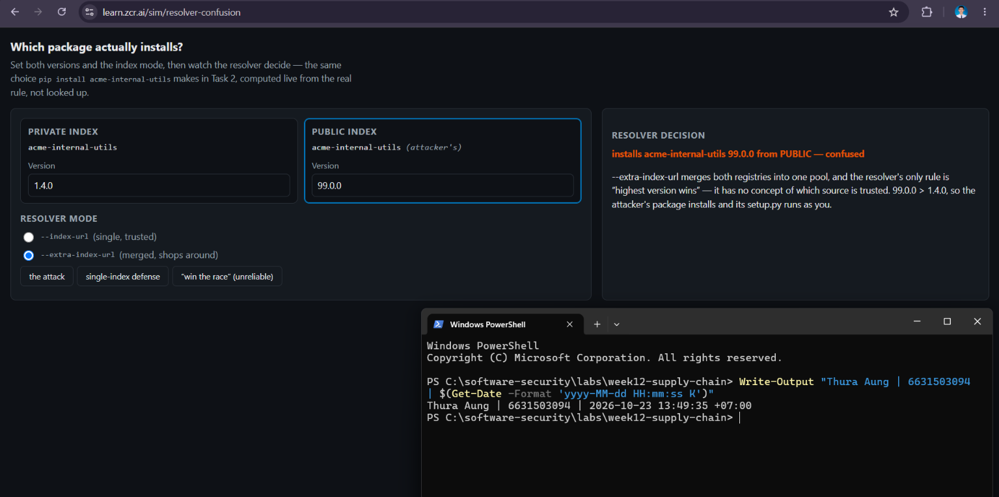

**Step 3: same versions, single-index `--index-url` mode**
Verdict: **installs acme-internal-utils 1.4.0 — safe.**
The versions are the same as before; only the **mode** changed. With `--index-url` only one index is configured, so the resolver has no second registry to compare against. The public look-alike is never even fetched, so its version number (99.0.0 or anything else) doesn't matter. This is the behavior Task 4's "single trusted index" defense relies on.

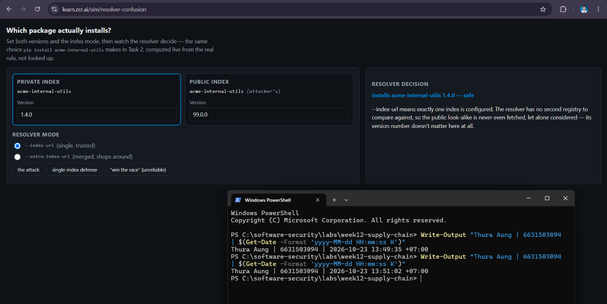

**Step 4: "win the race" preset (private `2.0.0`, public `1.9.0`, merged mode)**
Verdict: **installs acme-internal-utils 2.0.0 from PRIVATE — safe this time.** The private version wins only because it happens to be higher. The sim calls this "NOT a defense", because the attacker picks their own version number and can simply publish a higher one.

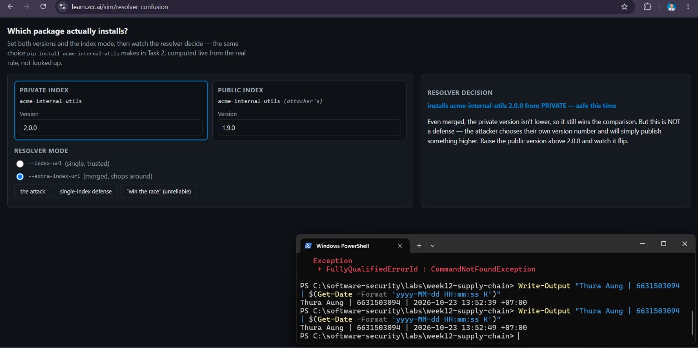

**Why "keep my internal version number high" fails:** the attacker chooses the public version number after seeing yours (or just publishes `99.0.0` or `9999.0.0`), so in merged mode they can always outbid you. The real fix is to stop the resolver from comparing the two indexes at all (single `--index-url` or a curated proxy) and to pin hashes.

### Task 3 — SBOM + signing/verification (30 min)
**Goal:** Produce a component inventory and prove integrity — A08.
**Steps:**
1. After `bash sign.sh week12-supplychain:lab`, open `sbom.cdx.json` and find Flask's entry.
2. Read the `cosign verify` PASS for the signed image.
3. Negative test on an unsigned image (it **must** fail):
   `cosign verify --certificate-identity-regexp '.*' --certificate-oidc-issuer-regexp '.*' python:3.9-slim`
   → `Error: no signatures found`. (Both `--certificate-identity*` flags are required in keyless mode; without
   them cosign stops at `Error: --certificate-identity or --certificate-identity-regexp is required` — a usage
   error, which is *not* the same thing as proving the image is unsigned.)
**Deliverable:** the SBOM Flask component entry + the verify PASS + the negative-test failure.

**Commands (PowerShell).** These are the same steps as `sign.sh`, run directly in Docker:
```powershell
cd C:\software-security\labs\week12-supply-chain
docker build -t week12-supplychain:lab .

# 1) CycloneDX SBOM of the image (sign.sh step 1/3)
docker run --rm -v "${PWD}:/src" -v /var/run/docker.sock:/var/run/docker.sock aquasec/trivy:latest image --format cyclonedx --output /src/sbom.cdx.json week12-supplychain:lab
Select-String -Path sbom.cdx.json -Pattern '"bom-ref": "pkg:pypi/flask@' -Context 1,15

# cosign can only sign an image stored in a registry, so push to a local one
docker run -d --name wk12reg -p 5000:5000 registry:2
docker tag week12-supplychain:lab localhost:5000/wk12:lab
docker push localhost:5000/wk12:lab
$digest = (docker push localhost:5000/wk12:lab | Select-String 'digest: (sha256:[0-9a-f]+)').Matches[0].Groups[1].Value
$ref = "host.docker.internal:5000/wk12@$digest"

# 2) Keyless sign (sign.sh step 2/3): OIDC login with my school Google account
docker run --rm -it gcr.io/projectsigstore/cosign:latest sign --yes --allow-insecure-registry --allow-http-registry $ref

# 3) Verify, pinned to my exact identity and issuer (sign.sh step 3/3, but stricter than its '.*')
docker run --rm gcr.io/projectsigstore/cosign:latest verify --allow-insecure-registry --allow-http-registry --certificate-identity 6631503094@lamduan.mfu.ac.th --certificate-oidc-issuer https://accounts.google.com $ref

# Negative test: an unsigned image must FAIL
docker run --rm gcr.io/projectsigstore/cosign:latest verify --certificate-identity-regexp '.*' --certificate-oidc-issuer-regexp '.*' python:3.9-slim
```

**Why I didn't run `bash sign.sh` as written:**
- Cosign signs images **in a registry**. `sign.sh` passes the local tag `week12-supplychain:lab`, which has no registry behind it.
- My first attempt to push to the public temporary registry `ttl.sh` kept timing out on the largest layer. So I ran a local `registry:2` on my PC. `--allow-http-registry` is only acceptable because that registry is local to my machine for the lab.
- Without `-it`, cosign used the "device flow" login, and Sigstore's login server rejected it (`Bad Request — Unregistered redirect_uri`). With `-it`, cosign used the copy-a-code login instead, which worked.

**Evidence 1: SBOM Flask component** (`sbom.cdx.json`, lines 7120–7136)
```json
{
  "bom-ref": "pkg:pypi/flask@1.1.4",
  "type": "library",
  "name": "Flask",
  "version": "1.1.4",
  "hashes": [ { "alg": "SHA-1", "content": "caefbe08593..." } ],
  "licenses": [ { "license": { "id": "BSD-3-Clause" } } ]
}
```
The SBOM is over 7,000 lines long. It lists every Debian OS package in the `python:3.9-slim` base as well as the Python libraries. For each component it gives the name, version, package URL (`pkg:pypi/flask@1.1.4`), hash and license. With this inventory, "are we running Flask 1.1.4?" is a single search instead of a manual investigation.

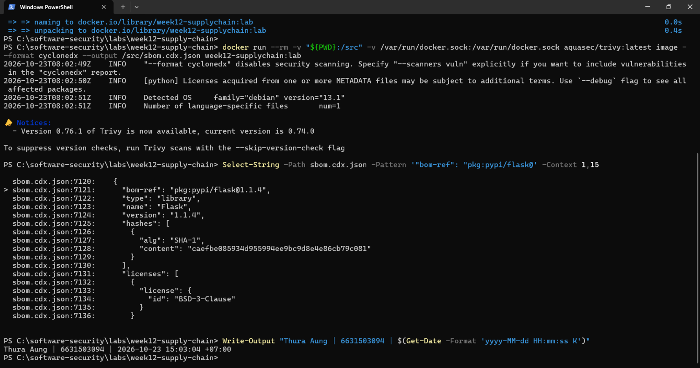

**Evidence 2: `cosign verify` PASS**
```
Verification for host.docker.internal:5000/wk12@sha256:1e838988124a90f38e90acae5bc6b36ba4829c166aacc9c5fd3a8444661ff3ac --
The following checks were performed on each of these signatures:
  - The cosign claims were validated
  - Existence of the claims in the transparency log was verified offline
  - The code-signing certificate was verified using trusted certificate authority certificates
```
I verified with `--certificate-identity 6631503094@lamduan.mfu.ac.th --certificate-oidc-issuer https://accounts.google.com` instead of `sign.sh`'s `'.*'`. That means the PASS shows that **this digest was signed by me, logged in through Google**, not just that *someone* signed it. A signature from any other identity would fail this check.

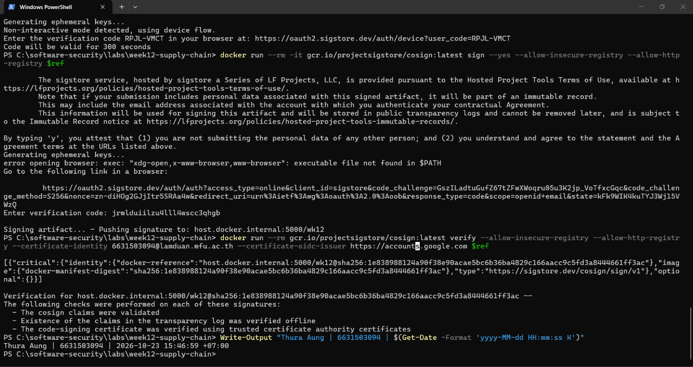

**Evidence 3: negative test on an unsigned image**
```
Error: no signatures found
```
Even with the permissive `'.*'` identity and issuer, verification of `python:3.9-slim` fails, because there's **no signature at all**. This is a real "unsigned" result, not the usage error `--certificate-identity … is required`.

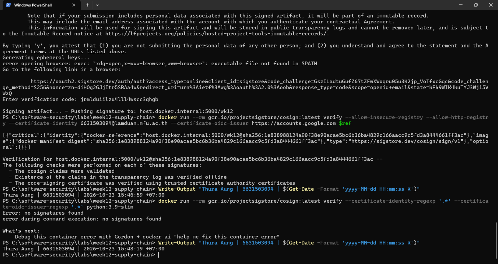

**Note (A08):** The SBOM gives a component inventory, and the keyless signature ties the exact image digest to a verified identity, recorded in the public Rekor log. This addresses **OWASP 2025 A08 Software or Data Integrity Failures** (CWE-494, download of code without an integrity check): if the image is changed by even one byte, or signed by anyone else, `cosign verify` fails. Signing proves *who* built it, not that it's safe: this signed image still contains the same vulnerable packages that Task 1 flagged.

### Task 4 — Defend / fix it (35 min)
**Goal:** Stop dependency confusion and lock integrity — defenses from `dependency-confusion.md` + `sign.sh`.
**Steps:**
1. **Pin + hashes:** run `pip install --require-hashes -r requirements.txt` against this lab's own
   `requirements.txt` (it has no hashes yet) and record pip's refusal — `ERROR: Hashes are required in
   --require-hashes mode...` plus the `--hash=sha256:…` line pip prints for you. That refusal is the same
   mechanism that would block a real confusion substitution: once hashes are required, a package that
   doesn't match — from *either* index — cannot install silently.
2. **Single trusted index:** use one `--index-url` instead of `--extra-index-url`; explain why the resolver stops shopping around (tie this back to Task 2's single-index verdict).
3. **Namespace scoping:** describe reserving/namespacing the internal package name.
4. **Provenance gate:** state how the `cosign verify` from `sign.sh` becomes a gate before a simulated deploy.
**Deliverable:** the `--require-hashes` refusal output (step 1) + the simulation's before/after verdict for merged vs. single index (from Task 2) + the one defense you found most effective and why.

#### 1. Pin + hashes

**Command (PowerShell, pip inside a throwaway container):**
```powershell
docker run --rm -v "${PWD}:/src" -w /src python:3.9-slim pip install --require-hashes -r requirements.txt
```

**Output, which is a refusal:**
```
Collecting Flask==1.1.4
  Downloading Flask-1.1.4-py2.py3-none-any.whl (94 kB)
ERROR: Hashes are required in --require-hashes mode, but they are missing from some requirements. Here is a list
of those requirements along with the hashes their downloaded archives actually had. Add lines like these to your
requirements files to prevent tampering. (If you did not enable --require-hashes manually, note that it turns on
automatically when any package has a hash.)
    Flask==1.1.4 --hash=sha256:c34f04500f2cbbea882b1acb02002ad6fe6b7ffa64a6164577995657f50aed22
```

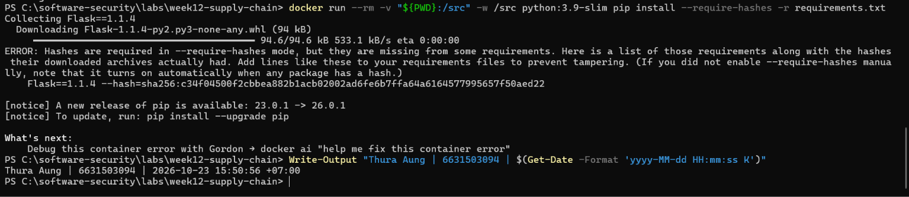

pip stopped at the first unhashed requirement, installed **nothing**, and printed the SHA-256 of the file it downloaded. When every line is pinned like `Flask==1.1.4 --hash=sha256:c34f…`, pip compares each downloaded file against that fingerprint. The attacker's look-alike can't match it, whether it comes from the public or the private index, so the install fails instead of running the attacker's `setup.py`. In `--require-hashes` mode pip also requires **every** dependency, including transitive ones like `idna`, to be pinned and hashed. So in practice you generate the whole lockfile with a tool (e.g. `pip-compile --generate-hashes`) rather than by hand.

#### 2. Single trusted index (before/after verdict from Task 2)

| Mode (same versions: private `1.4.0`, public `99.0.0`) | Simulation verdict |
|---|---|
| **Before:** `--extra-index-url` (merged) | **installs 99.0.0 from PUBLIC — confused** |
| **After:** `--index-url` (single) | **installs 1.4.0 — safe** |


With `--extra-index-url`, pip collects candidates from **both** indexes into one pool and installs the highest version, so it "shops around" and the attacker can always outbid. With a single `--index-url` (e.g. `pip install --index-url https://pypi.internal.acme/simple -r requirements.txt`, or `PIP_INDEX_URL` in CI), pip only ever asks **one** source. The public look-alike is never fetched, so its version number doesn't matter, which is exactly the Task 2 verdict flip. In practice that single URL is an internal proxy (Artifactory, Nexus or devpi) that serves the internal packages and mirrors approved public ones. The proxy must be configured so internal names are **never** looked up upstream; otherwise it recreates the same merge problem one level up.

#### 3. Namespace scoping

- **Reserve the name publicly.** Register `acme-internal-utils` (and every other internal package name) on public PyPI as a company-owned placeholder project. Then an attacker can't publish anything under that name.
- **Use a scope or prefix only you control.** npm has organization scopes (`@acme/internal-utils`), and only the `@acme` org can publish under that scope. Python has no built-in scopes, so use a distinctive company prefix and reserve it as above.
- **Keep the names from leaking.** Internal names leak through public repos, error messages and JS bundles, so they shouldn't be treated as secret. Reserving them is the real protection.

#### 4. Provenance gate (`cosign verify` before deploy)

The gate deploys an image **only if** `cosign verify` passes for the expected release identity. It checks the exact digest, the signer (`--certificate-identity`) and the OIDC issuer, not `'.*'`:
```powershell
function Deploy-Gate($image) { docker run --rm gcr.io/projectsigstore/cosign:latest verify --allow-insecure-registry --allow-http-registry --certificate-identity 6631503094@lamduan.mfu.ac.th --certificate-oidc-issuer https://accounts.google.com $image *> $null; if ($LASTEXITCODE -eq 0) { "GATE PASS    -> deploying $image" } else { "GATE BLOCKED -> $image (cosign exit code $LASTEXITCODE): not signed by the release identity, deploy refused" } }
Deploy-Gate $ref
Deploy-Gate python:3.9-slim
```
```
GATE PASS    -> deploying host.docker.internal:5000/wk12@sha256:1e838988124a90f38e90acae5bc6b36ba4829c166aacc9c5fd3a8444661ff3ac
GATE BLOCKED -> python:3.9-slim (cosign exit code 10): not signed by the release identity, deploy refused
```

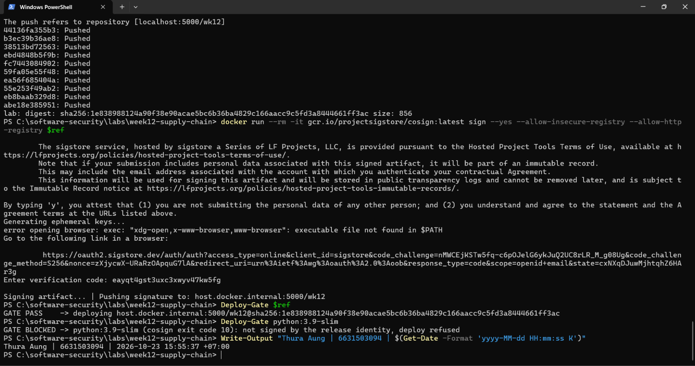

**It fails closed.** On my first run the local registry had been removed, so cosign couldn't even reach the signature (exit code 1). The gate **blocked my own signed image** instead of deploying it unchecked. A gate must treat "couldn't verify" the same as "not signed". In a real pipeline this check runs as a required CI step before the deploy step, using the image digest rather than a tag. In Kubernetes it would be an admission controller (e.g. Sigstore policy-controller or Kyverno `verifyImages`) that rejects any pod whose image isn't signed by the release workflow's identity.

#### Most effective defense: single trusted index

The single trusted index (through a curated proxy) is the one I found most effective, because it removes the **cause** of dependency confusion: the resolver comparing two indexes. Task 2 showed it: with the same `99.0.0` attacker version, switching only the mode flipped the verdict from "confused" to "safe". It protects every package, including new and transitive ones, with a single configuration change. Hash pinning only protects packages that are already in the lockfile, and name reservation only protects names you remembered to reserve. Hashes are still the best second layer, because they also catch a tampered file from the *trusted* index.

## Part 4 — Reflection

1. **Mapping:** table — finding | tool (`sca_scan.sh` / `sign.sh`) | OWASP 2025 id | CWE | fix.
2. **Real breach:** analyze the **XZ Utils backdoor (CVE-2024-3094)**. Which OWASP/CWE applies, and would an SBOM + signing + provenance gate have caught a maliciously-modified upstream dependency? (Compare with SolarWinds or Log4Shell if useful.)
3. **Best mitigation + SLSA self-assessment:** one paragraph — which SLSA level your defenses reach and why, and the single highest-leverage control for your team.

### 1. Mapping

| Finding | Tool | OWASP 2025 | CWE | Fix |
|---------|------|-----------|-----|-----|
| Flask 1.1.4: CVE-2023-30861, session cookie disclosed through caching proxies (HIGH) | `sca_scan.sh` (trivy fs + pip-audit) | A03 | CWE-1395 | Flask ≥ 3.1.3, upgraded together with its helpers |
| Werkzeug 1.0.1: CVE-2024-34069, debugger code execution (HIGH), plus 11 more advisories | `sca_scan.sh` | A03 | CWE-1395 | Werkzeug ≥ 3.1.9 |
| urllib3 1.26.4: CVE-2021-33503 ReDoS (HIGH), plus 10 more | `sca_scan.sh` | A03 | CWE-1395 | urllib3 ≥ 2.8.0, which also requires upgrading requests (2.25.1 caps urllib3 below 1.27) |
| Jinja2 2.11.3 and requests 2.25.1: Medium CVEs that Trivy's `HIGH,CRITICAL` filter hid | `sca_scan.sh` (pip-audit only) | A03 | CWE-1395 | Jinja2 ≥ 3.1.6, requests ≥ 2.33.0 |
| idna 2.10: transitive, **not in `requirements.txt`** (CVE-2024-3651) | `sca_scan.sh` (pip-audit only) | A03 | CWE-1395 | Fixed by the requests upgrade (idna 3.x); a lockfile pins transitive dependencies too |
| Old pins with no CVE (MarkupSafe, itsdangerous, click, PyYAML) and the end-of-life `python:3.9-slim` base | `requirements.txt` / `Dockerfile` review | A03 | CWE-1104 | Upgrade them as one set; switch the base to `python:3.12-slim` (the patched set needs Python ≥ 3.10, verified in Comprehension B) |
| Dependency confusion: merged index installs the public `99.0.0` | Resolver simulation (Task 2) | A03 | CWE-1357 / CWE-829 | Single `--index-url` or curated proxy; reserve internal names; hashes |
| No hashes: pip installs any file with the right name and version | `pip --require-hashes` (Task 4) | A08 | CWE-494 | Hash-pinned lockfile (`pip-compile --generate-hashes`) |
| Image deployed with no verifiable signature | `sign.sh` (cosign verify negative test) | A08 | CWE-345 | Keyless signing in CI plus a `cosign verify` gate before deploy |
| `sign.sh` verifies with `'.*'` identity and issuer, so it accepts **any** signer | `sign.sh` | A08 | CWE-347 | Pin `--certificate-identity` and `--certificate-oidc-issuer` (done in Tasks 3–4) |

### 2. Real breach: XZ Utils backdoor (CVE-2024-3094, CVSS 10.0)

**What happened.** An account called "Jia Tan" spent about two years (2021–2024) contributing to xz/liblzma, with help from sock-puppet accounts that pressured the overworked original maintainer. The account eventually became a co-maintainer. Releases **5.6.0 and 5.6.1** (Feb–Mar 2024) carried a backdoor:
- The payload was hidden in "test" files (corrupt `.xz` samples) that were in git.
- The trigger, a modified `build-to-host.m4`, existed **only in the release tarballs**, not in the git repository.
- At build time it injected code into liblzma. Some distributions patch `sshd` to link `libsystemd`, which links liblzma, so the backdoor ended up inside `sshd`. There it hooked RSA signature checking, so whoever held the attacker's Ed448 key could run commands before authentication.

Andres Freund found it on 29 March 2024, because SSH logins on Debian unstable were about 500 ms slower and valgrind reported errors. It had reached Debian testing/unstable, Fedora Rawhide/40 beta and openSUSE Tumbleweed, but not most stable releases.

**OWASP / CWE.** **A03 Software Supply Chain Failures** (a malicious upstream maintainer and component) and **A08 Software or Data Integrity Failures** (the shipped tarball didn't match the reviewed source). **CWE-506** (embedded malicious code) and **CWE-912** (hidden functionality).

**Would SBOM + signing + a provenance gate have caught it?** Mostly **no** for *prevention*, but they help with *response*:

| Control | Would it have stopped XZ? |
|---------|--------------------------|
| **Signing** | **No.** The 5.6.x tarballs were released by the attacker's own trusted maintainer account, so a signature check passes. Signing proves *who* published, and here the "who" was the attacker. |
| **SBOM** | **Not for prevention.** It would correctly list `xz-utils 5.6.1`, and nothing in it says "malicious". **But for response it's essential:** once the CVE was published, "where do we run 5.6.0/5.6.1?" becomes a query instead of a hunt. |
| **Provenance gate** | **Partly.** A gate that only accepts artifacts **built from the tagged git source** by a trusted builder would not have included the trigger, because the malicious `build-to-host.m4` existed only in the tarball. Diffing the tarball against git, or reproducible builds, would have exposed the extra file. But a maintainer this trusted could simply have committed it to git as well. |

**Comparison:**
- **SolarWinds (2020)** is the build-system version of the same problem. Attackers injected SUNBURST *during the build* of Orion, and the result was signed with SolarWinds' real certificate, so signing didn't help either. SLSA L3 (isolated, hardened builders) and reproducible builds are designed for that case.
- **Log4Shell (CVE-2021-44228)** was the opposite: no attacker in the supply chain, just a vulnerable component everywhere. That's where SBOM and SCA (Task 1) are the right controls.

**Lesson:** no single control stops a trusted maintainer who has turned malicious. XZ was caught by runtime anomaly detection and one curious engineer. So the right approach is defense in depth: verify that artifacts match their source, keep an SBOM so you can respond fast, and watch runtime behavior.

### 3. Best mitigation + SLSA self-assessment

My lab defenses are **SLSA Build L0, close to L1**. I have an SBOM, a keyless signature checked with a pinned identity, and a gate that blocks unsigned or unverifiable images. But I built and signed on **my own laptop**, I signed the **image**, not a SLSA **provenance attestation** describing how it was built, and the signing identity is **a person** (my school account), not a release pipeline. L1 needs a provenance record of the build, and L2 needs that provenance generated and signed by a **hosted** build platform. The **single highest-leverage control** for a team is to **move build, SBOM and signing into hosted CI** (e.g. GitHub Actions with its OIDC identity and `actions/attest-build-provenance`, or the `slsa-github-generator` reusable workflow for L3). Then gate deploys on that **workflow's** identity instead of a person's. That one change gets the team to L2. It means every later check trusts a reviewed pipeline rather than someone's laptop, and it closes the gap left by `sign.sh`'s `'.*'`. For dependency confusion specifically, the single trusted index from Task 4 remains the most effective control.

## Grading rubric (100)

| Criterion | Weight |
|-----------|--------|
| Lecture questions (Part 2) | 20 |
| Exploitation + evidence (Tasks 1–3: SCA findings, confusion proof, SBOM/verify) | 40 |
| Defense (Task 4: pinning/hashes, single index, scoping, provenance gate) | 25 |
| Reflection (Part 4: mapping, XZ breach, SLSA self-assessment) | 15 |
| **Total** | **100** |

---

## Evidence & Integrity (required)

- **Identity proof:** every screenshot/diagram must show a terminal running `printf '%s | %s | ' "$(whoami)" '<YOUR-STUDENT-ID>'; date '+%F %T %Z'` **in the
  same image as the evidence**. When the evidence is a browser page, a DevTools panel or a
  rendered response, put that terminal **beside the browser and capture the whole screen** — a
  cropped window carries nothing that identifies you, and the lab's own output is
  byte-identical for the whole cohort *by design*, so the stamp is the only thing that makes
  the shot yours. Generic or borrowed evidence is not accepted.
  *My stamp:* I worked in Windows PowerShell, where `printf`/`date '+%F'` don't exist, so every screenshot uses the PowerShell equivalent `Write-Output "Thura Aung | 6631503094 | $(Get-Date -Format 'yyyy-MM-dd HH:mm:ss K')"`. For browser evidence (Task 2) the PowerShell window is beside the browser in a full-screen capture.
- **Personalized flag (if this lab issues one):** N/A. Week 12 doesn't issue a flag; none of the lab files contain one.
  *Flags are unique per student — submitting another student's flag is a violation. How to submit: **learn.zcr.ai/submit** (full guide: `SUBMISSION.md` in the repo root).*
- **Explain in your own words** *(graded on your reasoning, not copied text):*
  1. What did you do, and **why did the vulnerability work**?

     I scanned the lab's `requirements.txt` with Trivy and pip-audit and found 33 known vulnerabilities in 6 packages. One of those packages, `idna`, isn't even listed in the file; `requests` pulls it in. The vulnerabilities are there because the project pins **old versions and never updates them**, so every bug fixed since those releases is still present, and the Dockerfile installs all of it into the image. In the simulation I showed dependency confusion. With `--extra-index-url`, pip treats the private and public indexes as one pool and installs the highest version number. So the attacker's public `99.0.0` beat our real `1.4.0`, and its install script would run on our build machine. pip trusts **names and version numbers**, not who published the package. Finally, before I signed it, nothing proved the image was the one we built.
  2. **Why does your fix actually stop it** — and what could still break it?

     - **Upgrading** to the patched set (Comprehension B) made pip-audit report `No known vulnerabilities found`, because the vulnerable code is no longer in the image.
     - A **single index** means pip never asks the public registry about our internal names, so the attacker's version is never even seen, whatever its number.
     - **Hashes** mean that even a file from the right index has to match its recorded fingerprint, or pip refuses it.
     - The **signature + gate** means only images signed by the expected identity get deployed, and anything that can't be verified is blocked. It even blocked my own image when the registry was missing.

     **What could still break it:**
     - New CVEs appear every week, so SCA has to keep running, not run once.
     - A trusted maintainer can turn malicious and publish a correctly signed bad release (XZ).
     - The proxy, CI pipeline or OIDC account could be compromised.
     - Someone could regenerate the lockfile without review.
     - Someone could copy lab shortcuts like `'.*'` or `--allow-http-registry` into a real pipeline.

---

## 🤖 Audit the AI (required)

AI is a power tool you must **distrust** — you are graded on your *critique*, not the AI's answer.

1. Ask an AI assistant to exploit **or** fix this week's vulnerability. Paste its full answer.
2. **Find what's wrong or risky** in it — insecure code, a subtly incomplete fix, a hallucinated API/function/CVE, a missed edge case, or wrong reasoning. Quote the exact line(s).
3. Produce the **correct, verified** version yourself and explain in 2–3 sentences why the AI's output was insufficient.

> Disclose your AI use in the Part 1 table. This task counts toward your **Defense + Reflection** score.

**AI used:** Claude (Anthropic), in VS Code. **What I asked:** to walk me through the fix for Task 3, signing and verifying the image (the A08 defense), step by step in PowerShell.

**1. The AI's answer (the parts that matter, quoted exactly):**

> **Step 3: put the image in a registry (needed before signing)** … push it to **ttl.sh** …
> ```powershell
> $name = "ttl.sh/wk12-$(New-Guid):24h"
> docker tag week12-supplychain:lab $name
> docker push $name
> $ref = docker inspect --format '{{index .RepoDigests 0}}' $name
> $ref
> ```
> "The last line should print something like `ttl.sh/wk12-3f2a…@sha256:9c1e…`. That's the exact image you'll sign."

> **Step 4: sign the image** …
> ```powershell
> docker run --rm gcr.io/projectsigstore/cosign:latest sign --yes --allow-insecure-registry $ref
> ```
> "It prints a line like this: `Enter the verification code ABCD-EFGH in your browser at: https://oauth2.sigstore.dev/auth/device?...` … **Copy that link into your browser.** Check that the code matches, choose **Google** or **Microsoft**, log in, and approve."

**2. What was wrong or risky (found by running it, not by reading it):**

| # | Exact line | What actually happened | Why it's wrong |
|---|-----------|------------------------|----------------|
| 1 | `$ref = docker inspect --format '{{index .RepoDigests 0}}' $name` | Printed `week12-supplychain@sha256:1e83…`, the **local** name, not a registry reference. | Docker Desktop's image store lists the local digest first. The AI *assumed* index 0 would be the registry digest. Signing that reference would have targeted an image that doesn't exist in any registry. |
| 2 | `cosign … sign --yes --allow-insecure-registry $ref` | `Error: … http: server gave HTTP response to HTTPS client` | `--allow-insecure-registry` only relaxes **TLS certificate checks**. Talking to a plain-HTTP registry needs `--allow-http-registry` too. |
| 3 | "Copy that link into your browser … log in, and approve" (no `-it`) | Sigstore's login page: **`Bad Request — Unregistered redirect_uri`** | Without a terminal, cosign switches to the **device flow**, which the public Sigstore server rejected. The AI described a login that couldn't work. |
| 4 | The later `Deploy-Gate` function keeps `--allow-insecure-registry --allow-http-registry` | Worked, but only because the registry was `localhost`. | **Risky:** the gate is exactly the code someone would copy into a real CI pipeline, and there these flags would fetch images and signatures **without TLS** (open to man-in-the-middle). The AI warned about this once for signing, but not on the gate. |

**3. Correct, verified version** (run successfully in Tasks 3–4; screenshots `task3-verify.png`, `task4-gate.png`):
```powershell
docker run -d --name wk12reg -p 5000:5000 registry:2          # registry I control (ttl.sh kept timing out)
docker tag week12-supplychain:lab localhost:5000/wk12:lab
$digest = (docker push localhost:5000/wk12:lab | Select-String 'digest: (sha256:[0-9a-f]+)').Matches[0].Groups[1].Value
$ref = "host.docker.internal:5000/wk12@$digest"               # digest taken from the registry's own reply
docker run --rm -it gcr.io/projectsigstore/cosign:latest sign --yes --allow-insecure-registry --allow-http-registry $ref   # -it = paste-a-code login
docker run --rm gcr.io/projectsigstore/cosign:latest verify --allow-insecure-registry --allow-http-registry --certificate-identity 6631503094@lamduan.mfu.ac.th --certificate-oidc-issuer https://accounts.google.com $ref
```
In a real pipeline, the gate has to drop both `--allow-*` flags and pin the **CI workflow's** identity instead of a person. This is the production form; I didn't run it in this lab:
```
cosign verify --certificate-identity https://github.com/<org>/<repo>/.github/workflows/release.yml@refs/heads/main --certificate-oidc-issuer https://token.actions.githubusercontent.com registry.example.com/app@sha256:<digest>
```

**Why the AI's output was insufficient:** Every command looked plausible, but three of them failed or gave the wrong result the first time I ran them. One of them (the wrong `$ref`) would have failed quietly, by pointing cosign at the wrong image, rather than with an obvious error. The AI also carried lab-only TLS shortcuts into the gate without a warning. That's the most dangerous piece to get wrong, because it's the piece that decides what gets deployed. I only found these problems by running each command and checking its real output against what the AI said I would see.

---

## 🧠 Comprehension & Prompt (required)

**A. Explain in Plain English (EiPE).** In 2–3 sentences, in your own words, describe what this week's vulnerable code/endpoint actually *does* and *why it is exploitable* — explain the mechanism, don't dump jargon.

The lab's `requirements.txt` tells pip to install exact, years-old versions of Flask and the libraries around it, and the Dockerfile builds them into the image. The app therefore ships with dozens of bugs that were fixed and published long ago, and anyone can read the CVE list to learn how to attack them. On top of that, pip decides what to install by **package name and version number**, not by who published it. If it's allowed to look at two indexes, it takes the highest number, so an attacker who uploads our internal package name with a bigger version gets their code run on our build machine. And without a signature, a deploy can't tell our real image from a swapped one.

**B. Prompt Problem.** Write a **single prompt** that makes an AI produce a *correct, secure* fix for one finding. Run it: does the exploit now fail? If not, refine the prompt and try again. Submit the **final prompt + the verified result**.
*Graded on the prompt's precision and your verification — this trains problem decomposition and AI literacy (Denny et al. 2024).*

**Finding fixed:** the vulnerable dependency set from Task 1 (pip-audit: 33 known vulnerabilities in 6 packages, including the transitive `idna`).

**Final prompt:**
> You are fixing a Python supply-chain finding. Context: `requirements.txt` pins `Flask==1.1.4, Werkzeug==1.0.1, Jinja2==2.11.3, MarkupSafe==2.0.1, itsdangerous==1.1.0, click==7.1.2, requests==2.25.1, urllib3==1.26.4, PyYAML==5.4.1`. `pip-audit -r requirements.txt` reports 33 known vulnerabilities in 6 packages, including the transitive dependency `idna 2.10`. `app.py` only uses `from flask import Flask, jsonify` and serves two JSON routes, `/` and `/health`. The Dockerfile is `FROM python:3.9-slim`.
> Produce: **(1)** a new requirements file that pins **every direct and transitive** dependency with `==` to a release that has **no known vulnerability** in the PyPA/OSV advisory database; **(2)** any Dockerfile change that's needed. Check each pinned package's `Requires-Python` against the base image's Python version, and change the base image if they don't match; **(3)** the exact commands to verify the fix: `pip-audit -r` on the new file must print `No known vulnerabilities found`, and `/` and `/health` must still return HTTP 200.
> Rules: don't make up version numbers (resolve them with pip, or say you're unsure); don't use `--extra-index-url`; don't change the app's behavior.

**How the prompt was refined:** the first result resolved current versions on Python 3.12. When I tested those pins against the lab's `python:3.9-slim`, pip refused: `ERROR: Could not find a version that satisfies the requirement click==8.5.0` because `8.5.0 Requires-Python >=3.10`. So the final prompt explicitly asks the AI to check `Requires-Python` against the base image and change the Dockerfile if needed. Bumping the pins alone would have broken the Docker build.

**Verified result** (produced with Claude, then verified by running it in Docker on 2026-10-23):

`requirements.txt` (fixed):
```
blinker==1.9.0
certifi==2026.10.19
charset-normalizer==3.5.2
click==8.5.0
Flask==3.1.3
idna==3.20
itsdangerous==2.2.0
Jinja2==3.1.6
MarkupSafe==3.0.4
PyYAML==6.0.3
requests==2.34.2
urllib3==2.8.0
Werkzeug==3.1.9
```
`Dockerfile` change: `FROM python:3.9-slim` → `FROM python:3.12-slim`. Python 3.9 is end-of-life, and `click 8.5.0` needs Python ≥ 3.10.

Verification output:
```
=== pip-audit ===
No known vulnerabilities found
=== app smoke test ===
/ 200 {'note': 'supply-chain SCA lab target', 'status': 'ok'}
/health 200 {'healthy': True}
```
The "exploit" here is the SCA finding list, and it now fails: **33 vulnerabilities → 0**, and the app still works unchanged. The lab's own `requirements.txt` was left as it is on purpose, because it's the deliberately vulnerable exercise material. The next step would be to add hashes to this file with `pip-compile --generate-hashes` (Task 4).
