# Worksheet 13 — Cloud & Container Security (4 hrs)

> **Course:** Software Security (KOSEN69) · Week 13
> **Aligned to:** OWASP 2025 **A02 Security Misconfiguration** · **CWE-732** (incorrect permission assignment), **CWE-16** (configuration), plus CWE-798, CWE-250, CWE-538, CWE-269, CWE-1104
> **Signature game:** 🔍 *Misconfig Hunt* (CloudGoat-style) — each misconfig you find **and** fix = a flag.

> ⚠️ **Ethics note:** All artifacts here are deliberately broken for teaching and are marked *"Sandbox/teaching only; for authorized lab use."* Scan, exploit, and harden **only** these lab files (or systems you own / are authorized to test). Never point Trivy or these techniques at third-party cloud accounts or images without written permission.

---

## Part 1 — Student Information

| Name | Student ID | Date | Group | AI Tool |
|------|-----------|------|-------|---------|
| Thura Aung | 6631503094 | 24.October.2026 | - | ChatGPT, Claude (VS Code) |

---

## Part 2 — Lecture Questions

Answer in your own words (2–4 sentences each).

1. Explain the **shared-responsibility model**. In `harden.md` it says "the cloud provider secures *of* the cloud; you secure what you put *in* it." Give one concrete example of each side for an S3-backed app.

Under the shared-responsibility model, the cloud provider and the customer each secure a different part of the system. The provider secures the cloud itself: data centres, hardware, network, hypervisor and the S3 service software. For example, AWS patches the servers that store our objects and keeps the storage durable. The customer secures everything they put *in* the cloud: bucket access settings, IAM roles, encryption-key choices, app code and container images. For example, if we make the bucket public or attach `iam-policy-insecure.json` to the app's role and data leaks, that is our failure, not AWS's. Most real cloud breaches (public S3 buckets, Capital One 2019) happen on the customer side.

2. `iam-policy-insecure.json` uses `"Action": "*"` and `"Resource": "*"`. Describe **why this violates least privilege** and map it to CWE-732 vs CWE-269 — what is the difference between the two CWEs here?

Least privilege means granting only the actions a principal needs, on only the resources it needs. The app only reads objects under `lab-app-bucket/app/*`, but `Action:*` + `Resource:*` with no `Condition` is effectively full admin. If these credentials leak, an attacker can read or delete every bucket, create new IAM users and keys for persistence, launch EC2 instances for crypto-mining and turn off CloudTrail.
- **CWE-269 (Improper Privilege Management) → `"Action": "*"`**: the identity is given more privilege than it needs. It can perform any action, including `iam:*`, so it can even grant itself more rights.
- **CWE-732 (Incorrect Permission Assignment for Critical Resource) → `"Resource": "*"` + no `Condition`**: on the resource side, every critical resource (all buckets, keys, logs) is opened to this role instead of a single bucket prefix.

In short, CWE-269 is about *what the actor may do*, and CWE-732 is about *which resources are exposed*. `iam-policy-leastpriv.json` fixes both: it allows only `s3:GetObject`/`s3:ListBucket`, only on `lab-app-bucket`, with an `s3:prefix` = `app/*` condition.

3. The insecure Dockerfile bakes `ENV API_TOKEN=sk_live_...`. Explain how an attacker recovers that secret from a shipped image (name the `docker` commands) and why this is **CWE-798 / CWE-200**.

`ENV` values are stored in the image's config and history metadata, so anyone who can pull the image can read them without running the app. `docker history --no-trunc <image>` shows the `ENV API_TOKEN=sk_live_...` instruction, and `docker inspect --format '{{.Config.Env}}' <image>` prints the variables in plain text. `docker run --rm <image> env` or `docker save <image>` (then reading the config JSON inside the tar) works too. Removing the variable in a later layer does not help, because earlier layers and the history stay in the image. This is **CWE-798** because the credential is hard-coded into the build artifact: every copy carries the same token, and it can't be rotated without a rebuild. It is **CWE-200** because pushing the image to a registry, CI cache or customer exposes the secret to people who should never see it. The fix is to inject secrets at runtime (secrets manager or mounted secret) and to rotate the leaked token.

4. Why is `FROM python:latest` (CWE-1104/CWE-16) a security and reproducibility problem, and how does pinning to an `@sha256:` digest fix it?

`latest` is a mutable tag, not a version. The image behind it changes whenever upstream pushes, so next week's build can get a different Python version (e.g., 3.14 → 3.15) and a different Debian base. For reproducibility, the image you tested and scanned is not necessarily the one you deploy, and builds can break with no change to your code. For security, you cannot tell which packages and CVEs you are shipping. If the tag is re-pointed (for example after a compromised publisher account), you silently pull the new image. It is also the full image, with compilers and many extra packages, so the attack surface is large. Trivy flags this as **DS-0001**. An `@sha256:` digest is the hash of the image manifest, so it is immutable: Docker rejects content that doesn't match, and every build uses exactly the bytes that were reviewed and scanned. The trade-off is that you no longer get updates automatically, so you refresh the digest on purpose (e.g., with Renovate or Dependabot) and re-scan.

5. What does a **distroless** base image remove (relative to `python:3.11-slim`), and how does that shrink the attack surface for an RCE or container-escape attacker?

A distroless image keeps only what the app needs to run: the Python interpreter, glibc, CA certificates, tzdata and a `nonroot` user. Compared with `python:3.11-slim`, it removes the shell (`/bin/sh`, `bash`), the package manager (`apt`, `dpkg`), coreutils (`ls`, `cat`, `chmod`, …) and other Debian tools. An attacker who gets RCE therefore has no shell to spawn (`os.system` and `shell=True` calls fail), no `apt-get` to install tools, and far fewer built-in binaries to explore or escape with. Fewer packages also means fewer CVEs to exploit. Together with `USER 65532:65532`, the process is not root, which makes container-escape exploits that need root much harder. Distroless is not complete protection: the Python interpreter is still there, so runtime flags such as `--read-only` and `--cap-drop ALL` are still needed.

---

## Part 3 — Hands-on Lab (180 min)

**Learning goals:** find cloud/container misconfigurations with Trivy, map each to a CWE, and rebuild the IAM policy + Dockerfile to least privilege / hardened so the findings drop.

**Prerequisites:** Docker installed and running; the `week13-cloud-container/` lab folder; internet access to pull `aquasec/trivy:latest`.

### Environment setup (real commands)

```bash
cd labs/week13-cloud-container

# Option A — the provided wrapper (trivy config over the Dockerfiles; IAM JSON is reviewed manually, see Task 2):
bash scan.sh

# Option B — run Trivy directly (MEDIUM is in the filter on purpose: one of the
# three rules Task 1 asks you to cite is rated MEDIUM, and HIGH,CRITICAL hides it):
docker run --rm -v "$PWD:/src" aquasec/trivy:latest config --severity MEDIUM,HIGH,CRITICAL /src

# (Optional) build + CVE-scan the hardened image:
docker build -f Dockerfile.hardened -t week13-hardened:lab .
docker run --rm -v /var/run/docker.sock:/var/run/docker.sock aquasec/trivy:latest image --severity HIGH,CRITICAL week13-hardened:lab
```

**What to submit per task:** the command(s) you ran + the relevant output (finding count or the specific finding line), a screenshot of the Trivy/terminal result, and a 2–3 sentence mitigation explaining *why* the fix reduces risk (cite the CWE).


### Task 0 — Onboarding (15 min)
Confirm Docker works (`docker version`), run `bash scan.sh`, and record the **baseline finding count** against `Dockerfile.insecure` (Trivy's `config` scanner does not parse standalone IAM policy JSON, so `iam-policy-insecure.json` is reviewed manually instead — see Task 2). **Deliverable:** screenshot of the baseline scan.

**Command (PowerShell):**
```powershell
cd C:\software-security\labs\week13-cloud-container
Write-Output "$(whoami) | Thura Aung | 6631503094 | $(Get-Date -Format 'yyyy-MM-dd HH:mm:ss K')"
docker version
docker run --rm -v "${PWD}:/src" aquasec/trivy:latest config --severity MEDIUM,HIGH,CRITICAL /src
```

I ran Trivy directly (Option B) instead of `bash scan.sh`. It is the same `trivy config` command the script runs. On Windows, `bash` in PowerShell opens WSL, and in Git Bash the script fails unless you set `MSYS_NO_PATHCONV=1`, because Git Bash rewrites `/src` to `C:/Program Files/Git/src`.

**Docker check:** Docker Desktop 4.86.0, Engine 29.7.2. Both the Client and Server sections respond, so the daemon is running.

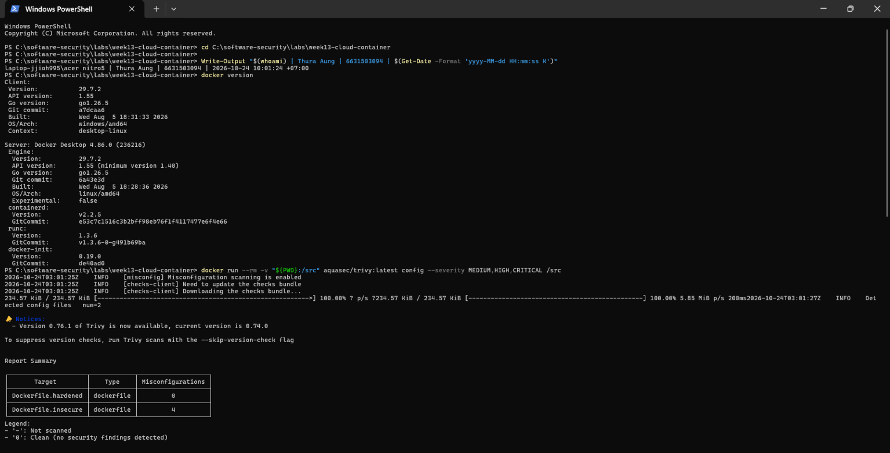

**Baseline scan result:**

| Target | Misconfigurations |
|--------|:-----------------:|
| `Dockerfile.insecure` | **4** (MEDIUM 1, HIGH 1, CRITICAL 2) |
| `Dockerfile.hardened` | 0 |

| Rule | Severity | Line | Finding |
|------|----------|:----:|---------|
| DS-0001 | MEDIUM | 11 | `FROM python:latest`, no pinned tag |
| DS-0002 | HIGH | — | No `USER` directive, so the container runs as root |
| DS-0031 | CRITICAL | 16 | Secret `API_TOKEN` in `ENV` |
| DS-0031 | CRITICAL | 17 | Secret `AWS_SECRET_ACCESS_KEY` in `ENV` |

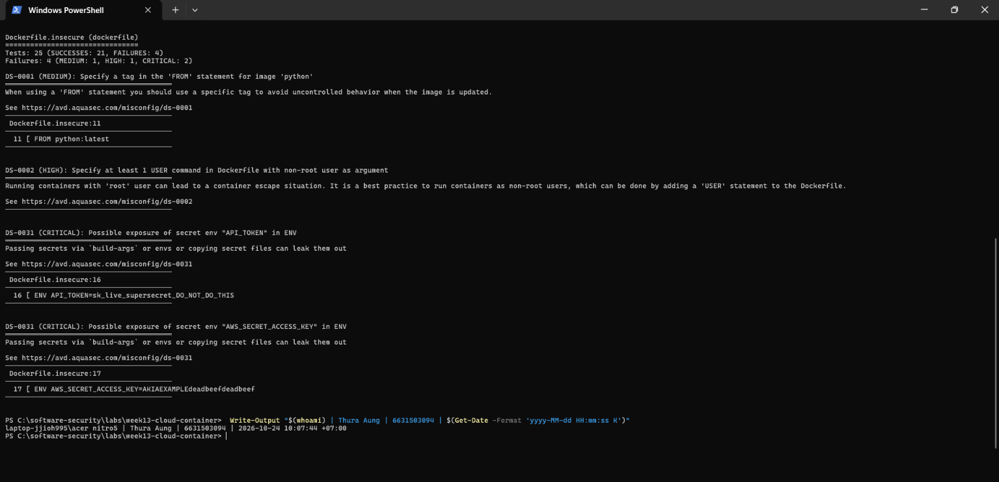

**Baseline finding count: 4.** These 4 findings cover only 3 of the 6 planted defects, because DS-0031 fires once for each secret. The other 3 (`COPY . .`, `chmod -R 777`, unpinned `pip install`) have no Trivy rule, so I find them by code review in Task 1. The IAM JSON files are not scanned; I review them manually in Task 2.

### Task 1 — Misconfig Hunt: container image (40 min)
*Goal:* find every defect in `Dockerfile.insecure`. *Steps:* read each `# DEFECT:` comment, then locate the matching Trivy finding where one exists — only 3 of the 6 (unpinned `:latest`, runs as root, secrets in `ENV`) map to a Trivy config rule (`DS-0001`, `DS-0002`, `DS-0031`); `COPY . .`, `chmod -R 777`, and unpinned `pip install` are instruction-level RUN/COPY semantics Trivy's Dockerfile scanner doesn't check, so identify those 3 by code review instead. Build a table: defect → CWE → Trivy rule/severity (write "manual review — no Trivy rule" where none exists). *Deliverable:* completed table (6 rows) using the IDs from `harden.md`.

**Commands (PowerShell):**
```powershell
# Code review: Dockerfile.insecure with line numbers
Write-Output "$(whoami) | Thura Aung | 6631503094 | $(Get-Date -Format 'yyyy-MM-dd HH:mm:ss K')"
$n=0; Get-Content .\Dockerfile.insecure -Encoding UTF8 | ForEach-Object { $n++; '{0,3}  {1}' -f $n, $_ }

# Trivy at ALL severities (no --severity filter), rule lines only
Write-Output "$(whoami) | Thura Aung | 6631503094 | $(Get-Date -Format 'yyyy-MM-dd HH:mm:ss K')"
docker run --rm -v "${PWD}:/src" aquasec/trivy:latest config -q --skip-version-check /src | Select-String '^DS-|Failures:'
```

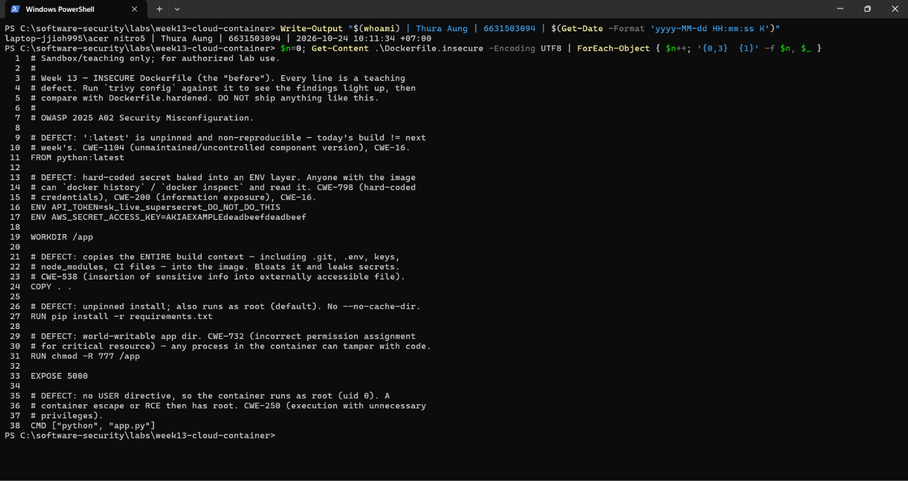

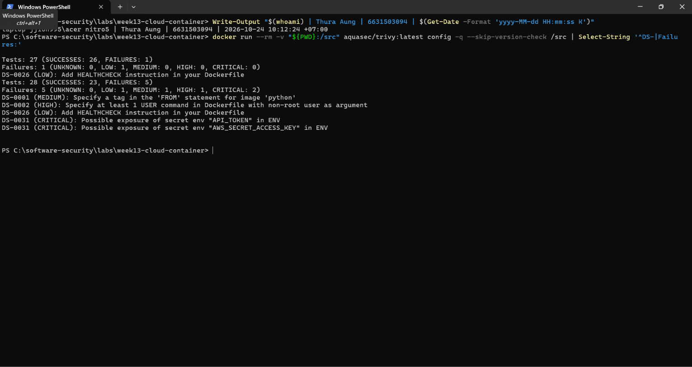

| # | Defect (line in `Dockerfile.insecure`) | CWE | Trivy rule / severity |
|---|----------------------------------------|-----|-----------------------|
| 1 | `FROM python:latest`: unpinned, mutable tag (L11) | CWE-1104 / CWE-16 | **DS-0001 / MEDIUM** |
| 2 | `ENV API_TOKEN=...` and `ENV AWS_SECRET_ACCESS_KEY=...`: secrets baked into the image (L16–17) | CWE-798 / CWE-200 | **DS-0031 / CRITICAL** (fires twice, once per variable) |
| 3 | `COPY . .`: copies the whole build context, and the folder has no `.dockerignore` (L24) | CWE-538 | manual review — no Trivy rule |
| 4 | `chmod -R 777 /app`: app code is world-writable (L31) | CWE-732 | manual review — no Trivy rule |
| 5 | No `USER` directive, so `CMD` runs as root, uid 0 (L38) | CWE-250 | **DS-0002 / HIGH** |
| 6 | `pip install -r requirements.txt`: unpinned, because `requirements.txt` only says `Flask>=3.1.3` with no transitive pins or hashes (L27) | CWE-1104 | manual review — no Trivy rule |

**Result:** Trivy's 4 findings cover defects 1, 2 and 5. Even with no severity filter, no rule fires for defects 3, 4 and 6. The only extra finding is DS-0026 (LOW, no `HEALTHCHECK`), which is not one of the six. Trivy's Dockerfile checks look at instructions like `FROM`, `USER` and `ENV`. They don't check what a `COPY` pulls in, what a `RUN chmod` does, or whether a requirements file is pinned. A clean `trivy config` result therefore does not mean a clean Dockerfile; code review is still needed.

**Mitigation:** Each fix removes the risk instead of just hiding the warning. Pinning the base image by digest (CWE-1104) and the dependencies with hashes makes the build reproducible. Removing the secrets from `ENV` (CWE-798) means the image no longer carries credentials. Copying only `app.py` with a `.dockerignore` (CWE-538) stops `.git` and `.env` files from leaking into the image. Normal file permissions plus `USER 65532` (CWE-732 / CWE-250) mean an attacker who gets RCE is not root and cannot rewrite the app code.

### Task 2 — Misconfig Hunt: IAM (30 min)
*Goal:* document why `iam-policy-insecure.json` is full-admin. *Steps:* identify the `Action:*` / `Resource:*` / no-`Condition` problems; map to CWE-269 / CWE-732. *Deliverable:* 3-row table + one sentence on the blast radius if these creds leak.

**Commands (PowerShell):** Trivy's `config` scanner does not parse standalone IAM JSON (Task 0 showed `Detected config files num=2`, which are only the two Dockerfiles), so I reviewed the policy manually.
```powershell
Write-Output "$(whoami) | Thura Aung | 6631503094 | $(Get-Date -Format 'yyyy-MM-dd HH:mm:ss K')"
# The policy with line numbers
$n=0; Get-Content .\iam-policy-insecure.json -Encoding UTF8 | ForEach-Object { $n++; '{0,3}  {1}' -f $n, $_ }
# The parsed statement; shows explicitly that there is no Condition
(Get-Content .\iam-policy-insecure.json -Raw -Encoding UTF8 | ConvertFrom-Json).Statement | Select-Object Sid, Effect, Action, Resource, @{n='Condition';e={ if ($_.Condition) { 'present' } else { '(none)' } }} | Format-List
```

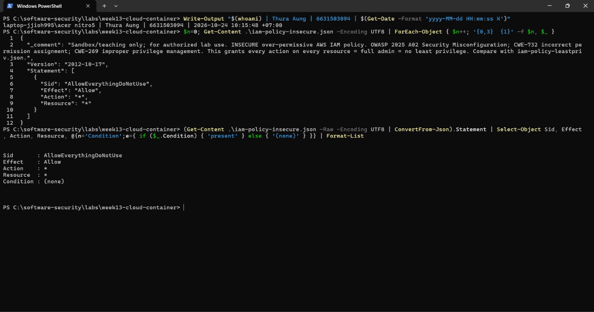

The policy has a single statement, `"Effect": "Allow", "Action": "*", "Resource": "*"`. That is the same document as AWS's managed **AdministratorAccess** policy, so the app's role is a full account admin, even though the app only needs to read objects under `lab-app-bucket/app/*`.

| # | Misconfiguration (line) | CWE | Why it is wrong | Fix (`harden.md`) |
|---|-------------------------|-----|-----------------|-------------------|
| 7 | `"Action": "*"` (L8) | CWE-269 Improper Privilege Management | Allows every API action in every AWS service, including `iam:*`, so the role can create users and keys or attach more policies to itself (privilege escalation). | List only the actions the app uses: `s3:GetObject` (+ `s3:ListBucket`) |
| 8 | `"Resource": "*"` (L9) | CWE-732 Incorrect Permission Assignment for Critical Resource | Applies to every resource in the account (all S3 buckets, KMS keys, CloudTrail logs, EC2), not just the app's bucket. | Scope to exact ARNs: `arn:aws:s3:::lab-app-bucket/app/*` |
| 9 | No `Condition` block (statement L5–10) | CWE-732 | No limits on how the permission is used: no prefix restriction, no source IP/VPC, no MFA. Stolen keys work from anywhere on the internet. | Add a `Condition`, e.g. `s3:prefix` = `app/*` (+ source IP/VPC or MFA where possible) |

**Blast radius:** if these credentials leak, for example through the `AWS_SECRET_ACCESS_KEY` baked into `Dockerfile.insecure` (Task 1, defect #2), the attacker gets full admin of the whole AWS account. They can read or delete every S3 bucket, create IAM users and access keys for persistence, launch EC2 instances for crypto-mining, and delete CloudTrail logs to hide what they did.

**Mitigation:** Least privilege does not stop credentials from leaking, but it limits what a leak can do. With `iam-policy-leastpriv.json`, the same stolen key can only read `app/*` objects in one bucket instead of controlling the whole account (CWE-269 / CWE-732). Removing `"Action": "*"` also removes `iam:*`, so the attacker cannot give themselves more rights.

### Task 3 — Secrets & storage (25 min)
*Goal:* show secrets must not live in the image. *Steps:* explain how `ENV API_TOKEN` / `AWS_SECRET_ACCESS_KEY` are exposed via `docker history`; propose where they belong instead (secrets manager / mounted secret / orchestrator secret per `harden.md`). *Deliverable:* 2–3 sentence remediation + the `.dockerignore` entries you would add to stop `COPY . .` leaking `.git`/`.env` (CWE-538).

**Commands (PowerShell):**
```powershell
# Build the insecure image (Docker itself warns: SecretsUsedInArgOrEnv, lines 16 and 17)
docker build -f Dockerfile.insecure -t week13-insecure:lab .

# 1) Recover the secrets from the image, without any exploit
Write-Output "$(whoami) | Thura Aung | 6631503094 | $(Get-Date -Format 'yyyy-MM-dd HH:mm:ss K')"
docker history --no-trunc --format '{{.CreatedBy}}' week13-insecure:lab | Select-String 'API_TOKEN|AWS_SECRET'
docker inspect --format '{{json .Config.Env}}' week13-insecure:lab
docker run --rm week13-insecure:lab env | Select-String 'API_TOKEN|AWS_SECRET'

# 2) See what COPY . . put into the image
Write-Output "$(whoami) | Thura Aung | 6631503094 | $(Get-Date -Format 'yyyy-MM-dd HH:mm:ss K')"
docker run --rm week13-insecure:lab sh -c "id; ls -la /app"
```

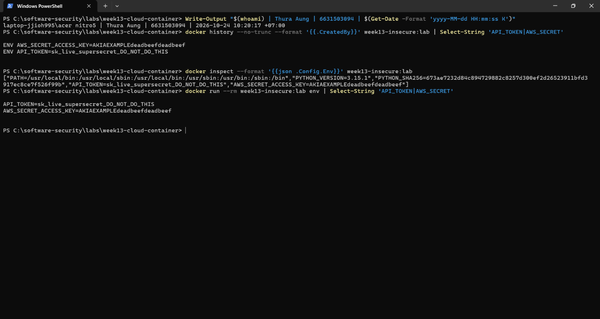

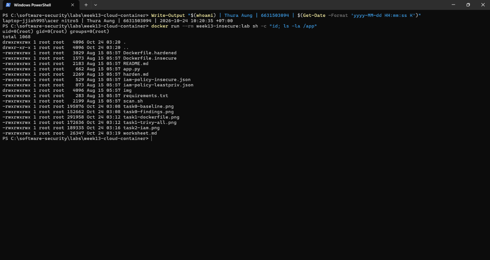

**How the secrets leak:** `ENV` values are saved in the image's config and build history, so anyone who can pull the image gets them, with no exploit and no access to a running container needed:
- `docker history --no-trunc` shows the build instructions `ENV API_TOKEN=sk_live_...` and `ENV AWS_SECRET_ACCESS_KEY=AKIA...`.
- `docker inspect` shows them in `Config.Env`.
- `docker run ... env` prints them inside the container.

Overwriting or unsetting the variable in a later layer does not help, because the original instruction stays in the history. Once the image has been pushed anywhere, the secrets must be treated as leaked and **rotated** (CWE-798 hard-coded credential, CWE-200 exposure).

**`COPY . .` leak:** `ls -la /app` shows that the whole build context was copied in: both Dockerfiles, the IAM policies, `scan.sh`, my `worksheet.md`, and all five screenshots with my identity stamp. Every file is `rwxrwxrwx` and the process runs as `uid=0(root)`, which confirms defects #3, #4 and #5 from Task 1. In a real project the same line would also copy `.git` (the full history, including secrets that were "deleted") and `.env`.

**Remediation (where secrets belong):** Secrets should be supplied at **runtime**, never at build time. Keep them in a secrets manager (AWS Secrets Manager / SSM Parameter Store, Vault) and have the app read them, or let the orchestrator mount them as a file (a Kubernetes Secret or Docker secret at `/run/secrets/api_token`). For AWS, don't use access keys at all: give the container an **IAM role** (ECS task role, EKS IRSA, EC2 instance profile) so it gets short-lived credentials automatically. If a secret is needed *during* the build, use `RUN --mount=type=secret` so it never lands in a layer.

**`.dockerignore` (CWE-538):** the best option is an allowlist. Deny everything, then allow only what the image needs:
```
# Deny everything by default...
*
# ...then allow only what the image needs
!app.py
!requirements.txt
```
If a denylist is used instead, it needs at least these entries. The `**/` prefix matters, because a bare `.env` only matches the top-level folder:
```
**/.git
**/.gitignore
**/.env
**/.env.*
**/*.pem
**/*.key
**/id_rsa*
**/.aws
**/*.md
**/*.png
**/*.pdf
**/Dockerfile*
**/.dockerignore
**/__pycache__
**/.venv
```
I tested both on a copy of the lab folder with a fake `.git/`, `.env` and `keys/deploy.pem` added. The denylist kept those out, but it still let through files nobody had listed (the IAM JSON, `scan.sh`, `img/`). The allowlist left only `app.py` and `requirements.txt`. That is why the allowlist is safer: a file you forget about stays out instead of leaking in. `Dockerfile.hardened` goes one step further and copies only `app.py` by name.

### Task 4 — Hardened-Dockerfile + least-priv-IAM defense (50 min)
*Goal:* prove the "after" is clean. *Steps:* (a) re-run `bash scan.sh` (or `trivy config`) against `Dockerfile.hardened` and capture the **reduced** finding count (Trivy's config scanner does not parse standalone IAM JSON, so confirm the IAM fix manually per Task 2 by diffing `iam-policy-leastpriv.json` against the insecure policy); (b) for the Dockerfile, point to the fix for each Task-1 defect (digest pin, multi-stage venv, distroless runtime, `USER 65532:65532`, no secrets in `ENV`, copy only `app.py`); (c) for IAM, confirm the rewrite scopes `s3:GetObject` to `arn:aws:s3:::lab-app-bucket/app/*` and adds the `s3:prefix` `Condition`; (d) list the extra runtime flags from `harden.md` (`--read-only`, `--cap-drop ALL`, `--security-opt no-new-privileges`). *Deliverable:* before/after finding counts, the defect→fix mapping, and the diffed policy/Dockerfile with one sentence per fix.

**Commands (PowerShell):**
```powershell
docker build -f Dockerfile.hardened -t week13-hardened:lab .

# (a) Before/after: image sizes + trivy config on both Dockerfiles
Write-Output "$(whoami) | Thura Aung | 6631503094 | $(Get-Date -Format 'yyyy-MM-dd HH:mm:ss K')"
docker images --format '{{.Repository}}:{{.Tag}}  {{.Size}}' | Select-String 'week13'
docker run --rm -v "${PWD}:/src" aquasec/trivy:latest config -q --skip-version-check --severity MEDIUM,HIGH,CRITICAL /src

# (b) Check the hardened image + run it with the runtime flags from harden.md
Write-Output "$(whoami) | Thura Aung | 6631503094 | $(Get-Date -Format 'yyyy-MM-dd HH:mm:ss K')"
docker inspect --format 'User={{.Config.User}}' week13-hardened:lab
docker inspect --format '{{json .Config.Env}}' week13-hardened:lab
docker history --no-trunc --format '{{.CreatedBy}}' week13-hardened:lab | Select-String 'API_TOKEN|AWS_SECRET'
docker run --rm --entrypoint sh week13-hardened:lab -c id
docker run --rm week13-hardened:lab -c "import os; print('uid', os.getuid()); print(oct(os.stat('/app/app.py').st_mode & 0o777), 'app.py writable:', os.access('/app/app.py', os.W_OK))"
docker run -d --name w13-hardened -p 5013:5000 --read-only --cap-drop ALL --security-opt no-new-privileges --memory 256m --pids-limit 100 week13-hardened:lab
Start-Sleep 3; Invoke-RestMethod http://localhost:5013/health
docker inspect --format 'ReadOnly={{.HostConfig.ReadonlyRootfs}} CapDrop={{.HostConfig.CapDrop}} SecOpt={{.HostConfig.SecurityOpt}} Mem={{.HostConfig.Memory}} Pids={{.HostConfig.PidsLimit}}' w13-hardened
docker rm -f w13-hardened

# (c) IAM: diff the insecure policy against the least-privilege rewrite
Write-Output "$(whoami) | Thura Aung | 6631503094 | $(Get-Date -Format 'yyyy-MM-dd HH:mm:ss K')"
git --no-pager diff --no-index iam-policy-insecure.json iam-policy-leastpriv.json

# Extra: CVE + secret scan of both built images
Write-Output "$(whoami) | Thura Aung | 6631503094 | $(Get-Date -Format 'yyyy-MM-dd HH:mm:ss K')"
foreach ($img in 'week13-insecure:lab','week13-hardened:lab') { "=== $img"; docker run --rm -v /var/run/docker.sock:/var/run/docker.sock -v trivy-cache:/root/.cache/trivy aquasec/trivy:latest image -q --skip-version-check --severity HIGH,CRITICAL $img | Select-String '^Total:|^[^\s│].*\((debian \S+|python-pkg|secrets)\)\s*$' }
```

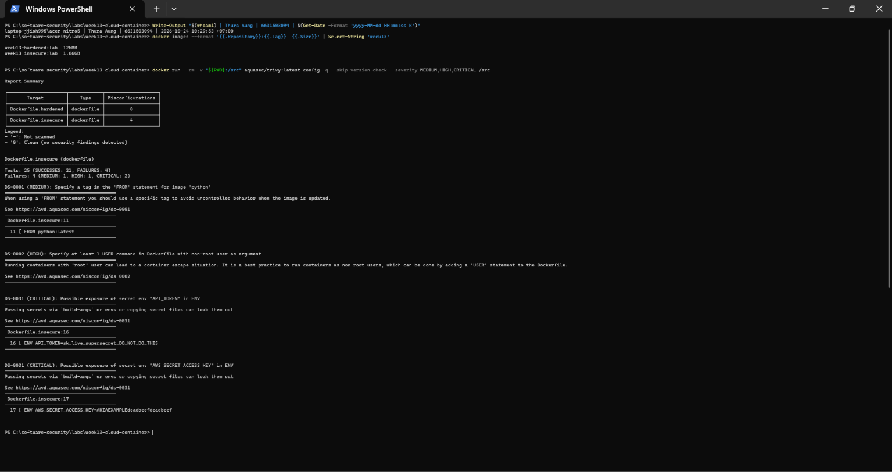

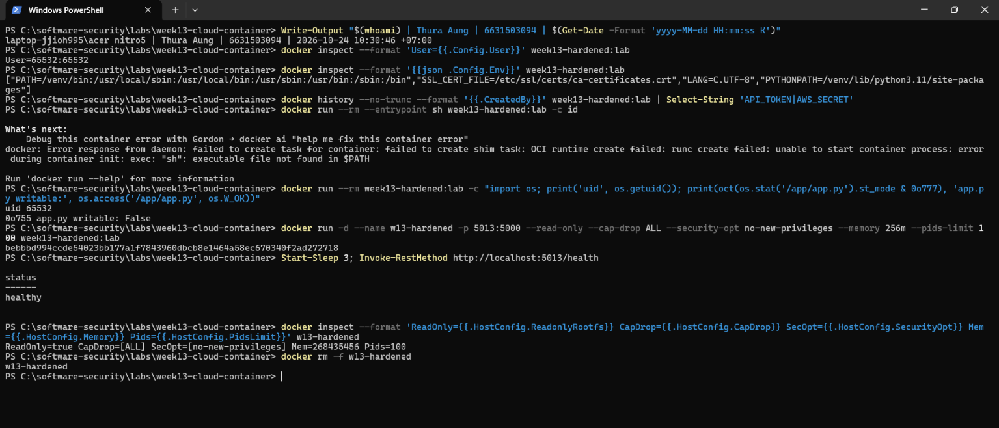

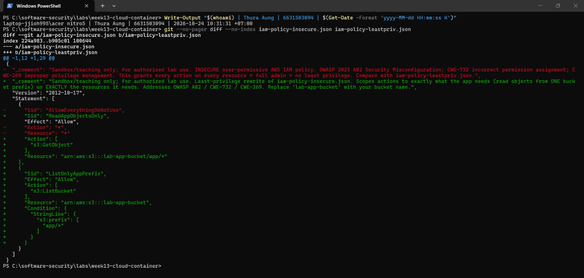

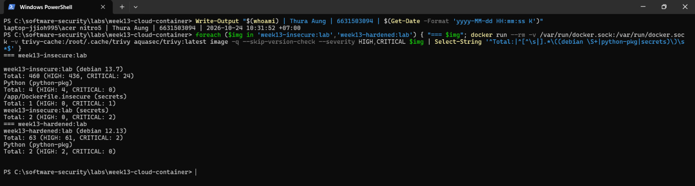

#### (a) Before / after

| Check | `Dockerfile.insecure` | `Dockerfile.hardened` |
|-------|:---------------------:|:---------------------:|
| `trivy config` (MEDIUM, HIGH, CRITICAL) | **4** | **0** |
| `trivy config` (all severities) | 5 | 1 (only DS-0026, LOW: no `HEALTHCHECK`) |
| `trivy image` OS CVEs (HIGH/CRITICAL) | 460 (436 H / 24 C), Debian 13.7 | 63 (61 H / 2 C), Debian 12.13 |
| `trivy image` Python-package CVEs (HIGH/CRITICAL) | 4 | 2 |
| `trivy image` secrets found | 3 CRITICAL (`API_TOKEN` in the image config ×2, and in `/app/Dockerfile.insecure` copied by `COPY . .`) | 0 |
| Image size | 1.66 GB | 125 MB |
| Runs as | `uid=0(root)` | `65532:65532` |
| Shell in image | yes | none (`exec: "sh": executable file not found`) |

#### (b) Defect → fix mapping (`Dockerfile.insecure` → `Dockerfile.hardened`)

| # | Defect | Fix in `Dockerfile.hardened` | Why it reduces risk |
|---|--------|------------------------------|---------------------|
| 1 | `FROM python:latest` | L15 `python:3.11-slim@sha256:cdbd…` (build stage) and L42 `distroless/python3-debian12@sha256:2fdb…` (runtime) | A digest can't change, so every build uses exactly the bytes that were scanned. DS-0001 is gone (CWE-1104 / CWE-16). |
| 2 | Secrets in `ENV` | L54–55: `ENV` holds only `PATH` / `PYTHONPATH`; secrets are injected at runtime | `docker history` / `inspect` have nothing to reveal, and `trivy image` finds 0 secrets. DS-0031 is gone (CWE-798 / CWE-200). |
| 3 | `COPY . .` | L20 `COPY requirements.txt .`, L28 `COPY app.py .`, L47–48 copy only `/venv` and `app.py` from the build stage | Only named files reach the image, so `.git`, `.env` and the worksheet cannot leak (CWE-538). |
| 4 | `chmod -R 777 /app` | Removed. Files keep the default `755` and are owned by root | uid 65532 cannot modify the code (`app.py writable: False`) (CWE-732). |
| 5 | Runs as root | L59 `USER 65532:65532` | RCE lands as an unprivileged user, not root. DS-0002 is gone (CWE-250). |
| 6 | Unpinned `pip install` | L23–24: install into a venv in a throwaway build stage with `--no-cache-dir` | **Only partly fixed.** Build tools stay out of the runtime image, but `requirements.txt` still says `Flask>=3.1.3`, so versions can change between builds (CWE-1104). See gap 1 below. |
| + | Full Debian base | L42 distroless runtime | No shell, no `apt`, no coreutils, so an attacker has nothing to work with, and OS CVEs drop from 460 to 63. |

**Gaps that remain in the "hardened" build (from my own checks):**
1. **Defect #6 is not really fixed.** The comment on L22 says "pinned, reproducible install", but `requirements.txt` only has `Flask>=3.1.3`, with no transitive pins and no hashes. The fix is a lockfile: `pip-compile --generate-hashes` produced pins for all 7 packages (`flask==3.1.3`, `werkzeug==3.1.9`, `jinja2==3.1.6`, `markupsafe==3.0.4`, `itsdangerous==2.2.0`, `click==8.5.0`, `blinker==1.9.0`) with sha256 hashes. Installing it with `pip install --require-hashes -r req.lock` worked in a test container.
2. **The 2 remaining Python CVEs are in build tooling, not the app:** `wheel 0.45.1` (CVE-2026-24049) and `jaraco.context 5.3.0` vendored inside setuptools (CVE-2026-23949). The venv still contains pip, setuptools and wheel. Uninstalling them before `COPY --from=build /venv` would remove these CVEs.
3. **63 OS CVEs remain in the pinned distroless base.** Pinning a digest also freezes patches, so the digest has to be refreshed regularly (Renovate / Dependabot) and re-scanned.

#### (c) IAM (`iam-policy-insecure.json` → `iam-policy-leastpriv.json`)

| # | Before | After | Why it reduces risk |
|---|--------|-------|---------------------|
| 7 | `"Action": "*"` | `["s3:GetObject"]` and `["s3:ListBucket"]` | The role can only read and list objects, with no `iam:*` and no way to escalate (CWE-269). |
| 8 | `"Resource": "*"` | `arn:aws:s3:::lab-app-bucket/app/*` (objects) and `arn:aws:s3:::lab-app-bucket` (listing) | One bucket and one prefix instead of the whole account (CWE-732). |
| 9 | No `Condition` | `"StringLike": {"s3:prefix": ["app/*"]}` on the `ListBucket` statement | Listing is limited to `app/`, so other prefixes stay hidden. `s3:prefix` only applies to `ListBucket`; `GetObject` is limited by the ARN path instead (CWE-732). |

Trivy can't scan IAM JSON, so I confirmed this with the diff. Leaked keys would now expose only `app/*` objects in one bucket, not the whole account. One thing could still be added: an `aws:SourceVpce` or source-IP condition, so stolen keys don't work from outside the VPC.

#### (d) Runtime flags (`harden.md`)

| Flag | Effect |
|------|--------|
| `--read-only` | The root filesystem is read-only, so an attacker can't drop tools or modify the code |
| `--cap-drop ALL` | Removes all Linux capabilities (e.g. `NET_RAW`, `SETUID`, `CHOWN`), which many container-escape techniques need |
| `--security-opt no-new-privileges` | Blocks privilege gain through setuid binaries |
| `--memory 256m`, `--pids-limit 100` | Limit damage from DoS or fork bombs |
| Never `--privileged`, never mount `/var/run/docker.sock` | Either one gives the container effective root on the host |

I ran the hardened image with all of these flags and the app still answered `/health` → `{"status": "healthy"}`, so the hardening doesn't break the app.

### Task 5 — Flag tally (20 min)
*Goal:* score the hunt. *Steps:* one flag per misconfig found **and** fixed (6 container + 3 IAM = 9). *Deliverable:* flag count + the single biggest-risk misconfig and why.

| # | Misconfiguration | Found (evidence) | Fixed (evidence) | Flag |
|---|------------------|------------------|------------------|:----:|
| 1 | `FROM python:latest` | Trivy DS-0001 (`task0-findings.png`) | Digest pins on L15 and L42. DS-0001 is gone (`task4-before-after.png`) | 🚩 |
| 2 | Secrets in `ENV` | Trivy DS-0031 ×2; `docker history` / `inspect` print them (`task3-secrets.png`) | No secrets in `ENV`; `trivy image` finds 0 secrets (`task4-hardened.png`, `task4-cve.png`) | 🚩 |
| 3 | `COPY . .` | Code review; `ls /app` shows the whole context, including my worksheet (`task3-copy-leak.png`) | Copy only `requirements.txt` / `app.py`; `.dockerignore` allowlist tested (Task 3) | 🚩 |
| 4 | `chmod -R 777 /app` | Code review; every file `rwxrwxrwx` (`task3-copy-leak.png`) | Removed; `0o755`, `app.py writable: False` (`task4-hardened.png`) | 🚩 |
| 5 | Runs as root | Trivy DS-0002; `uid=0(root)` (`task3-copy-leak.png`) | `USER 65532:65532`; `uid 65532` (`task4-hardened.png`) | 🚩 |
| 6 | Unpinned `pip install` | Code review; `requirements.txt` = `Flask>=3.1.3` | ⚠️ **Not fixed in `Dockerfile.hardened`.** Fixed in **Comprehension B** (`Dockerfile.fixed`): a hash-pinned lockfile + `--require-hashes`. A swapped or unpinned package now fails the build, and the Python CVEs went 2 → 0 | 🚩 (B) |
| 7 | `"Action": "*"` | Manual review (`task2-iam.png`) | `s3:GetObject` / `s3:ListBucket` only (`task4-iam-diff.png`) | 🚩 |
| 8 | `"Resource": "*"` | Manual review (`task2-iam.png`) | Scoped to `lab-app-bucket` and `app/*` (`task4-iam-diff.png`) | 🚩 |
| 9 | No `Condition` | Manual review; `Condition : (none)` (`task2-iam.png`) | `s3:prefix` = `app/*` on `ListBucket` (`task4-iam-diff.png`) | 🚩 |

**Flag count: 9 / 9.** All 9 misconfigurations were found. 8 are fixed and verified in the provided hardened image or the least-privilege policy. #6 is **not** fixed by the provided `Dockerfile.hardened`, which still installs `Flask>=3.1.3`. I fixed and verified it myself in Comprehension B, so that flag comes from my `Dockerfile.fixed`, not from the lab's reference build. The IAM fixes (#7–#9) were verified by review and diff, because Trivy can't scan IAM JSON and I didn't apply the policy to a real AWS account.

**Biggest-risk misconfiguration: #2, secrets in `ENV`.**
- **Easiest to exploit:** anyone who can pull the image (registry users, CI caches, customers) reads the secrets with one command, `docker history` or `docker inspect`. No exploit, no running container and no skill are needed. Trivy rates it CRITICAL and Docker's own build warns about it.
- **Can't be undone by rebuilding:** once the image has been pushed, the secret is out, and the only fix is to rotate it.
- **It chains into the worst impact:** the leaked value here is an `AWS_SECRET_ACCESS_KEY`. Combined with the `Action:*` / `Resource:*` policy (#7/#8), one `docker pull` becomes a full AWS account takeover.

The other defects need something else first. Root (#5) and `777` (#4) only matter after an attacker already has RCE. `:latest` (#1) needs an upstream compromise. `COPY . .` (#3) depends on what happens to be in the folder. `Action:*` (#7) has the biggest blast radius, but only once credentials leak, and #2 is exactly that leak.

---

## Part 4 — Reflection

1. **Mapping.** For three findings, write the line of the artifact → CWE → OWASP 2025 A02, and the one-line fix.
2. **Real incident.** Briefly describe a real breach caused by a cloud/container misconfiguration (e.g., a public S3 bucket leak, or an over-permissive IAM role). What single control from this lab would have prevented it?
3. **Best mitigation.** Of everything you did, which control gives the most risk reduction per unit of effort, and why? Argue for least-privilege IAM vs. distroless+non-root.

### 1. Mapping

| Artifact line | CWE | OWASP 2025 | One-line fix |
|---------------|-----|------------|--------------|
| `Dockerfile.insecure:16–17` `ENV API_TOKEN=sk_live_...` / `ENV AWS_SECRET_ACCESS_KEY=...` | CWE-798 / CWE-200 | A02 Security Misconfiguration | Delete both lines; inject secrets at runtime from a secrets manager or mounted secret, use an IAM role instead of AWS keys, and rotate the leaked values. |
| `Dockerfile.insecure:38` `CMD ["python", "app.py"]` with no `USER` before it, so it runs as root | CWE-250 | A02 Security Misconfiguration | Add `USER 65532:65532` before `CMD` (distroless `nonroot`). |
| `iam-policy-insecure.json:8–9` `"Action": "*"`, `"Resource": "*"` | CWE-269 / CWE-732 | A02 Security Misconfiguration | Allow only `s3:GetObject` on `arn:aws:s3:::lab-app-bucket/app/*` (+ `s3:ListBucket` with an `s3:prefix` condition). |

### 2. Real incident: Capital One (2019)

**What happened.** In 2019 an attacker (a former AWS engineer) found a misconfigured web application firewall running on an EC2 instance in Capital One's AWS account. Through it, the attacker made a **server-side request forgery (SSRF)** request to the EC2 **instance metadata service**, which returned temporary credentials for the IAM role attached to the WAF instance. That role had far more permission than a firewall needs: it could **list and read S3 buckets** holding customer data. With the stolen credentials, the attacker listed the buckets and copied their contents out. About **106 million** people in the US and Canada were affected, including about 140,000 US Social Security numbers and 80,000 bank account numbers. Capital One was fined **$80 million** by the US OCC and later settled a class action for $190 million.

**Misconfigurations, mapped to this lab:**
- An over-permissive IAM role, the same problem as `iam-policy-insecure.json` (#7/#8, CWE-269 / CWE-732, A02).
- No `Condition` on where the credentials could be used, so they worked from the attacker's own machine (#9).

**Single control that would have prevented it: least-privilege IAM (Task 2 / Task 4c).** If the WAF role had only the few actions the WAF needed, on only its own resources (no `s3:ListAllMyBuckets`, no `s3:GetObject` on customer buckets), the SSRF would still have returned credentials, but they would have been useless for reading customer data. A `Condition` such as `aws:SourceVpce` (#9) would also have blocked the stolen credentials from working outside Capital One's VPC. AWS's later fix, IMDSv2, makes the SSRF step harder, but least privilege is what limits the damage when credentials leak anyway.

### 3. Best mitigation: least-privilege IAM

**Least-privilege IAM gives the most risk reduction per unit of effort.**

**Effort.** The IAM fix is an edit of about 20 lines of JSON. It needs no rebuild, no app change and no redeploy, and it took minutes. Distroless + non-root took much more work: a multi-stage build, a venv, digest pins, and matching the build image's Python (3.11) to distroless Debian 12. The lab's own comments say that step broke before. Debugging also gets harder, because there is no shell.

**Risk reduction.**
- **IAM:** the blast radius goes from **the whole AWS account** to **reading `app/*` in one bucket**. It protects against *every* way credentials can leak: the `ENV` key in the image (Task 3), an SSRF like Capital One, a leaked CI log, or RCE in the container.
- **Distroless + non-root:** these only reduce what an attacker can do *inside one container after RCE*: no shell, not root, 460 → 63 OS CVEs, 1.66 GB → 125 MB. They don't protect credentials. In `task4-hardened.png`, `python -c` still ran inside the distroless image, so an attacker with RCE can still use Python to read environment variables and mounted secrets, or to ask the metadata endpoint for the role's credentials. Once those credentials leave the container, distroless and non-root do nothing, and only IAM limits the damage.

**Conclusion:** least privilege first. Then add `USER 65532:65532`, which is one line and is the cheapest part of the container hardening. Distroless comes last: it is valuable, but it costs the most effort for a smaller reduction. All three are defense in depth, and none of them helps if the secret is still baked into the image, so deleting the two `ENV` lines (#2) comes before everything else.

---

## Grading rubric (100)

| Component | Points | What earns full marks |
|-----------|:------:|-----------------------|
| Part 2 — Lecture questions | 20 | All 5 answered correctly with CWE/A02 reasoning |
| Part 3 — Tasks + evidence | 40 | Tasks 0–5 complete; commands, outputs, and screenshots present |
| Defense (Task 4 hardening) | 25 | Hardened Dockerfile + least-priv IAM shown to reduce findings; per-fix justification |
| Part 4 — Reflection | 15 | Accurate mapping, relevant incident, well-argued best mitigation |

---

## Evidence & Integrity (required)

- **Identity proof:** every screenshot/diagram must show a terminal running `printf '%s | %s | ' "$(whoami)" '<YOUR-STUDENT-ID>'; date '+%F %T %Z'` **in the
  same image as the evidence**. When the evidence is a browser page, a DevTools panel or a
  rendered response, put that terminal **beside the browser and capture the whole screen** — a
  cropped window carries nothing that identifies you, and the lab's own output is
  byte-identical for the whole cohort *by design*, so the stamp is the only thing that makes
  the shot yours. Generic or borrowed evidence is not accepted.
  *My stamp:* I worked in Windows PowerShell, where `printf` / `date '+%F'` don't exist, so every screenshot uses the PowerShell equivalent `Write-Output "$(whoami) | Thura Aung | 6631503094 | $(Get-Date -Format 'yyyy-MM-dd HH:mm:ss K')"`. It prints my machine account (`laptop-jjioh995\acer nitro5`), name, student ID and local time. All 11 screenshots are terminal output, with the stamp in the same image.
- **Personalized flag (if this lab issues one):** N/A. Week 13 doesn't issue a personalized flag, and none of the lab files contain one. Its "flags" are the 9 Misconfig Hunt flags, scored in Task 5 (8 / 9).
  *Flags are unique per student — submitting another student's flag is a violation. How to submit: **learn.zcr.ai/submit** (full guide: `SUBMISSION.md` in the repo root).*
- **Explain in your own words** *(graded on your reasoning, not copied text):*
  1. What did you do, and **why did the vulnerability work**?

     I scanned the two Dockerfiles with Trivy and found 4 problems in the insecure one. Reading the file myself found 3 more that Trivy has no rule for, and I reviewed the IAM policy by hand because Trivy can't read it. Then I built the insecure image and attacked it: `docker history` and `docker inspect` printed the API token and the AWS secret key, and `ls /app` showed that `COPY . .` had copied my own worksheet and screenshots into the image, all world-writable, with the app running as root. It worked because a Docker image isn't a sealed box. Every `ENV` value and build step is saved as readable metadata, and Docker's defaults (run as root, copy whatever is in the folder) are unsafe unless you change them. The IAM policy said "allow everything on everything", which is full admin, so whoever gets that leaked key owns the account.
  2. **Why does your fix actually stop it** — and what could still break it?

     The hardened image never contains a secret, so there is nothing for `docker history` to show; Trivy found 0 secrets. It copies only `app.py`, runs as uid 65532 with no shell, and is pinned by digest, which took the Trivy findings from 4 to 0. The new IAM policy only allows reading `app/*` in one bucket, so even a leaked key can't do much.

     **What could still break it:**
     - Secrets injected at runtime are still readable by an attacker who gets code execution in the container. Python is still in the distroless image, so the attacker can read env vars or mounted files.
     - In the provided hardened build, `requirements.txt` still says `Flask>=3.1.3` (defect #6), and pip, setuptools and wheel are left in the venv. My `Dockerfile.fixed` (Comprehension B) closes both, but only if the lockfile is reviewed whenever it is regenerated.
     - The pinned base image doesn't get patches unless someone refreshes the digest (63 OS CVEs right now).
     - The IAM policy has no source-IP/VPC condition, so a leaked key still works from anywhere, just with much less power.
     - A kernel container-escape bug ignores non-root.
     - Someone could deploy with `--privileged` or mount `docker.sock` and undo everything.

---

## 🤖 Audit the AI (required)

AI is a power tool you must **distrust** — you are graded on your *critique*, not the AI's answer.

1. Ask an AI assistant to exploit **or** fix this week's vulnerability. Paste its full answer.
2. **Find what's wrong or risky** in it — insecure code, a subtly incomplete fix, a hallucinated API/function/CVE, a missed edge case, or wrong reasoning. Quote the exact line(s).
3. Produce the **correct, verified** version yourself and explain in 2–3 sentences why the AI's output was insufficient.

> Disclose your AI use in the Part 1 table. This task counts toward your **Defense + Reflection** score.

**AI used:** Claude (Anthropic), in VS Code. **What I asked:** to walk me through Tasks 0–4 step by step in PowerShell: run the scans, prove the misconfigurations, and verify the hardened fix.

**1. The AI's answer (the parts that matter, quoted exactly):**

> **Task 4, "Extra: CVE + secret scan of both built images":**
> ```powershell
> docker run --rm -v /var/run/docker.sock:/var/run/docker.sock -v trivy-cache:/root/.cache/trivy aquasec/trivy:latest image -q --skip-version-check --severity HIGH,CRITICAL $img
> ```
> **Task 4 (d), runtime-flag table, same answer:** "Never `--privileged`, never mount `/var/run/docker.sock` | Either one gives the container effective root on the host"

> **Task 0, Step 1:** "Open a **Git Bash** terminal, not PowerShell. `scan.sh` is a bash script…" followed by `bash scan.sh`.

> **Task 2, first version of the evidence command:**
> ```powershell
> (Get-Content .\iam-policy-insecure.json -Raw -Encoding UTF8 | ConvertFrom-Json).Statement | Format-List Sid, Effect, Action, Resource, Condition
> ```

> **Task 4, first version of the CVE summary filter:** `Select-String '^Total:|^\S.*\((debian|python-pkg)'`

**2. What was wrong or risky (found by running it, not by reading it):**

| # | Exact line | What actually happened | Why it's wrong |
|---|-----------|------------------------|----------------|
| 1 | `-v /var/run/docker.sock:/var/run/docker.sock … aquasec/trivy:latest` | It worked, and that is the problem. It gives an **unpinned** image (`:latest`, defect #1) control of the Docker daemon, which is **root on the host**. My local `:latest` was Trivy **0.74.0** while the current release was **0.76.1** (the notice is visible in `task0-baseline.png`), so `:latest` already meant different code on different machines. The AI then added `--skip-version-check`, which hid that warning. | **The AI broke its own rule.** The same answer says "never mount `/var/run/docker.sock`" and the whole lab teaches "never use `:latest`". Whoever controls the `aquasec/trivy:latest` tag could take over my laptop. The lab folder was also mounted read-write although Trivy only needs to read it. |
| 2 | "Open a Git Bash terminal" + `bash scan.sh` | `FATAL … lstat C:/Program Files/Git/src: no such file or directory` | Git Bash rewrites the `/src` argument into a Windows path, so the lab's own script fails on Windows. In PowerShell, `bash` runs **WSL** (`C:\Windows\system32\bash.exe`), not Git Bash. This edge case was missed. |
| 3 | `Format-List Sid, Effect, Action, Resource, Condition` | The output had **no `Condition` line at all**, and there was no error. | `Format-List` silently skips properties that don't exist. The evidence for misconfiguration #9 ("no Condition") would simply have been missing from the screenshot. Fixed with a calculated property that prints `Condition : (none)`. |
| 4 | `Select-String '^Total:\|^\S.*\((debian\|python-pkg)'` | It matched a table border row (`│ week13-insecure:lab (debian 13.7) │ …`) and printed `Total: 1 (CRITICAL: 1)` and `Total: 2 (CRITICAL: 2)` **without their labels**. | The two unlabelled CRITICAL lines were the **secret findings**, the most important result. A reader couldn't tell what they were. Fixed by also matching `(secrets)` and excluding `│` rows. |

**3. Correct, verified version** of the riskiest one (#1). I ran it on 2026-10-24 and got the same results as the risky version:
```powershell
# Pin Trivy by version AND digest, the same rule as Task 4 row 1
$TRIVY = 'aquasec/trivy:0.76.1@sha256:790fd66d1697395d8693d1acaa1ea702406a20f109b6fc7bac8db623eca6c06c'

# Config scan: the lab folder is mounted read-only
docker run --rm -v "${PWD}:/src:ro" $TRIVY config -q --severity MEDIUM,HIGH,CRITICAL /src

# Image scan WITHOUT the Docker socket: save the image to a tar and scan the file read-only
$scan = "$env:TEMP\w13scan"; New-Item -ItemType Directory -Force $scan | Out-Null
docker save week13-hardened:lab -o "$scan\hardened.tar"
docker run --rm -v "${scan}:/scan:ro" -v trivy-cache:/root/.cache/trivy $TRIVY image -q --input /scan/hardened.tar --severity HIGH,CRITICAL
```
Results: `Dockerfile.insecure` **4** / `Dockerfile.hardened` **0**, and the hardened image has **63** OS CVEs (61 HIGH / 2 CRITICAL) + **2** Python-package CVEs. These are identical to the socket version, so the safer form costs nothing. (`task4-cve.png` was produced with the AI's original command, before I found this problem.)

**Why the AI's output was insufficient:** Every command looked fine and most of them "worked", which is exactly why the problems were easy to miss. The worst one passed silently: it gave an unpinned third-party image root-level control of my machine, which is the misconfiguration the lab is about, and the same answer warned against it. Two others (#3, #4) failed silently in the evidence itself, so the screenshots would have looked complete but been missing the proof for #9 and the labels for the secret findings. I only caught these by running each command and checking its real output against what the AI said I would see.

---

## 🧠 Comprehension & Prompt (required)

**A. Explain in Plain English (EiPE).** In 2–3 sentences, in your own words, describe what this week's vulnerable code/endpoint actually *does* and *why it is exploitable* — explain the mechanism, don't dump jargon.

`Dockerfile.insecure` is the recipe for the app's container. It writes an API token and an AWS secret key into the image as environment variables, copies everything in the project folder into the image, makes all of it writable by anyone, and runs the app as the all-powerful root user. A Docker image keeps every step of that recipe as readable metadata, so anyone who downloads the image can type `docker history` and read both secrets without hacking anything. The IAM policy attached to the app says "allow every action on every resource", so whoever gets that AWS key controls the whole cloud account, not just the one bucket the app needs.

**B. Prompt Problem.** Write a **single prompt** that makes an AI produce a *correct, secure* fix for one finding. Run it: does the exploit now fail? If not, refine the prompt and try again. Submit the **final prompt + the verified result**.
*Graded on the prompt's precision and your verification — this trains problem decomposition and AI literacy (Denny et al. 2024).*

**Finding fixed:** #6, the unpinned `pip install` (CWE-1104). It is the one flag Task 5 couldn't claim, because `Dockerfile.hardened` still installs `Flask>=3.1.3`. The same fix also removes the 2 Python CVEs that come from build tooling (pip/setuptools) left in the venv (Task 4, gaps 1 and 2).

**Final prompt:**
> You are fixing ONE finding in a Python container build: **CWE-1104, unpinned dependencies**. Context: `requirements.txt` contains only `Flask>=3.1.3`. `Dockerfile.hardened` has a build stage `FROM python:3.11-slim@sha256:cdbd05fb6f457ca275ff51ce00d93d865ca0b6a25f5ffb08262d94f6835771e5` that runs `python -m venv /venv && /venv/bin/pip install --no-cache-dir -r requirements.txt`, then copies `/venv` and `app.py` into `gcr.io/distroless/python3-debian12@sha256:2fdb05402a2cf21cf78fdb3ba4c5db167241e9e498140f5bf689d7efb773731f` (Python 3.11) and runs as `USER 65532:65532`. `trivy image` also reports 2 HIGH CVEs in build tooling left in the venv (`wheel` and `jaraco.context`, vendored inside setuptools).
> Produce: **(1)** the exact command that generates `requirements.lock`, pinning **every direct and transitive** dependency with `==` and `--hash=sha256:`, resolved under **Python 3.11 inside the same pinned build image**; **(2)** the changed Dockerfile, so that the install uses `--require-hashes` from the lockfile and the runtime venv contains **no pip, setuptools or wheel**; **(3)** verification steps proving that: the build **fails** if a pinned version is swapped (hash mismatch) and if any requirement is unpinned; `trivy config` stays at 0 MEDIUM+ findings; `trivy image` shows 0 HIGH/CRITICAL Python-package CVEs; and `/health` still returns `healthy` under `--read-only --cap-drop ALL --security-opt no-new-privileges`.
> Rules: keep both digest pins, the distroless runtime and `USER 65532:65532` unchanged; don't invent versions or hashes (generate them with pip-compile); don't add secrets, `curl` or a shell to the runtime image.

**Why the prompt is written this way:** each constraint comes from something I found by running things earlier:
- **Python 3.11 in the same pinned image:** the venv is copied into distroless Debian 12, which runs Python 3.11, so a lockfile resolved under a different Python version could break the build.
- **"No pip, setuptools or wheel":** Task 4's `trivy image` showed that the 2 remaining CVEs live in build tooling.
- **"Don't invent hashes":** a made-up hash would break the build or, worse, make it look verified when it isn't.
- **Attack tests in step (3):** they define what "the exploit now fails" means.

**Result** (produced with Claude, then verified by building it in Docker on 2026-10-24):

(1) Lockfile, generated inside the pinned build image:
```powershell
docker run --rm -v "${PWD}:/src" -w /src python:3.11-slim@sha256:cdbd05fb6f457ca275ff51ce00d93d865ca0b6a25f5ffb08262d94f6835771e5 sh -c "pip install -q --root-user-action=ignore pip-tools 2>/dev/null && pip-compile -q --generate-hashes --strip-extras --no-header -o requirements.lock requirements.txt"
```
The resulting `requirements.lock` pins 7 packages with **163** sha256 hashes: `blinker==1.9.0`, `click==8.5.0`, `flask==3.1.3`, `itsdangerous==2.2.0`, `jinja2==3.1.6`, `markupsafe==3.0.4`, `werkzeug==3.1.9`.

(2) `Dockerfile.fixed`. Only the build stage changes:
```dockerfile
FROM python:3.11-slim@sha256:cdbd05fb6f457ca275ff51ce00d93d865ca0b6a25f5ffb08262d94f6835771e5 AS build
WORKDIR /app
# FIX (CWE-1104): install from a hash-pinned lockfile, not "Flask>=3.1.3".
COPY requirements.lock .
# venv WITHOUT pip/setuptools; the build image's own pip installs into it.
# --require-hashes: any unpinned line or any file whose hash differs aborts the build.
RUN python -m venv --without-pip /venv \
    && pip --python /venv/bin/python install --no-cache-dir --require-hashes -r requirements.lock
COPY app.py .

# Runtime stage: unchanged from Dockerfile.hardened
FROM gcr.io/distroless/python3-debian12@sha256:2fdb05402a2cf21cf78fdb3ba4c5db167241e9e498140f5bf689d7efb773731f
WORKDIR /app
COPY --from=build /venv /venv
COPY --from=build /app/app.py /app/app.py
ENV PATH="/venv/bin:$PATH" \
    PYTHONPATH="/venv/lib/python3.11/site-packages"
USER 65532:65532
EXPOSE 5000
CMD ["app.py"]
```

**Verification output:**

| Check | `Dockerfile.hardened` | `Dockerfile.fixed` |
|-------|:---------------------:|:------------------:|
| Packages in the runtime venv | app deps + pip 24.0, setuptools 79.0.1 (with vendored wheel) | **exactly the 7 locked packages**, no pip/setuptools/wheel |
| `trivy config` (MEDIUM+) | 0 | **0** |
| `trivy image` Python-package CVEs (HIGH/CRITICAL) | 2 | **0** |
| `trivy image` OS CVEs (HIGH/CRITICAL) | 63 | 63 (same base image; needs a digest refresh, Task 4 gap 3) |
| `/health` under `--read-only --cap-drop ALL --security-opt no-new-privileges` | healthy | **healthy**, `User=65532:65532` |

**Attack 1, a swapped package:** I changed `flask==3.1.3` to `flask==3.1.2` in the lockfile and kept the reviewed hashes. The build **failed**:
```
ERROR: THESE PACKAGES DO NOT MATCH THE HASHES FROM THE REQUIREMENTS FILE. If you have updated the package versions, please update the hashes. Otherwise, examine the package contents carefully; someone may have tampered with them.
    flask==3.1.2 from https://files.pythonhosted.org/packages/.../flask-3.1.2-py3-none-any.whl (from -r requirements.lock (line 9)):
        Expected sha256 0ef0e52b8a9cd932855379197dd8f94047b359ca0a78695144304cb45f87c9eb
             Got        ca1d8112ec8a6158cc29ea4858963350011b5c846a414cdb7a954aa9e967d03c
```
**Attack 2, an unpinned requirement** (the original `Flask>=3.1.3`). The build **failed**:
```
ERROR: In --require-hashes mode, all requirements must have their versions pinned with ==. These do not:
    Flask>=3.1.3 from https://files.pythonhosted.org/packages/.../flask-3.1.3-py3-none-any.whl (from -r requirements.lock (line 5))
```

**Did the exploit fail?** Yes. Before, pip installed whatever version and file it was given that satisfied `>=3.1.3`. Now any package that differs from the reviewed lockfile, in version or in content, stops the build. The first result passed every check, so the prompt didn't need refining. The commands that needed fixing were two of my own verification commands: a quoting error in a `python -c` one-liner, and an output filter that printed blank lines. The lab's own `requirements.txt` and `Dockerfile.hardened` were left unchanged on purpose; `Dockerfile.fixed` and `requirements.lock` were built and tested in a separate folder.
